# Thematic & Sector ETF Intelligence Report

## Overview
> **Updated 2026-10-13:** the empirical section below was regenerated with nine proposed additions (GRID, SHLD, BOTZ, IGV, UFO, SRVR, XBI, ICLN, SLV) and new analyses of correlation structure, factor overlap, marginal diversification, up/down capture, macro sensitivities, a random-portfolio frontier and model backtests. The matrix and tier narrative below are the original (Sept-14) framing; live metrics are in §7.

This report profiles **14 sector-specific and thematic exchange-traded funds (ETFs)**. The selection maps the multi-tiered ecosystem of the modern market—spanning the direct AI compute stack (silicon, quantum, software, and electrical power), physical real-world bottlenecks (space, uranium, copper, water, and lithium), non-cyclical defensive healthcare (GLP-1s and legacy big pharma), and macro stores of value (spot crypto and physical gold).

The matrix is organized into **six structural tiers** to isolate distinct risk factors, operational bottlenecks, expense structures, and cross-asset correlations.

---

## Master Thematic & Sector ETF Matrix

| Category | Ticker | Focus | Price | Expense Ratio | 2026 YTD (+/-) | 3-Yr Return *(Ann.)* | Corr: In-Group | Corr: Broad Indexes *(VTI / VUG / VTV)* | Corr: Semis & AI *(SMH / SOXX)* |
| :--- | :--- | :--- | :--- | :--- | :--- | :--- | :--- | :--- | :--- |
| **1. AI & Silicon** | **DRAM** | Memory chips & data storage (HBM, DRAM, NAND flash) | **~$55.00** | 0.65% | **+77.9%** *(+$24.10)* | **N/A** *(Apr '26 incep.)* | **High** (moves with QTUM & SOXQ) | **High VUG** (cyclical tech growth) | **Extremely High** (pure memory bottleneck) |
| | **SOXQ** | Broad semiconductor leaders *(Nvidia, Broadcom, TSMC, AMD)* | **~$88.50** | **0.19%** | **+57.9%** *(+$32.40)* | **+29.3%** | **High** (the core semiconductor anchor) | **High VUG** (direct driver of growth indexes) | **Benchmark** (1:1 with chip cycle & AI hardware) |
| | **QTUM** | Quantum computing hardware & machine learning | **~$143.00** | 0.40% | **+35.4%** *(+$37.40)* | **+44.2%** | **High** (moves with DRAM & SOXQ) | **High VUG** (growth tech & compute) | **Very High** (advanced chips, foundries & AI compute) |
| **2. Digital Infra** | **CIBR** | Cybersecurity software & network defense | **~$98.50** | 0.58% | **+40.5%** *(+$28.40)* | **+29.1%** | **Low–Mod** (pure software play) | **High VUG** (software growth beta) | **Moderate** (tracks AI security needs; skips silicon beta) |
| | **AIPO** | Power grid & utility buildouts for AI data centers | **~$28.80** | 0.69% | **+26.8%** *(+$6.10)* | **N/A** *(Jul '25 incep; +38.9% 1-Yr)* | **Low–Mod** (thematic link to URNM) | **High VTV** (capital-intensive utilities & industrials) | **Moderate** (moves with data center capex; lacks chip exposure) |
| **3. Space** | **NASA** | Commercial spaceflight, satellites & orbital logistics | **~$23.20** | 0.75% | **-7.6%** *(-$1.90)* | **N/A** *(Mar '26 incep.)* | **Low** (isolated aerospace niche) | **Mod. VTI** (aerospace procurement & launch catalysts) | **Low** (independent of chips and tech cycles) |
| **4. Physical Infra & Materials** | **URNM** | Uranium miners & physical uranium holding *(nuclear fuel)* | **~$50.70** | 0.75% | **+4.0%** *(+$1.95)* | **+17.8%** | **Low–Mod** (fuel provider for AIPO's grid) | **Mod. VTV / Low VUG** (driven by nuclear fuel deficit) | **Low** (utility fuel; zero silicon hardware beta) |
| | **COPX** | Copper mining & smelting *(grid wire & electrification)* | **~$88.50** | 0.65% | **+23.8%** *(+$17.00)* | **+29.7%** | **Low** (pure commodity play) | **High VTV** (global industrial cyclical beta) | **Low** (wiring & motors; commodity supply/demand driven) |
| | **LIT** | Lithium mining, battery refining & EV energy storage | **~$46.50** | 0.75% | **+10.7%** *(+$4.50)* | **+2.4%** | **Low** (isolated battery niche) | **Mod. VTV / Low VUG** (commodity supply & manufacturing) | **Low** (driven by EV battery demand, not computing) |
| | **FIW** | Water infrastructure, pumps & data center liquid cooling | **~$116.00** | 0.53% | **+0.6%** *(+$0.70)* | **+7.7%** | **Low** (defensive infrastructure) | **High VTV** (defensive utilities & capital equipment) | **Low–Mod** (indirect tailwind from chip liquid cooling loops) |
| **5. Healthcare** | **OZEM** | GLP-1 receptor agonists & weight-loss pharmaceuticals | **~$31.10** | 0.59% | **-6.4%** *(-$2.10)* | **N/A** *(May '24 incep.)* | **Low** (pairs with PPH) | **Mod. VUG** (high-growth biotech/pharma like Eli Lilly) | **Zero** (completely decoupled from tech, software, & chips) |
| | **PPH** | Mega-cap drugmakers *(Merck, Pfizer, J&J, AbbVie, Novartis)* | **~$109.50** | 0.36% | **+8.6%** *(+$8.70)* | **+13.8%** | **Low** (pairs with OZEM) | **High VTV / Mod. VTI** (defensive cash cow; patent moats & dividends) | **Zero** (non-cyclical healthcare; zero correlation to AI/chips) |
| **6. Store of Value** | **IBIT** | Direct spot Bitcoin price exposure *(physical holding)* | **~$44.50** | 0.25% | **-11.8%** *(-$5.95)* | **N/A** *(Jan '24 incep.)* | **Zero** (digital store of value) | **Near-Zero** (crypto liquidity & adoption cycles) | **Low** (macro risk-on sentiment; 0% equity overlap) |
| | **GLDM** | Physical vaulted gold bullion storage *(safe-haven commodity)* | **~$85.00** | **0.10%** | **+3.5%** *(+$2.90)* | **+31.8%** | **Zero** (physical store of value) | **Near-Zero / Negative** (traditional non-equity safe haven) | **Zero** (unaffected by silicon cycles or corporate earnings) |

---

## Portfolio & Correlation Analysis

### 1. The Compute Stack vs. Physical Constraints
* **Silicon Architecture (Category 1):** **SOXQ** serves as the core foundational benchmark for logic processors and foundries (Nvidia, TSMC), while **DRAM** captures the High-Bandwidth Memory (HBM) packaging bottleneck that limits AI accelerator throughput. **QTUM** captures longer-dated, non-binary processing architectures.
* **The "Molecules & Megawatts" Trade (Categories 2 & 4):** Computing scale cannot expand without physical resources. **AIPO** and **URNM** solve the baseload nuclear power requirement for hyperscale data centers; **COPX** supplies the copper cabling needed for grid interconnections; and **FIW** captures the mission-critical closed-loop liquid cooling equipment necessary to prevent modern high-density server racks from melting.

### 2. Factor Sensitivities (Growth vs. Value)
* **VUG (Large-Cap Growth) Cluster:** Heavily concentrated in **DRAM**, **SOXQ**, **QTUM**, and **CIBR**. These funds feature high price-to-earnings multiples and expand when enterprise tech capex increases.
* **VTV (Value & Industrial) Cluster:** Anchored by **AIPO**, **URNM**, **COPX**, **FIW**, and **PPH**. These are capital-intensive, asset-heavy businesses characterized by tangible plant infrastructure, mining reserves, utility rate bases, and mature drug pipelines.

### 3. Non-Correlated Balance & Hedges
* **Healthcare Stability (Category 5):** **PPH** (Merck, Pfizer, AbbVie) functions as an equity anchor, generating resilient free cash flow and dividend yields regardless of the macro tech cycle. **OZEM** offers selective growth exposure driven by clinical trials and metabolic prescription volume rather than IT budgets.
* **Monetary & Asset Alternatives (Category 6):** **IBIT** and **GLDM** carry **zero operational equity correlation**. **GLDM** (0.10% fee) provides an effective hedge against currency debasement, equity drawdowns, and geopolitical shocks (+31.8% 3-year annualized return), while **IBIT** offers an asymmetric digital commodity play operating strictly on decentralized network adoption and global liquidity.

---

## References

1. **Semiconductors & Computing Sponsors:**
   * Invesco PHLX Semiconductor ETF (`SOXQ`) — *Invesco Ltd. / Nasdaq PHLX Index Provider*
   * Roundhill Memory ETF (`DRAM`) — *Roundhill Financial Inc.*
   * Defiance Quantum ETF (`QTUM`) — *Defiance ETFs LLC*
2. **Infrastructure, Materials & Software Sponsors:**
   * First Trust Nasdaq Cybersecurity ETF (`CIBR`) & First Trust Water ETF (`FIW`) — *First Trust Portfolios L.P.*
   * Defiance AI & Power Infrastructure ETF (`AIPO`) — *Defiance ETFs LLC*
   * Tema Space Innovators ETF (`NASA`) — *Tema Global Limited*
   * Sprott Uranium Miners ETF (`URNM`) — *Sprott Asset Management LP / North Shore Indices*
   * Global X Copper Miners ETF (`COPX`) & Global X Lithium & Battery Tech ETF (`LIT`) — *Global X ETFs / Mirae Asset Financial Group*
3. **Healthcare & Pharma Sponsors:**
   * VanEck Pharmaceutical ETF (`PPH`) — *VanEck Associates Corporation / MVIS Indices*
   * Roundhill GLP-1 & Weight Loss ETF (`OZEM`) — *Roundhill Financial Inc.*
4. **Alternative Asset Custody & Trust Sponsors:**
   * iShares Bitcoin Trust (`IBIT`) — *BlackRock Asset Management / Coinbase Custody Trust Co.*
   * SPDR Gold MiniShares Trust (`GLDM`) — *World Gold Trust Services / State Street Global Advisors*
5. **Benchmark Index References:**
   * Vanguard Total Stock Market ETF (`VTI`), Vanguard Growth ETF (`VUG`), and Vanguard Value ETF (`VTV`) — *The Vanguard Group, Inc. / CRSP Index Data*
   * Semiconductor Benchmarks: VanEck Semiconductor ETF (`SMH`) & iShares Semiconductor ETF (`SOXX`)

---

## Historical Multi-Sector Timelines & Empirical Evidence

*Regenerated 2026-10-13 by `analysis_sector_etfs.py` from the pipeline's adjusted closes (dividends reinvested). Nine proposed additions are marked **(new)**; short-history ETFs use proxies for multi-year statistics: DRAM→SOXX, NASA→UFO, AIPO→GRID, SHLD→ITA, OZEM→XBI.*

### 0. Scorecard — what the data says about the matrix

- **Best risk-adjusted theme (1Y Sharpe):** SOXQ (1.76); VTI 1.09.
- **Deepest 1Y drawdown:** SLV (-52%).
- **Most redundant pairs (3Y weekly corr):** SOXQ–SMH **0.99**, NASA–UFO **0.97**, VTI–VUG **0.94**, AIPO–GRID **0.89**, QTUM–SOXQ **0.88**, DRAM–SOXQ **0.87**.
- **Most independent pairs:** IBIT–PPH **0.02**, PPH–DRAM **0.06**, GLDM–CIBR **0.06**, IBIT–GLDM **0.09**, GLDM–IGV **0.09**, PPH–SMH **0.09**.
- **Most 'own-theme' variance (least explained by market/style/semis factors):** GLDM 98%, IBIT 93%, SLV 91%, URNM 76%, SHLD 76%, ICLN 72%.
- **Least (closest to an index clone):** DRAM 24%, GRID 24%, BOTZ 22%, QTUM 21%, SOXQ 2%.
- **Free-lunch diversifiers vs a VTI core** (lower vol *and* higher CAGR at a 10% sleeve, 3Y): GLDM (vol -1.1pp, CAGR +0.7pp), SHLD (vol -0.1pp, CAGR +1.2pp).
- **Most rate-sensitive (corr with Δ10Y):** SRVR -0.64, FIW -0.56, BOTZ -0.55, GRID -0.55; least rate-sensitive: IBIT +0.17, URNM -0.16, CIBR -0.20.

### 1. Proposed additions

| Ticker | Fund | Fills the gap | ER | 3Y CAGR | 3Y MaxDD | corr VTI | unique var |
| :--- | :--- | :--- | :--- | :--- | :--- | :--- | :--- |
| **BOTZ** | Global X Robotics & AI | Robotics / physical-AI beneficiaries beyond chips | 0.68% | +12.8% | -29.0% | 0.87 | 22% |
| **IGV** | iShares Software | Pure software (SaaS valuation reset) — separates CIBR's software beta | 0.38% | +16.5% | -36.6% | 0.69 | 34% |
| **SRVR** | Pacer Data Center REITs | Data-center & tower REITs — rate-sensitive AI real estate | 0.49% | +6.8% | -19.3% | 0.52 | 64% |
| **UFO** | Procure Space | Space with a 2019 history (NASA only from Mar-26) | 0.75% | +37.7% | -39.8% | 0.61 | 62% |
| **SHLD** | Global X Defense Tech | Defense tech / drones — distinct from commercial space | 0.50% | +33.5% | -25.4% | 0.48 | 76% |
| **GRID** | First Trust Smart Grid | Grid equipment & transformers (the AIPO 'megawatts' trade, 2018 history) | 0.56% | +26.0% | -20.6% | 0.82 | 24% |
| **ICLN** | iShares Global Clean Energy | Clean energy — the renewable side of power demand | 0.38% | +9.2% | -31.8% | 0.48 | 72% |
| **XBI** | SPDR S&P Biotech | Equal-weight biotech — healthcare beta that is *not* mega-pharma | 0.35% | +27.3% | -33.0% | 0.59 | 61% |
| **SLV** | iShares Silver | Silver — industrial + monetary metal, higher beta than gold | 0.50% | +38.7% | -52.3% | 0.30 | 91% |

### 2. Performance timelines

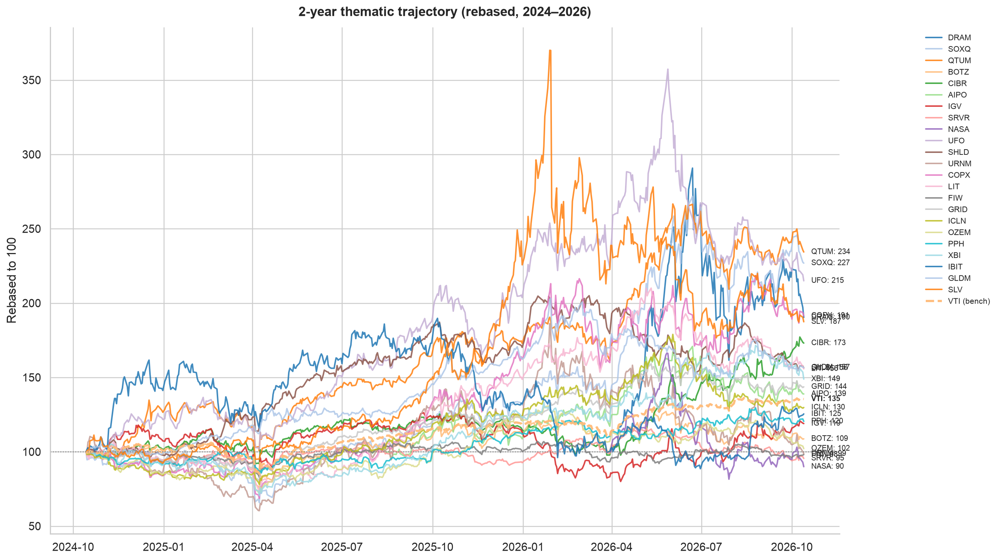

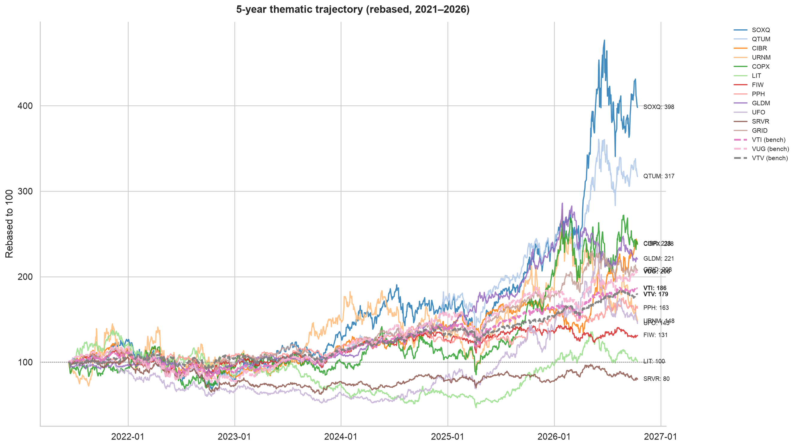

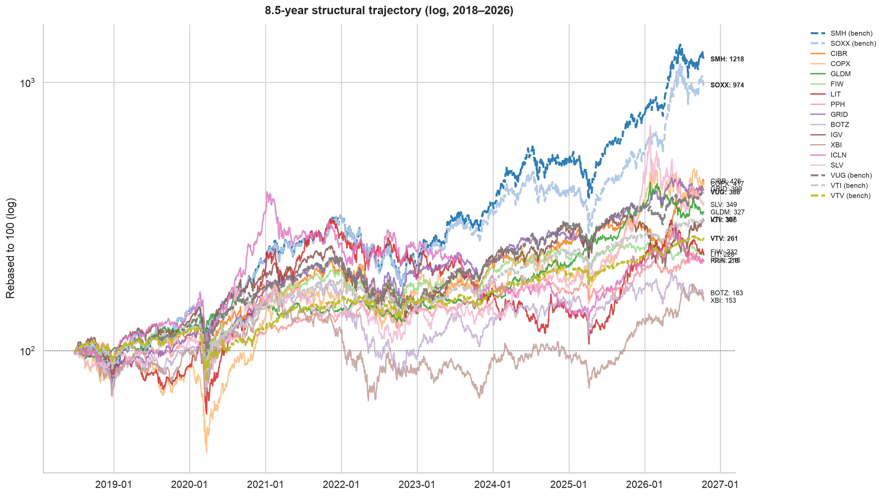

*💡 **Insight**: the long-cycle chart is the honest one — semis compounded an order of magnitude, cyber and copper roughly tripled, and most other themes (clean energy, lithium, water, biotech) round-tripped or lagged VTI. Theme selection, not 'thematic investing', did the work.*

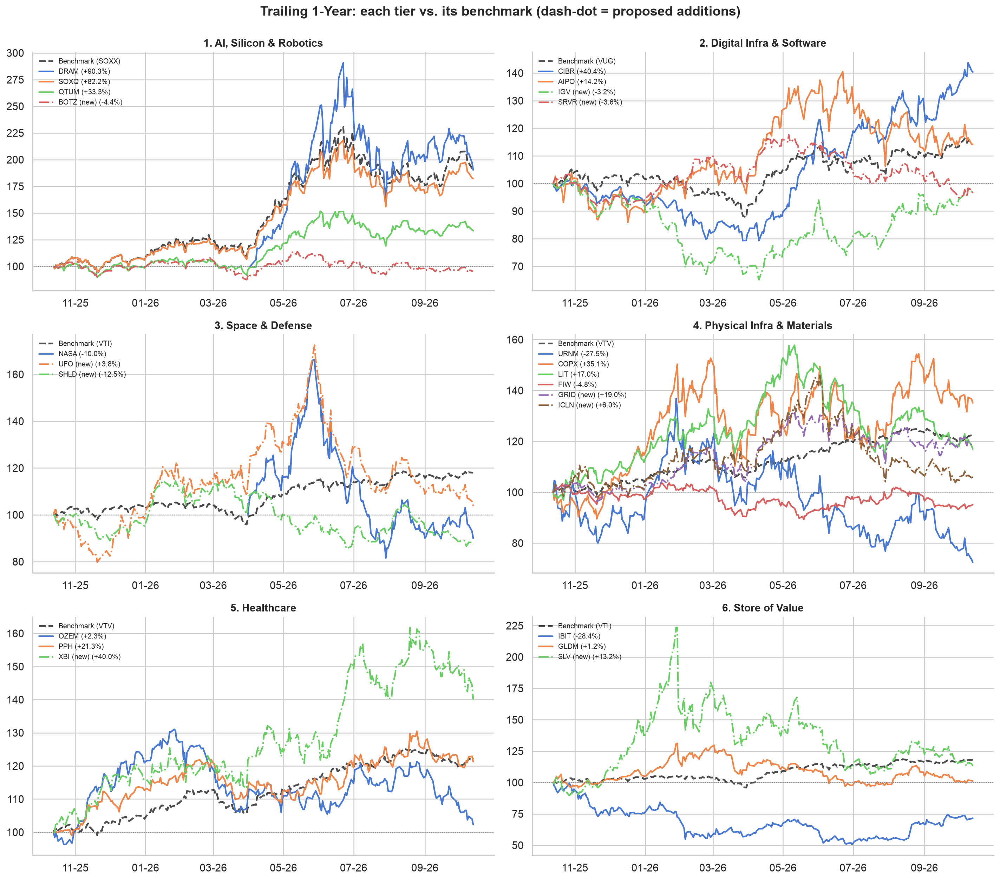

### 3. Correlation structure & overlap

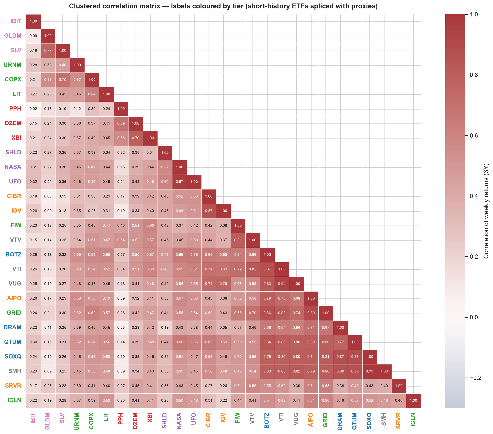

*💡 **Insight**: the clustering orders assets so that neighbours are most alike; read the blocks along the diagonal. Pairs above 0.85 are effectively one position: SOXQ–SMH **0.99**, NASA–UFO **0.97**, VTI–VUG **0.94**, AIPO–GRID **0.89**. The least related pairs (IBIT–PPH **0.02**, PPH–DRAM **0.06**, GLDM–CIBR **0.06**) are where real diversification lives.*

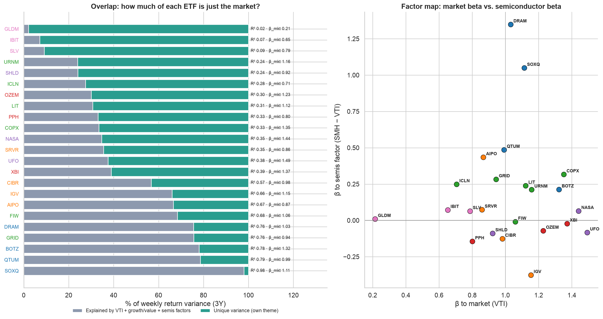

*💡 **Insight**: regress each ETF's weekly return on VTI, a growth−value spread (VUG−VTV) and a semis spread (SMH−VTI). The grey bar is the share of variance you could have bought with three index funds; the green bar is the theme's own risk. Low unique-variance ETFs (GRID, BOTZ, QTUM, SOXQ) mostly re-package index exposure at 0.4–0.7% fees; high ones (GLDM, IBIT, SLV, URNM) are genuinely different bets.*

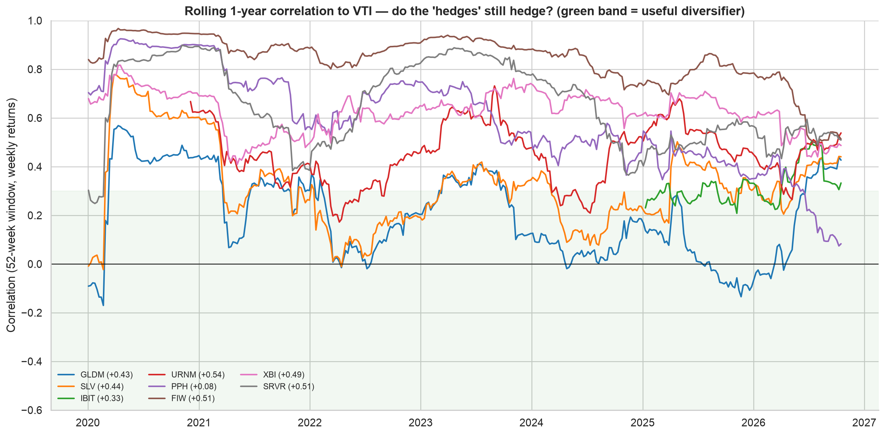

*💡 **Insight**: correlations drift, so a diversifier must be re-checked. Current 52-week correlation to VTI: PPH +0.08, IBIT +0.33, GLDM +0.43, SLV +0.44, XBI +0.49, SRVR +0.51, FIW +0.51, URNM +0.54. Anything above ~0.5 is an equity satellite, not a hedge; the store-of-value trio (GLDM/SLV/IBIT) still earns its 'uncorrelated' label on this window, with IBIT the least stable of the three.*

### 4. Growth vs. risk trade-offs

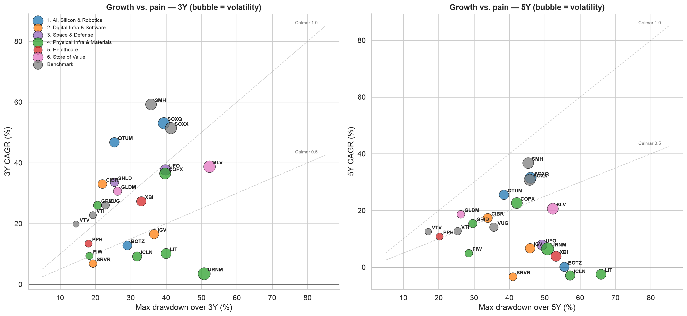

*💡 **Insight**: Calmar (CAGR ÷ max drawdown) separates 'paid for the pain' from 'just painful'. Anything below the 0.5 line delivered less than half a point of annual return per point of peak-to-trough loss — over 3 years that is BOTZ, IGV, SRVR, URNM, LIT, ICLN. Above 1.0: SOXQ, QTUM, CIBR, SHLD, GRID, GLDM.*

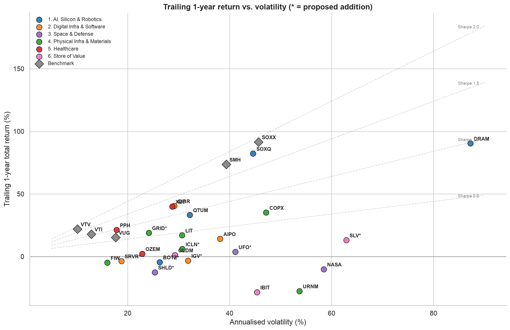

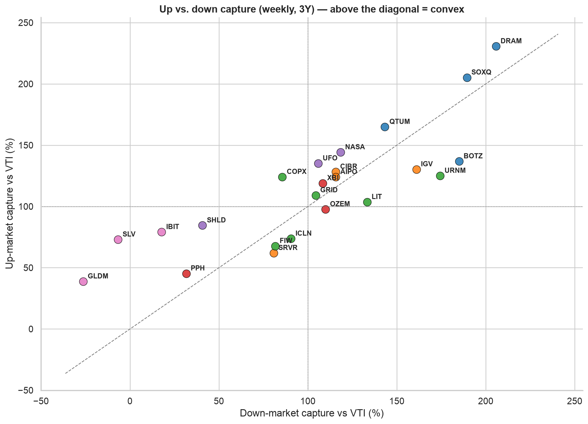

*💡 **Insight**: up/down capture vs VTI on weekly returns. Convex profiles (more upside than downside participation): SLV (73/-7), GLDM (39/-26), IBIT (79/18), SHLD (84/41), COPX (124/86). Themes that fall *harder* than they rise are paying for beta twice.*

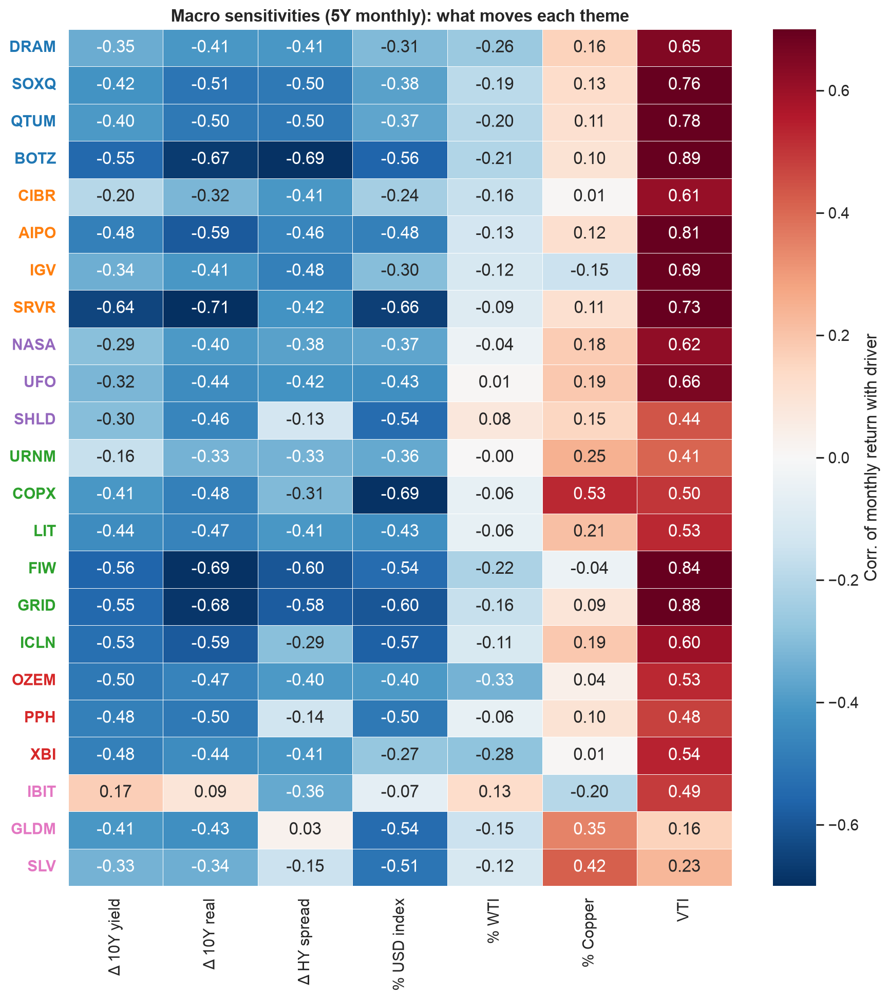

*💡 **Insight**: with the 10Y at 5.2% this matters. Themes most hurt by rising yields: SRVR (-0.64), FIW (-0.56), BOTZ (-0.55), GRID (-0.55). Oil sensitivity (% WTI) — most positive: IBIT +0.13, SHLD +0.08, UFO +0.01; most negative: OZEM -0.33, XBI -0.28, DRAM -0.26 — the 'molecules vs. bits' split, measured.*

### 5. Diversification: what each ETF does to a VTI core

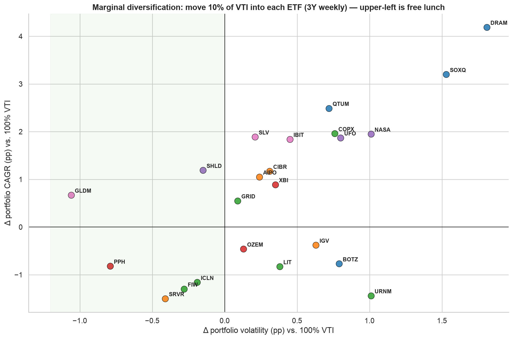

| Ticker | corr VTI | β VTI | Δ vol (pp) | Δ CAGR (pp) | Δ Sharpe | Δ MaxDD (pp) |
| :--- | :--- | :--- | :--- | :--- | :--- | :--- |
| **GLDM** | 0.13 | 0.17 | -1.06 | +0.67 | +0.160 | +2.08 |
| **SLV** | 0.30 | 0.80 | +0.21 | +1.89 | +0.110 | +0.99 |
| **DRAM** | 0.64 | 2.00 | +1.81 | +4.19 | +0.104 | -1.35 |
| **QTUM** | 0.80 | 1.45 | +0.72 | +2.49 | +0.099 | -0.44 |
| **SHLD** | 0.48 | 0.79 | -0.15 | +1.19 | +0.097 | +2.21 |
| **IBIT** | 0.26 | 0.83 | +0.45 | +1.84 | +0.091 | -0.03 |
| **SOXQ** | 0.80 | 1.96 | +1.53 | +3.20 | +0.069 | -1.47 |
| **COPX** | 0.54 | 1.32 | +0.76 | +1.96 | +0.060 | -0.34 |
| **UFO** | 0.61 | 1.39 | +0.80 | +1.87 | +0.051 | -0.58 |
| **CIBR** | 0.71 | 1.15 | +0.31 | +1.17 | +0.051 | -0.20 |
| **AIPO** | 0.73 | 1.13 | +0.24 | +1.05 | +0.049 | +0.11 |
| **NASA** | 0.59 | 1.50 | +1.01 | +1.95 | +0.036 | -0.58 |
| **GRID** | 0.82 | 1.05 | +0.09 | +0.55 | +0.029 | +0.11 |
| **XBI** | 0.59 | 1.13 | +0.35 | +0.89 | +0.028 | -0.74 |
| **PPH** | 0.34 | 0.40 | -0.79 | -0.82 | +0.020 | +1.20 |
| **OZEM** | 0.51 | 0.97 | +0.13 | -0.46 | -0.044 | -0.22 |
| **ICLN** | 0.48 | 0.78 | -0.19 | -1.16 | -0.063 | +1.08 |
| **FIW** | 0.72 | 0.78 | -0.28 | -1.30 | -0.065 | +0.45 |
| **SRVR** | 0.52 | 0.67 | -0.41 | -1.50 | -0.067 | +0.62 |
| **IGV** | 0.69 | 1.34 | +0.63 | -0.38 | -0.083 | -0.81 |
| **LIT** | 0.53 | 1.12 | +0.38 | -0.83 | -0.092 | -0.22 |
| **BOTZ** | 0.87 | 1.52 | +0.79 | -0.77 | -0.123 | -0.80 |
| **URNM** | 0.48 | 1.37 | +1.01 | -1.44 | -0.184 | -2.00 |

*💡 **Insight**: a 10% sleeve is the realistic unit. Only the entries with negative Δvol **and** positive ΔCAGR improve the core on both axes; everything in the upper-right buys return with proportionally more risk, which is fine for a satellite but is not 'diversification'.*

### 6. Portfolio construction: frontier and model backtests

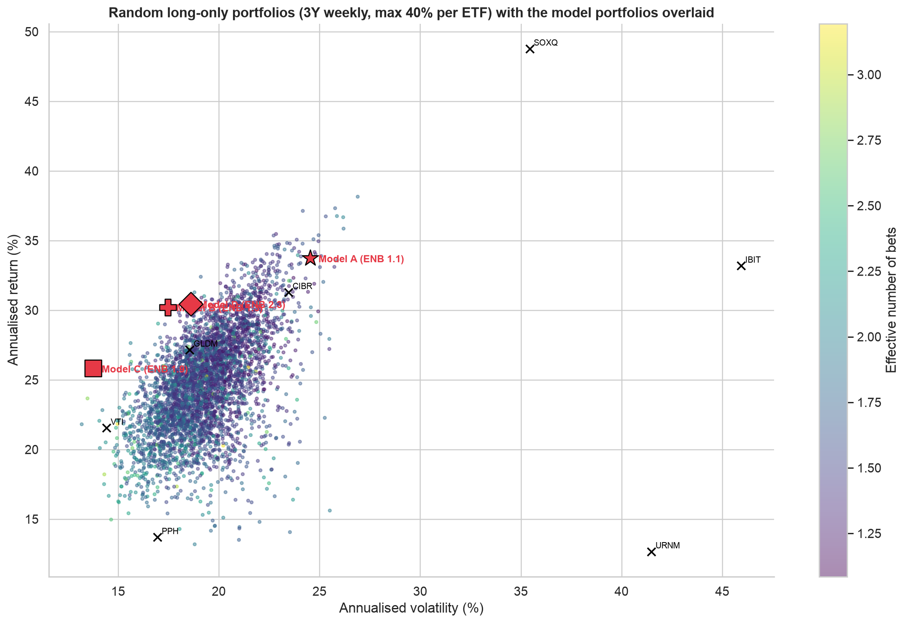

| Model | Ann. return | Ann. vol | Sharpe | Effective bets | Div. ratio |
| :--- | :--- | :--- | :--- | :--- | :--- |
| Model A: Frontier Alpha | 33.7% | 24.5% | 1.21 | 1.1 | 1.34 |
| Model B: Macro Barbell | 30.2% | 17.5% | 1.50 | 1.3 | 1.53 |
| Model C: Real-Asset Compounder | 25.8% | 13.8% | 1.59 | 1.9 | 1.53 |
| Model D: Max-Sharpe, ENB>=2, <=25% per ETF (derived) | 30.5% | 18.6% | 1.42 | 2.3 | 1.47 |

*💡 **Insight**: the colour of the cloud is the effective number of independent bets (ENB). Even a 24-ETF thematic universe rarely exceeds 2.5 ENB — most themes load on the same equity/growth factor. Model A ENB 1.1, Sharpe 1.21; Model B ENB 1.3, Sharpe 1.50; Model C ENB 1.9, Sharpe 1.59; Model D ENB 2.3, Sharpe 1.42. Model D is not hand-picked: it is the highest-Sharpe random portfolio with ENB ≥ 2, i.e. what the data says a genuinely diversified thematic mix looks like.*

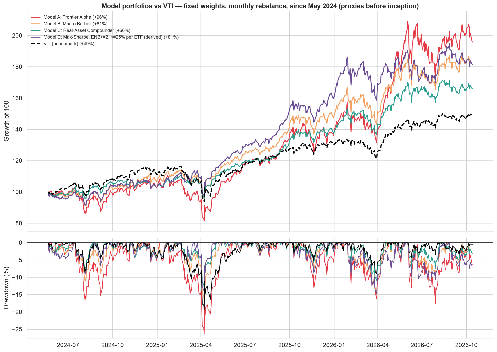

| Model | Total return | CAGR | Vol | Sharpe | Max DD | Calmar |
| :--- | :--- | :--- | :--- | :--- | :--- | :--- |
| Model A: Frontier Alpha | +95.8% | 32.6% | 29.3% | 0.97 | -26.2% | 1.24 |
| Model B: Macro Barbell | +81.4% | 28.4% | 21.2% | 1.15 | -17.0% | 1.67 |
| Model C: Real-Asset Compounder | +65.9% | 23.7% | 16.8% | 1.17 | -13.2% | 1.79 |
| Model D: Max-Sharpe, ENB>=2, <=25% per ETF (derived) | +81.2% | 28.4% | 21.2% | 1.15 | -14.8% | 1.91 |
| VTI (benchmark) | +49.4% | 18.4% | 16.1% | 0.89 | -19.3% | 0.95 |

*💡 **Insight**: backtests use today's weights with monthly rebalancing and proxies before each fund's inception, so they describe the *mix*, not a live track record. Compare Calmar and max drawdown, not total return — the window is a semiconductor bull market and flatters anything overweight chips. Model D is *selected* on this same 3-year window, so its edge here is in-sample; treat its weights as a diversification template, not a forecast.*

### 7. Full metrics table

| Tier | Ticker | Fund | Inception | ER | YTD | 1Y | 3Y CAGR | 5Y CAGR | 1Y Vol | Sharpe 1Y | MaxDD 1Y | MaxDD 3Y | Calmar 3Y | RSI | vs MA |
| :--- | :--- | :--- | :--- | :--- | :--- | :--- | :--- | :--- | :--- | :--- | :--- | :--- | :--- | :--- | :--- |
| **1. AI, Silicon & Robotics** | **BOTZ** *(new)* | Global X Robotics & AI | 2018-01-02 | 0.68% | -4.7% | -4.4% | +12.8% | +0.1% | 26.3% | -0.32 | -19.3% | -29.0% | 0.44 | 46 | -5.1% (200d) |
| **1. AI, Silicon & Robotics** | **DRAM** | Roundhill Memory | 2026-04-02 | 0.65% | +90.3% | +90.3% | n/a | n/a | 87.2% | n/a | -44.4% | n/a | n/a | 27 | -7.9% (50d) |
| **1. AI, Silicon & Robotics** | **QTUM** | Defiance Quantum | 2018-09-05 | 0.40% | +32.2% | +33.3% | +46.7% | +25.5% | 32.2% | 0.92 | -21.5% | -25.4% | 1.84 | 39 | +8.8% (200d) |
| **1. AI, Silicon & Robotics** | **SOXQ** | Invesco PHLX Semis | 2021-06-11 | 0.19% | +66.1% | +82.2% | +53.1% | +31.5% | 44.6% | 1.76 | -28.6% | -39.4% | 1.35 | 42 | +16.0% (200d) |
| **2. Digital Infra & Software** | **AIPO** | Defiance AI & Power Infra | 2025-07-25 | 0.69% | +22.1% | +14.2% | n/a | n/a | 38.1% | 0.27 | -24.4% | n/a | n/a | 45 | -0.5% (200d) |
| **2. Digital Infra & Software** | **CIBR** | First Trust Cybersecurity | 2018-01-02 | 0.58% | +52.5% | +40.4% | +33.0% | +17.4% | 29.1% | 1.26 | -21.9% | -22.0% | 1.50 | 59 | +32.6% (200d) |
| **2. Digital Infra & Software** | **IGV** *(new)* | iShares Software | 2018-01-02 | 0.38% | +8.2% | -3.2% | +16.5% | +6.7% | 31.8% | -0.23 | -36.2% | -36.6% | 0.45 | 59 | +18.4% (200d) |
| **2. Digital Infra & Software** | **SRVR** *(new)* | Pacer Data Center REITs | 2018-05-16 | 0.49% | +1.7% | -3.6% | +6.8% | -3.3% | 18.7% | -0.40 | -19.3% | -19.3% | 0.35 | 40 | -8.3% (200d) |
| **3. Space & Defense** | **NASA** | Tema Space Innovators | 2026-03-31 | 0.75% | -10.0% | -10.0% | n/a | n/a | 58.5% | n/a | -51.0% | n/a | n/a | 39 | -6.7% (50d) |
| **3. Space & Defense** | **SHLD** *(new)* | Global X Defense Tech | 2023-09-14 | 0.50% | -10.4% | -12.5% | +33.5% | n/a | 25.3% | -0.65 | -25.4% | -25.4% | 1.32 | 25 | -12.3% (200d) |
| **3. Space & Defense** | **UFO** *(new)* | Procure Space | 2019-04-11 | 0.75% | +1.2% | +3.8% | +37.7% | +7.9% | 41.1% | -0.01 | -39.8% | -39.8% | 0.95 | 34 | -14.2% (200d) |
| **4. Physical Infra & Materials** | **COPX** | Global X Copper Miners | 2018-01-02 | 0.65% | +15.9% | +35.1% | +36.5% | +22.6% | 47.1% | 0.66 | -27.8% | -39.7% | 0.92 | 42 | +1.4% (200d) |
| **4. Physical Infra & Materials** | **FIW** | First Trust Water | 2018-01-02 | 0.50% | -2.8% | -4.8% | +9.4% | +4.9% | 16.0% | -0.55 | -13.8% | -18.3% | 0.51 | 52 | -1.8% (200d) |
| **4. Physical Infra & Materials** | **GRID** *(new)* | First Trust Smart Grid | 2018-01-02 | 0.56% | +15.8% | +19.0% | +26.0% | +15.4% | 24.1% | 0.62 | -15.8% | -20.6% | 1.26 | 50 | +1.2% (200d) |
| **4. Physical Infra & Materials** | **ICLN** *(new)* | iShares Global Clean Energy | 2018-01-02 | 0.38% | +0.8% | +6.0% | +9.2% | -2.9% | 30.7% | 0.07 | -29.0% | -31.8% | 0.29 | 46 | -8.7% (200d) |
| **4. Physical Infra & Materials** | **LIT** | Global X Lithium & Battery | 2018-01-02 | 0.75% | +2.5% | +17.0% | +10.1% | -2.5% | 30.6% | 0.43 | -26.8% | -40.0% | 0.25 | 40 | -9.6% (200d) |
| **4. Physical Infra & Materials** | **URNM** | Sprott Uranium Miners | 2019-12-04 | 0.75% | -26.4% | -27.5% | +3.5% | +6.5% | 53.7% | -0.59 | -47.0% | -50.8% | 0.07 | 28 | -25.9% (200d) |
| **5. Healthcare** | **OZEM** | Roundhill GLP-1 | 2024-05-21 | 0.59% | -15.9% | +2.3% | n/a | n/a | 22.8% | -0.07 | -21.9% | n/a | n/a | 16 | -11.1% (200d) |
| **5. Healthcare** | **PPH** | VanEck Pharma | 2018-01-02 | 0.36% | +7.1% | +21.3% | +13.4% | +10.8% | 17.8% | 0.98 | -10.8% | -18.1% | 0.74 | 46 | +2.8% (200d) |
| **5. Healthcare** | **XBI** *(new)* | SPDR S&P Biotech | 2018-01-02 | 0.35% | +20.9% | +40.0% | +27.3% | +3.9% | 28.7% | 1.26 | -13.4% | -33.0% | 0.83 | 35 | +5.1% (200d) |
| **6. Store of Value** | **GLDM** | SPDR Gold MiniShares | 2018-06-26 | 0.10% | -3.9% | +1.2% | +30.6% | +18.6% | 29.2% | -0.09 | -26.3% | -26.3% | 1.17 | 39 | -8.0% (200d) |
| **6. Store of Value** | **IBIT** | iShares Bitcoin | 2024-01-11 | 0.25% | -7.5% | -28.4% | n/a | n/a | 45.4% | -0.72 | -49.4% | n/a | n/a | 43 | +12.6% (200d) |
| **6. Store of Value** | **SLV** *(new)* | iShares Silver | 2018-01-02 | 0.50% | -18.6% | +13.2% | +38.7% | +20.6% | 62.9% | 0.15 | -52.3% | -52.3% | 0.74 | 30 | -18.5% (200d) |
| **Benchmark** | **SMH** | SMH | 2018-01-02 | 0.35% | +57.5% | +73.6% | +59.2% | +36.7% | 39.3% | 1.78 | -24.6% | -35.7% | 1.66 | 43 | +15.7% (200d) |
| **Benchmark** | **SOXX** | SOXX | 2018-01-02 | 0.33% | +73.7% | +91.5% | +51.4% | +30.8% | 45.7% | 1.93 | -29.0% | -41.4% | 1.24 | 38 | +17.2% (200d) |
| **Benchmark** | **VTI** | VTI | 2018-01-02 | 0.03% | +14.4% | +18.0% | +22.8% | +12.7% | 12.9% | 1.09 | -8.9% | -19.3% | 1.18 | 60 | +7.4% (200d) |
| **Benchmark** | **VTV** | VTV | 2018-01-02 | 0.03% | +16.2% | +22.0% | +19.8% | +12.5% | 10.1% | 1.79 | -6.3% | -14.5% | 1.37 | 54 | +5.7% (200d) |
| **Benchmark** | **VUG** | VUG | 2018-01-02 | 0.03% | +13.6% | +15.3% | +26.1% | +14.1% | 17.6% | 0.64 | -16.5% | -22.9% | 1.14 | 62 | +10.0% (200d) |

---

## Tactical Portfolio Construction Playbook

The original three models are kept; Model D is derived from the random-portfolio cloud (max Sharpe subject to ≥2 effective bets and ≤25% in any ETF, weights rounded to 2.5%). All weights are illustrative.

### Model A: Frontier Alpha
* **15% SOXQ** · **15% DRAM** · **10% AIPO** · **10% URNM** · **15% CIBR** · **7.5% COPX** · **7.5% QTUM** · **10% IBIT** · **10% VTI**

### Model B: Macro Barbell
* **12.5% SOXQ** · **12.5% QTUM** · **10% AIPO** · **10% COPX** · **20% GLDM** · **7.5% CIBR** · **7.5% FIW** · **10% PPH** · **10% IBIT**

### Model C: Real-Asset Compounder
* **15% FIW** · **15% PPH** · **25% GLDM** · **20% AIPO** · **15% CIBR** · **10% SOXQ**

### Model D: Max-Sharpe, ENB>=2, <=25% per ETF (derived)
* **2.5% DRAM** · **2.5% SOXQ** · **2.5% QTUM** · **2.5% BOTZ** · **5% CIBR** · **2.5% IGV** · **2.5% UFO** · **20% SHLD** · **20% COPX** · **7.5% GRID** · **2.5% PPH** · **2.5% XBI** · **5% IBIT** · **17.5% GLDM** · **2.5% VTI**

**Sizing rules the data supports**

1. Treat SOXQ, DRAM, SMH/SOXX, QTUM and BOTZ as *one* position when sizing (pairwise correlations 0.8–0.95); cap the block, not the tickers.
2. IBIT is a return engine with equity-like drawdown behaviour, not a hedge — size it like a speculative satellite (≤5–10%). GLDM is the only holding with persistently near-zero equity correlation.
3. Prefer the lower-fee / higher-unique-variance version of each theme where two overlap (e.g. GRID vs AIPO, UFO vs NASA, XBI vs OZEM) and let the long-history fund carry the backtest.
4. With the 10Y above 5%, the rate-sensitive sleeve (SRVR, IGV, ICLN, FIW, LIT) should be funded from trims of the compute block, not from cash, so overall equity beta does not rise.

---
