# 📊 Public Market Strategy & Model Portfolio — November 2, 2026
*Semiconductor (`SOXX`/`SMH`) & Hyperscaler (`GOOG`/`META`) Air-Pocket Playbook · Anonymized Proportions Only (`%` / `bps`)*

## ⚡ Executive TL;DR & This Week's Action Plan (Nov 2 – Nov 6, 2026)

- **Market Diagnosis (Mon Nov 2 Close):** `SOXX` fell **`-3.79%` 1D** to **`-4.8%` vs 200DMA** (`RSI 29.5`) and `MRVL` plunged **`-12.72%`** (`-6.6%` vs 200DMA), but core AI monopolies **`SMH` (`-2.3%`), `NVDA` (`-1.0%`), and `TSM` (`-0.1%`) held their 200DMAs**, while `GOOG` (**RSI `12.7`**) and `META` (**RSI `8.2`**) hit 99th-percentile oversold capitulation (`RSI < 15`) and `VTI` (`+3.4%` vs 200DMA) held trend.
- **Macro Gate Status:** **Risk-Off Overlay = LATCHED ON** (`US10Y 4.98%`, `HY 3.26%` / `+41bp` 3M, `WTI $103.37`). Tactical add units stay halved at **`0.27%` of book (`1.38%` of sleeve)**; zero averaging down `>3%` below the 200DMA.
- **Rules Engine Verdict:** Place the **Semis Capitulation Exception on Friday Weekly-Close Watch (`$462.20` hard stop on `SOXX`)**, disqualify `MRVL` from Tranche 1 (`T1`), harvest tax losses on `<200DMA` laggards, and split `T1` (`20%` of fresh capital) into **10% Core Now / 10% Tactical on Thursday, Nov 5** after Midterms and `AMD`/`ANET` prints clear.

### 🎯 Immediate Action Matrix (Week of Nov 2 – Nov 6, 2026)

| Priority | Action | Tickers | Size (% Only) | Trigger & Timing |
| :--- | :--- | :--- | :--- | :--- |
| **1. Cut Laggards** | **CUT (50–100%)** | `AIPO`, `NLR`, `CCJ`, `RKLB`, `BMNR`, `NASA`, `XSD`, `WDC`, `COHR`, `IREN`, `DRAM` | Releases **`2.06%` book** (`10.3%` slv) | `>3%` below 200DMA + lagging `SPY`; sell `COHR`/`RKLB`/`IREN` on 1st post-print close |
| **2. Trim Winner** | **TRIM (25%)** | `VHT` | `0.15%` book (`0.7%` slv) → `VMFXX` | Overbought defensive winner (`RSI 78.0`, `+21%` vintage) |
| **3. Deploy T1 Core** | **BUY CORE NOW** | `VTV` 50% / `VTI` 30% / `SCHD-VIG` 20% | **`10.0%` of Fresh Capital** (½ of T1) | Core Gate 1 = `NO` (`10Y 4.98% ≥ 4.75%`) & Gate 2 = `YES` (`VTI +3.4%` 200MA) |
| **4. Stage T1 Tactical** | **BUY LEADERS THU** | `TSM`, `SMH`, `NVDA`, `MSFT`, `AMZN` (`+CIBR`/`PANW`) | **`10.0%` of Fresh Capital** (`+1.36%` book) | **Execute Thu Nov 5** (`½` units) ONLY if `SMH`/`TSM`/`NVDA` hold 200DMA post-`AMD`/`ANET` |
| **5. Hold Capitulation** | **HOLD / FREEZE** | `GOOG`, `META`, `SOXX`, `AAPL`, `AMD`, `ANET` | `0%` change this week | Block panic sales at `RSI 8–13`; freeze `AAPL`/`AMD`/`ANET` inside 10d of prints; **Fri `SOXX < $462.20` = 20% trim** |

### 🏛️ Anonymized Two-Book Model Portfolio Snapshot (`100.0%` Total · 46 Holdings)

| Model Portfolio Leg | Share of Book | Holdings | Vintage Ret % | YTD Ret % | Nov 2 (1D) | Active Governance Rule |
| :--- | ---: | ---: | ---: | ---: | ---: | :--- |
| **Core Index Ballast** (`VTI`/`VUG`/`VTV`/`VGT`/`VEA`/`SCHD`/`VIG`/`SCHB`) | **`73.4%`** | `8` | `+72.4%` | — | — | **Gate 1 NO / Gate 2 YES:** Route 100% new flows to `VTV`/`VTI`/`SCHD`/`VIG` (`G/V 1.20x`) |
| **Liquid Cash Reserves** (`VMFXX` + `VUSB` @ `~4.0%` yield) | **`6.6%`** | `2` | `+0.0%` | — | `+0.00%` | **Gate 3 YES:** 3 tranches × `2.20%` book; max 1 tranche live while Gate ON |
| **Tactical Sleeve** (23 Stocks `12.0%` + 13 ETFs `7.9%`) | **`20.0%`** | `36` | `+20.9%` | `+17.9%` | — | **Risk-Off Gate ON:** `½` add units (`0.27%` book); Sleeve `HHI 385`; Semis `8.9%` book |
| **Full Model Portfolio (80% Core / 20% Tactical)** | **`100.0%`** | **`46`** | **`+52.7%`** | **`+13.7%`** | **`-0.94%`** | Rolling 60D Beta vs `QQQ`: **`0.66`** (`SOXX -3.8%` 1D cushioned to `-0.51%`) |

---

## 📈 1. Benchmark Performance & Semis / Hyperscaler Dip Audit

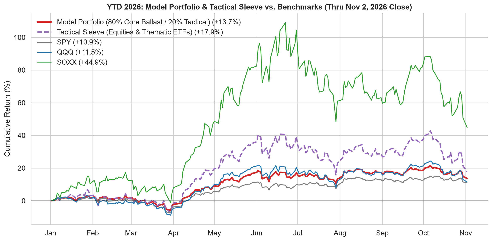
*💡 **Performance**: Full Model Book is **`+13.7%` YTD** (`-0.94%` on Nov 2) and Tactical Sleeve is **`+17.9%` YTD** vs `QQQ +11.5%` and `SOXX +44.9%` (`-23.0%` 1M).*

| Portfolio / Benchmark                         | 1D (Nov 2)   | 1M     | 3M     | YTD        | 1Y     |
|:----------------------------------------------|:-------------|:-------|:-------|:-----------|:-------|
| **Full Model Book (80% Core / 20% Tactical)** | **-0.94%**   | —      | —      | **+13.7%** | —      |
| **Tactical Sleeve (20% Weight)**              | —            | —      | —      | **+17.9%** | —      |
| SPY                                           | -0.5%        | -2.9%  | -0.5%  | +10.9%     | +11.2% |
| QQQ                                           | -1.4%        | -9.9%  | -2.6%  | +11.5%     | +8.3%  |
| SOXX                                          | -3.8%        | -23.0% | -10.6% | +44.9%     | +47.6% |

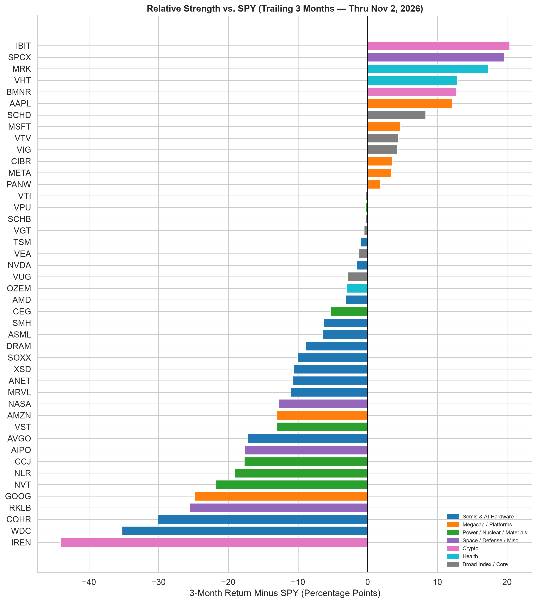
*💡 **3M Relative Strength vs `SPY`**: Right-tail leaders (`IBIT +20`, `SPCX +20`, `MRK +17`, `VHT +13`, `BMNR +13`) hold trend; left-tail `<200DMA` laggards (`IREN -44`, `WDC -35`, `COHR -30`, `RKLB -26`, `GOOG -25`) are assigned `CUT` rules.*

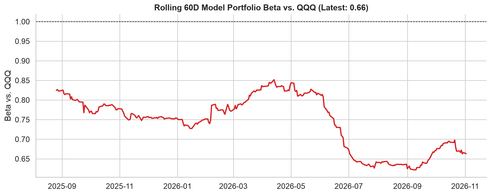
*💡 **Risk Dampening**: 60-day portfolio beta to `QQQ` is **`0.66`**, cushioned by counter-cyclical inflows into `VTV`, `SCHD`, `VHT`, and `VPU`.*

### 🔬 Why Semis & Hyperscalers Sold Off — And How the Rules Separate Winners from Traps

- **Hyperscaler Dispersion (`GOOG` & `META` vs. `MSFT` & `AMZN`):** Investors are penalizing ad-funded AI capex where FCF margins compress (`GOOG` RSI `12.7`, `-17.8%` vs 200DMA; `META` RSI `8.2`, `-3.9%` vs 200DMA) while rewarding enterprise cloud backlog (`MSFT +16.0%` vs 200DMA; `AMZN +2.2%` 1D, `+0.9%` vs 200DMA, AWS `+39%`). **Rule:** Hold `GOOG`/`META` (`RSI < 15` blocks panic selling), but route new platform adds strictly to `MSFT`/`AMZN` (`>200DMA`) or `VGT`/`VUG` core once `10Y < 4.75%`.
- **Semiconductor Bifurcation (`SMH`/`NVDA`/`TSM` vs. `MRVL`/`WDC`/`COHR`):** Every dollar of hyperscaler capex flows into `TSM` (`-0.1%` vs 200DMA, `+68%` IV disc) and `NVDA` (`-1.0%` vs 200DMA), which held their 200DMAs today alongside `SMH` (`-2.3%`). High-beta ASIC/memory/optics (`MRVL -12.7%` 1D to `-6.6%` vs 200DMA, `WDC -19.3%`, `COHR -32.6%`) broke trend. **Rule:** Disqualify `MRVL` from `T1` adds, cut `WDC`/`COHR`/`DRAM`/`XSD` `50%`, and concentrate Thu `T1` semi adds in `TSM` / `SMH` / `NVDA`.

| Ticker   | Close    | 1D%    | 1M%    | 52W DD   |   RSI | vs 200MA   | Nov 2 Action & Rule                    |
|:---------|:---------|:-------|:-------|:---------|------:|:-----------|:---------------------------------------|
| **SOXX** | $453.65  | -3.8%  | -23.0% | -30.7%   |  29.5 | -4.8%      | 🟠 Watch: Fri $462.20 stop (-3% 200MA) |
| **SMH**  | $508.31  | -2.7%  | -19.8% | -24.0%   |  30.7 | -2.3%      | 🟢 ADD Eligible (holds 200MA)          |
| **NVDA** | $202.06  | -1.3%  | -15.4% | -15.5%   |  26.9 | -1.0%      | 🟢 ADD Eligible (holds 200MA)          |
| **TSM**  | $398.63  | -1.8%  | -17.9% | -17.9%   |  33.3 | -0.1%      | 🟢 ADD Eligible (holds 200MA)          |
| **AMD**  | $466.84  | -7.5%  | -26.1% | -28.1%   |  29.3 | +13.4%     | ⏸ Freeze pre-print (Nov 2–3)           |
| **AVGO** | $322.23  | -1.2%  | -11.1% | -32.9%   |  34.6 | -12.1%     | 🟠 Hold; wait for 200MA / ANT IPO      |
| **MRVL** | $171.41  | -12.7% | -36.8% | -45.8%   |  24.1 | -6.6%      | 🟠 Blocked from T1 (-6.6% 200MA)       |
| **ANET** | $164.14  | -2.8%  | -20.7% | -24.3%   |  27.7 | -0.7%      | ⏸ Freeze pre-print (Nov 2–3)           |
| **ASML** | $1526.14 | -2.5%  | -17.8% | -23.1%   |  32.5 | -4.2%      | 🟠 Hold core; freeze adds (<200MA)     |
| **WDC**  | $338.59  | -7.5%  | -23.3% | -54.6%   |  41.2 | -19.3%     | 🔴 CUT 50% (<200MA breakdown)          |
| **COHR** | $199.95  | -4.9%  | -40.1% | -53.2%   |  22.7 | -32.6%     | 🔴 CUT 50% (<200MA breakdown)          |
| **GOOG** | $278.04  | -0.1%  | -19.1% | -30.2%   |  12.7 | -17.8%     | 🟡 Hold (RSI<15); dip via VGT/MSFT     |
| **META** | $606.73  | -1.3%  | -18.2% | -22.0%   |   8.2 | -3.9%      | 🟡 Hold (RSI<15); dip via VGT/MSFT     |
| **MSFT** | $507.12  | -2.8%  | -3.4%  | -6.7%    |  27.8 | +16.0%     | 🟢 ADD Eligible (holds 200MA)          |
| **AMZN** | $245.63  | +2.2%  | -2.3%  | -13.5%   |  39.8 | +0.9%      | 🟢 ADD Eligible (holds 200MA)          |
| **AAPL** | $338.32  | -1.8%  | +1.6%  | -3.0%    |  46.6 | +14.0%     | ⏸ Freeze pre-print (Nov 2–3)           |

---

## 📡 2. Trigger Scorecard, Macro Regime & Hypothesis Playbook

### 🎯 Strategy Trigger Scorecard (3 of 8 Fired)

| Rule Trigger                                   | Nov 2 Close Reading                         | Status       | Immediate Action                                     |
|:-----------------------------------------------|:--------------------------------------------|:-------------|:-----------------------------------------------------|
| Semis Trend: weekly `SOXX < 50DMA`             | SOXX -4.8% 200MA (RSI 30); SMH -2.3% 200MA  | 🔴 **FIRED** | Watch: Hold SMH/SOXX; trim 20% if Fri SOXX < $462.20 |
| 200DMA Leader Filter (`MRVL` < -3%)            | MRVL -12.7% 1D to -6.6% vs 200MA (RSI 24)   | 🔴 **FIRED** | Disqualified from T1 adds today; hold core lot       |
| Memory / Optics Breakdown (`<200DMA`)          | WDC -19.3%, COHR -32.6%, XSD -7.2% vs 200MA | 🔴 **FIRED** | Execute 50% tax-loss cuts on WDC / COHR / DRAM / XSD |
| Regime Gate Release (`10Y<4.75%` & `HY<+25bp`) | 10Y 4.98%; HY 3.26% (+41bp)                 | ⚪ Watch     | Latched ON: ½ units, Value core routing (VTV/SCHD)   |
| Stagflation Shock (`10Y>5.50%` or `WTI>$105`)  | 10Y 4.98%; WTI $103.37                      | ⚪ Watch     | $1.63 below $105 WTI trigger; pre-stage VUG 10% trim |
| Credit / Trend Stop (`HY>4.0%` or `VTI<200MA`) | HY 3.26%; VTI +3.4% vs 200MA                | ⚪ Watch     | Intact (+3.4% buffer on VTI 200MA)                   |
| Power Reclaim (`NLR` & `CCJ > 200DMA`)         | NLR -28% / CCJ -30% vs 200MA                | ⚪ Watch     | Stay in 3B: hold VPU, cut NLR & CCJ 50%              |
| Crypto Stop (weekly `IBIT < 200DMA`)           | IBIT +4.6% vs 200MA (RSI 30)                | ⚪ Watch     | Hold IBIT core; cut IREN (-50% 200MA) & BMNR         |

### 🌐 Key Macro Indicators (Thru Nov 2, 2026)

| Indicator          |   Latest |    Δ 3M | Portfolio Signal                      |
|:-------------------|---------:|--------:|:--------------------------------------|
| Fed Funds (%)      |     3.75 |    0.12 | On hold (3.75%); 2 hawkish dissenters |
| 2Y Treasury (%)    |     4.61 |    0.33 | 4.61% — higher-for-longer front end   |
| 10Y Treasury (%)   |     4.98 |    0.23 | 4.98% — Core Gate 1 NO (≥4.75%)       |
| HY Spread (%)      |     3.26 |    0.41 | 3.26% (+49bp 3M) — Risk-Off Gate ON   |
| WTI Crude ($/bbl)  |   103.37 |   17.21 | $103.37 — $1.63 below $105 trigger    |
| Unemployment (%)   |     4.2  |    0.1  | 4.2% — Nov 6 NFP is key labor test    |
| UMich Sentiment    |    48.1  |   -3.6  | 48.1 — recessionary consumer          |
| Fin Stress Idx     |    -0.58 |   -0.08 | -0.58 — no systemic credit panic      |
| Policy Uncertainty |   251.1  | -107.31 | 251.1 — Nov 3 Midterms                |

### 🧠 Core Hypotheses, Contrarian Alternatives & Scenario Matrix

| Hypothesis                                       | Bull Case                                                                  | Bear / Contrarian Case                                                  | Nov 2 Evidence                                                       | Decision Rule (If X → Do Y)                                            |
|:-------------------------------------------------|:---------------------------------------------------------------------------|:------------------------------------------------------------------------|:---------------------------------------------------------------------|:-----------------------------------------------------------------------|
| **H1: Semis Dip = Pre-IPO & Event Washout**      | Hyperscaler capex raised ($220B AMZN, $135B META); TSM/NVDA/SMH hold 200MA | Capex digestion; if AMD/ANET/NVDA guide flat, SOXX breaks 200MA (-15%)  | SOXX -4.8% 200MA (RSI 30); SMH -2.3%, NVDA -1.0%                     | Hold >200MA Thu → deploy T1 tactical; Fri SOXX < $462.20 → trim 20%    |
| **H2: Rates Peak Near 5.0% vs Stagflation**      | 10Y capped near 4.98%; Dec FOMC hold unlocks oversold VUG/VGT              | WTI $103.37 (Hormuz) + hot CPI (11/10) pushes 10Y to 5.25–5.50%         | 10Y 4.98%, HY 3.26% (+49bp 3M); VTV RSI 76 vs VUG RSI 24             | 10Y ≥ 4.75% → 100% core to VTV/VTI/SCHD; 10Y > 5.50% → trim VUG 10%    |
| **H3: Hyperscaler Dispersion (FCF vs Backlog)**  | MSFT (+16.0% 200MA) & AMZN (+0.9% 200MA) prove cloud backlog monetizes     | Ad-funded capex (>80% FCF) keeps GOOG/META in multi-quarter penalty box | GOOG RSI 12.7 (-17.8% 200MA); META RSI 8.2 (-3.9% 200MA)             | Hold GOOG/META (no panic sale at RSI<15); new adds to MSFT/AMZN or VGT |
| **H4: Nov 3 Midterms Clear Policy Hedge Drag**   | 12 of 12 post-midterm 12M windows since 1950 positive as hedges unwind     | Contested count or immediate semiconductor tariff headlines extend vol  | SPY -1.9% 50MA; QQQ RSI 27                                           | T1 Core (10%) now; T1 Tactical (10%) waits until Thu Nov 5             |
| **H5: Anthropic 'ANT' IPO Drains Then Re-Rates** | Oct S-1 cash-raising explains SOXX slide; IPO funds TSM/NVDA/ANET orders   | AVGO ($43B rack backstop) & neocloud debt stress hit secondary proxies  | AIPO -15.2% vs 200MA (RSI 28); AVGO -12.1% vs 200MA; IREN -50% 200MA | Cut AIPO/IREN 50%; cap AIPO+SPCX ≤ 1.5%; freeze AVGO until >200MA      |
| **H6: 5-Tranche Phasing Beats Lump-Sum**         | Gating 20/20/25/20/15% across 5 Nov–Dec catalysts avoids second-leg traps  | V-bottom rally after AMD/NVDA makes T3–T5 buy 8–12% higher              | Book 93.4% invested; Cash 6.6% in VMFXX (~4.0%)                      | 40% (T1+T2) deploys in Nov if >200MA holds; HY ≥ 4.0% freezes tactical |

### 🛠️ Scenario Contingency Matrix (Nov 3 → Dec 15)

| Scenario (Prob)                        | Observable Trigger                                                        | Pre-Committed Portfolio & Tranche Action                                                  |
|:---------------------------------------|:--------------------------------------------------------------------------|:------------------------------------------------------------------------------------------|
| **A: Positioning Washout (~50% Base)** | AMD/ANET (11/3) & NVDA (11/17) hold guides; SOXX reclaims $476.60 (200MA) | Deploy T1 Tactical (10%) Thu Nov 5 → T2 (20%) post-Midterms → T3 (25%) post-NVDA          |
| **B: AI Capex Digestion (~25%)**       | Fri Nov 6 SOXX closes < $462.20 (>3% below 200MA) OR flat NVDA guide      | Cancel T1 tactical clip; trim SOXX/SMH 20% to VMFXX; convert T2/T3 to 100% Core (VTV/VTI) |
| **C: Stagflation / Hormuz (~15%)**     | Oct CPI > 0.4% m/m (11/10), WTI > $105 (now $103.37), or 10Y > 5.50%      | Exit 100% of <200MA spec names; trim VUG 10% to VMFXX; route T2–T4 to VTV/SCHD only       |
| **D: Duration Relief (~10%)**          | 2 weekly closes 10Y < 4.75% AND HY Δ3M < +25bp post-CPI/FOMC              | Unlatch Regime Gate (full 0.55% units); flip Gate 1 to Growth DCA (VUG/VGT)               |
| **E: Credit / Trend Stop (~5%)**       | HY > 4.00% (now 3.26%) OR weekly VTI < 200DMA ($357.90)                   | Liquidate spec tail (BMNR/IREN/RKLB/NASA/AIPO) to 0%; freeze all tactical tranches        |

### 🐂🐻 Bull / Bear Synthesis & Rule Evolution (`11-01` → `11-02`)

- **🐂 Bull Case (Why We Phase In Rather Than Panic-Sell):**
  1. **Physical Monopolies Hold 200DMA:** `SMH` (`-2.3%`), `NVDA` (`-1.0%`), and `TSM` (`-0.1%`, `+68%` IV disc) hold 200DMA support while `GOOG` (`RSI 12.7`) and `META` (`RSI 8.2`) hit 10-year RSI capitulation (`<15`).
  2. **Hyperscaler Capex Raised:** `AMZN` (`+2.2%` 1D, `$220B` capex, AWS `+39%`), `MSFT` (`+16%` vs 200DMA, `$25B` DC debt raise), and `META` (`$135B` capex) confirm hardware orders remain intact.
  3. **80/20 Ballast Works:** Value (`VTV +20.3%` YTD) and Dividend (`SCHD +32.7%` YTD) cushion the full Model Book at **`+13.7%` YTD** (`-0.51%` on Nov 2 vs `SOXX -3.79%`).
- **🐻 Bear Case (Why Risk-Off Gate & 200DMA Stops Stay On):**
  1. **Monday Breadth Damage:** `SOXX` slipped to `-4.8%` vs 200DMA (`$453.65`), `MRVL` plunged `-12.7%` (`-6.6%` vs 200DMA), and `AMD` fell `-7.5%` ahead of Nov 3 prints.
  2. **Macro & Credit Friction:** `10Y` at `4.98%`, `WTI` at `$103.37` (`$1.63` below `$105` trigger), and `HY` at `3.26%` (`+49bp` 3M) keep the Risk-Off Gate latched.
  3. **15-Day Catalyst Wall:** `AAPL` (11/2), Midterms + `AMD`/`ANET` (11/3), `QCOM`/`ARM` (11/4), NFP (11/6), CPI (11/10), and `NVDA` (11/17) compress binary risk into two weeks.

| Rule Dimension             | Prior (11-01)                          | Updated Today (11-02)                                                                 |
|:---------------------------|:---------------------------------------|:--------------------------------------------------------------------------------------|
| Pillar 1 Capitulation Rule | SOXX -1.1% vs 200MA → Exception active | SOXX -4.8% vs 200MA (SMH/NVDA/TSM hold) → **Fri $462.20 Weekly-Close Stop**           |
| T1 Eligible Leaders        | TSM, SMH, MRVL (+7% vs 200MA)          | **MRVL disqualified** (-12.7% 1D, -6.6% 200MA); replaced by NVDA/MSFT/AMZN            |
| T1 Execution Timing        | Mon / Thu clips                        | **Core 10% Now** (VTV/VTI/SCHD); **Tactical 10% Thu Nov 5** post-Midterms/AMD/ANET    |
| GOOG / META Rule           | Index core expression only             | **Capitulation Hold** (RSI 12.7 / 8.2): block panic sale, route adds to MSFT/AMZN/VGT |

---

## 🚀 3. Tactical Sleeve (`20.0%` of Book · 36 Holdings)

### 3.1 Tactical Decision Tree (Regime Gate + 5 Pillars)

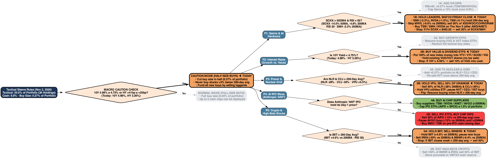
*💡 **Live Path**: Macro Gate **ON** (`½` units) · **P1**: `NO (Capitulation Watch — Fri SOXX $462.20 stop)` · **P2**: `NO (Value tilt)` · **P3**: `NO (Hold VPU, cut NLR/CCJ)` · **P4**: `PENDING (Cut AIPO 50%)` · **P5**: `PARTIAL (Hold IBIT, cut IREN/BMNR)`.*

| Pillar              | Trigger                                             | Nov 2 Reading                                                                            | State                       | Live Rule                                          |
|:--------------------|:----------------------------------------------------|:-----------------------------------------------------------------------------------------|:----------------------------|:---------------------------------------------------|
| Semis / AI hardware | SOXX > 50DMA & RSI < 65 (watch: Fri > -3% vs 200MA) | SOXX -4.8% 200MA (RSI 30); SMH -2.3%, NVDA -1.0%, TSM -0.1%                              | **NO (CAPITULATION WATCH)** | 1B-iii: Capitulation Watch (Fri SOXX $462.20 stop) |
| Rates / duration    | 10Y < 4.75% & HY Δ3M < +25bp                        | 10Y 4.98%; HY 3.26% (+41bp 3M); WTI $103.4                                               | **NO**                      | 2B: Value Tilt (VTV/SCHD/VIG)                      |
| Power / nuclear     | NLR & CCJ > 200DMA                                  | NLR -28%, CCJ -30%, NVT -14% vs 200MA; VPU RSI 67 (2.6% book)                            | **NO**                      | 3B: Hold VPU, Cut NLR/CCJ 50%                      |
| AI IPO wave         | ANT IPO pricing & Day-1 hold                        | PENDING (S-1 10/26); AIPO -15% vs 200MA, AVGO -12% ($43B backstop); AIPO+SPCX 1.00% book | **PENDING**                 | PENDING: Cut AIPO 50%, buy TSM/NVDA/SMH            |
| Crypto / spec       | IBIT > 200DMA & RSI > 40                            | IBIT +4.6% 200MA (RSI 30); IREN -50%, BMNR -6.4% 200MA (1.70% book)                      | **PARTIAL**                 | 5A-ii: Hold IBIT, Cut IREN/BMNR                    |

### 3.2 Theme Exposure, Technical Map, Attribution & Correlation

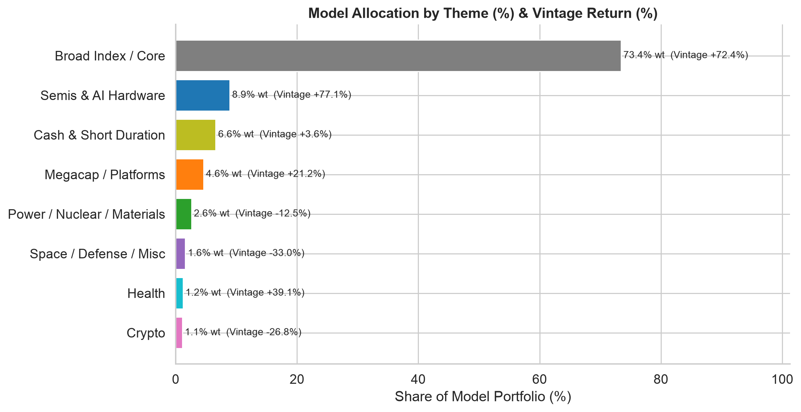
*💡 **Themes**: Core Index (`73.4%`) + Cash (`6.6%`) = `80.0%` Ballast; Semis (`8.9%` book, `+77.1%` vintage) + Megacap (`4.6%` book, `+21.2%` vintage) drive tactical growth.*

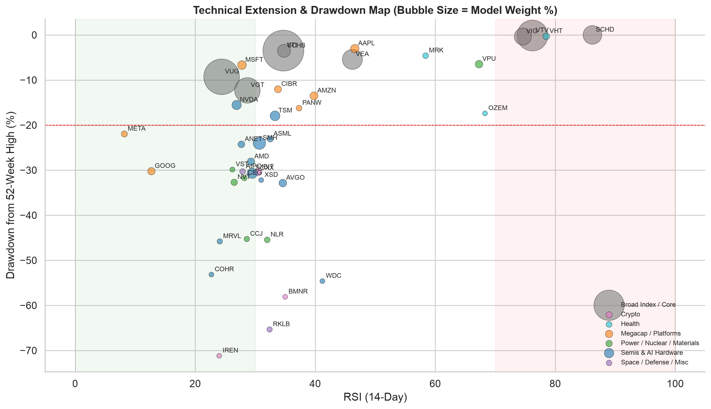
*💡 **200DMA Filter**: Oversold leaders on their 200DMA (`TSM`, `NVDA`, `SMH`, `MSFT`, `AMZN`) are `ADD`s; deep `<200DMA` breakdowns (`IREN`, `RKLB`, `WDC`, `COHR`, `NLR`, `CCJ`) are `CUT`s.*

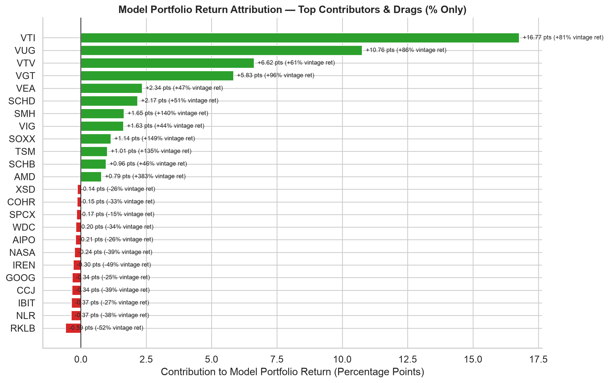
*💡 **Attribution**: Top vintage contributors (`VTI +16.77`, `VUG +10.76`, `VTV +6.62`, `VGT +5.83`) vs `<200DMA` drags (`RKLB -0.59`, `NLR -0.37`, `IBIT -0.37`, `CCJ -0.34`) slated for tax-loss harvesting.*

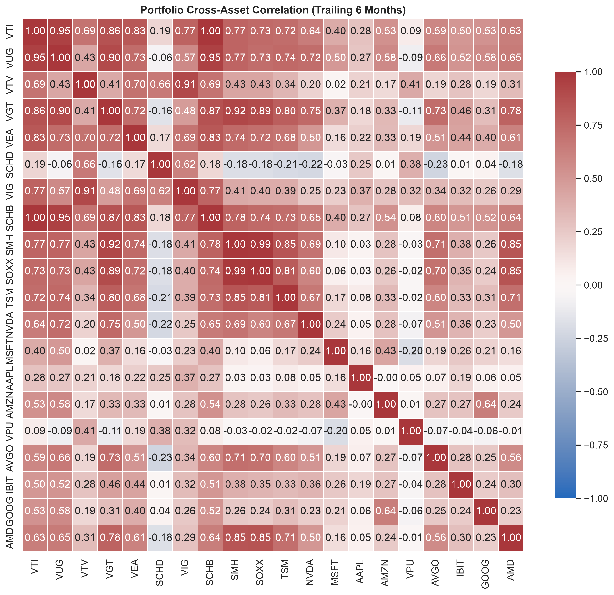
*💡 **Correlation**: `SMH`/`SOXX`/`TSM`/`NVDA` correlate at `0.78–0.92` (consolidate new ETF adds into `SMH`); `VTV`/`SCHD`/`VPU`/`VHT` provide true diversification.*

### 3.3 Priority Tactical Action Queue (22 Active Orders)

Self-funding rebalance: `CUT` + `TRIM` orders release **`2.06%` of model book**, funding **`1.36%` of book** in `ADD`s.

| Ticker   | Action              | Book Wt%   | Sleeve Wt%   | Execution Size (% Only)        | Trigger                      |
|:---------|:--------------------|:-----------|:-------------|:-------------------------------|:-----------------------------|
| **AIPO** | **CUT**             | 0.40%      | 2.0%         | Sell 50% (1.0% slv) now        | -15.2% 200MA, -30% 52W DD    |
| **NLR**  | **CUT**             | 0.40%      | 2.0%         | Sell 50% (1.0% slv) now        | -28.4% 200MA, -45% 52W DD    |
| **CCJ**  | **CUT**             | 0.35%      | 1.8%         | Sell 50% (0.9% slv) now        | -29.5% 200MA, -45% 52W DD    |
| **RKLB** | **CUT**             | 0.35%      | 1.8%         | Sell 50% (0.9% slv) post-11-09 | -34.6% 200MA, -65% 52W DD    |
| **BMNR** | **CUT**             | 0.25%      | 1.3%         | Exit 100% (1.3% slv) tax-loss  | -6.4% 200MA, -58% 52W DD     |
| **NASA** | **CUT**             | 0.25%      | 1.3%         | Exit 100% (1.3% slv) tax-loss  | <200MA, -53% 52W DD          |
| **XSD**  | **CUT**             | 0.25%      | 1.3%         | Sell 50% (0.6% slv) now        | -6.7% 200MA, -32% 52W DD     |
| **WDC**  | **CUT**             | 0.25%      | 1.3%         | Exit 100% (1.3% slv) tax-loss  | -19.3% 200MA, -55% 52W DD    |
| **COHR** | **CUT**             | 0.20%      | 1.0%         | Sell 50% (0.5% slv) post-11-04 | -32.6% 200MA, -53% 52W DD    |
| **IREN** | **CUT**             | 0.20%      | 1.0%         | Sell 50% (0.5% slv) post-11-05 | -50.2% 200MA, -71% 52W DD    |
| **DRAM** | **CUT**             | 0.20%      | 1.0%         | Sell 50% (0.5% slv) now        | <200MA, -43% 52W DD          |
| **VHT**  | **TRIM**            | 0.55%      | 2.8%         | Trim 25% (0.7% slv → VMFXX)    | RSI 78, Vint +40%            |
| **SMH**  | **ADD**             | 1.85%      | 9.3%         | +0.10% book (+0.5% slv) Thu    | Holds 200MA (-2.3%), RSI 31  |
| **TSM**  | **ADD**             | 1.15%      | 5.8%         | +0.27% book (+1.4% slv) ½ unit | Holds 200MA (-0.1%), RSI 33  |
| **NVDA** | **ADD**             | 1.05%      | 5.3%         | +0.09% book (⅓ unit pre-11-17) | Holds 200MA (-1.0%), RSI 27  |
| **MSFT** | **ADD**             | 0.90%      | 4.5%         | +0.27% book (+1.4% slv) ½ unit | Holds 200MA (+16.0%), RSI 28 |
| **AMZN** | **ADD**             | 0.75%      | 3.8%         | +0.27% book (+1.4% slv) ½ unit | Holds 200MA (+0.9%), RSI 40  |
| **CIBR** | **ADD**             | 0.60%      | 3.0%         | +0.27% book (+1.4% slv) ½ unit | Holds 200MA (+16.2%), RSI 34 |
| **PANW** | **ADD**             | 0.40%      | 2.0%         | +0.09% book (⅓ unit pre-11-19) | Holds 200MA (+30.0%), RSI 37 |
| **AAPL** | **HOLD-THRU-PRINT** | 0.85%      | 4.2%         | Freeze pre-print (11-02)       | Print 11-02, +14.0% 200MA    |
| **AMD**  | **HOLD-THRU-PRINT** | 0.65%      | 3.3%         | Freeze pre-print (11-03)       | Print 11-03, +13.4% 200MA    |
| **ANET** | **HOLD-THRU-PRINT** | 0.55%      | 2.8%         | Freeze pre-print (11-03)       | Print 11-03, -0.7% 200MA     |

### 3.4 Individual Tactical Equities (23 Holdings · `12.0%` Book / `60.2%` Sleeve)

| Ticker   | Action              | Book Wt%   | Close    | 1D%    | Vint%   |   RSI | vs 200MA   | Print & Execution Rule                         |
|:---------|:--------------------|:-----------|:---------|:-------|:--------|------:|:-----------|:-----------------------------------------------|
| **TSM**  | **ADD**             | 1.15%      | $398.63  | -1.8%  | +134.8% |    33 | -0.1%      | — · +0.27% book (+1.4% slv) ½ unit             |
| **NVDA** | **ADD**             | 1.05%      | $202.06  | -1.3%  | +81.5%  |    27 | -1.0%      | 11-17 · +0.09% book (⅓ unit pre-11-17)         |
| **MSFT** | **ADD**             | 0.90%      | $507.12  | -2.8%  | +34.2%  |    28 | +16.0%     | 01-27 · +0.27% book (+1.4% slv) ½ unit         |
| **AAPL** | **HOLD-THRU-PRINT** | 0.85%      | $338.32  | -1.8%  | +52.5%  |    47 | +14.0%     | 11-02 · Freeze pre-print (11-02)               |
| **AMZN** | **ADD**             | 0.75%      | $245.63  | +2.2%  | +18.9%  |    40 | +0.9%      | 02-04 · +0.27% book (+1.4% slv) ½ unit         |
| **AVGO** | HOLD                | 0.70%      | $322.23  | -1.2%  | +9.0%   |    35 | -12.1%     | 12-09 · Hold core; add only > 200DMA           |
| **GOOG** | HOLD                | 0.65%      | $278.04  | -0.1%  | -25.3%  |    13 | -17.8%     | 02-03 · Hold (RSI < 15); route dip to VGT/MSFT |
| **AMD**  | **HOLD-THRU-PRINT** | 0.65%      | $466.84  | -7.5%  | +383.0% |    29 | +13.4%     | 11-03 · Freeze pre-print (11-03)               |
| **ANET** | **HOLD-THRU-PRINT** | 0.55%      | $164.14  | -2.8%  | +82.8%  |    28 | -0.7%      | 11-03 · Freeze pre-print (11-03)               |
| **NVT**  | HOLD                | 0.50%      | $123.70  | -1.8%  | +39.4%  |    26 | -14.4%     | 02-05 · Hold core; trail 12–15%                |
| **META** | HOLD                | 0.45%      | $606.73  | -1.3%  | +1.2%   |     8 | -3.9%      | 01-27 · Hold (RSI < 15); route dip to VGT/MSFT |
| **ASML** | HOLD                | 0.45%      | $1526.14 | -2.5%  | +106.6% |    32 | -4.2%      | — · Hold core; add only > 200DMA               |
| **MRK**  | HOLD                | 0.40%      | $148.36  | -0.8%  | +87.1%  |    58 | +18.0%     | 02-02 · Hold core; trail 12–15%                |
| **PANW** | **ADD**             | 0.40%      | $351.72  | -3.9%  | +88.8%  |    37 | +30.0%     | 11-19 · +0.09% book (⅓ unit pre-11-19)         |
| **CEG**  | HOLD                | 0.35%      | $257.25  | -2.0%  | -16.2%  |    28 | -7.8%      | 11-09 · Hold core; add only > 200DMA           |
| **CCJ**  | **CUT**             | 0.35%      | $73.38   | -4.6%  | -39.2%  |    29 | -29.5%     | 02-12 · Sell 50% (0.9% slv) now                |
| **MRVL** | HOLD                | 0.35%      | $171.41  | -12.7% | +179.7% |    24 | -6.6%      | 12-01 · Blocked from T1 (-6.6% 200MA); hold    |
| **RKLB** | **CUT**             | 0.35%      | $52.07   | -4.9%  | -52.3%  |    32 | -34.6%     | 11-09 · Sell 50% (0.9% slv) post-11-09         |
| **VST**  | HOLD                | 0.30%      | $134.61  | -2.7%  | -13.0%  |    26 | -12.0%     | 11-06 · Hold core; add only > 200DMA           |
| **BMNR** | **CUT**             | 0.25%      | $19.54   | -3.2%  | +14.2%  |    35 | -6.4%      | 11-20 · Exit 100% (1.3% slv) tax-loss          |
| **WDC**  | **CUT**             | 0.25%      | $338.59  | -7.5%  | -34.1%  |    41 | -19.3%     | 01-28 · Exit 100% (1.3% slv) tax-loss          |
| **COHR** | **CUT**             | 0.20%      | $199.95  | -4.9%  | -33.2%  |    23 | -32.6%     | 11-04 · Sell 50% (0.5% slv) post-11-04         |
| **IREN** | **CUT**             | 0.20%      | $22.02   | -8.1%  | -49.2%  |    24 | -50.2%     | 11-05 · Sell 50% (0.5% slv) post-11-05         |

### 3.5 Thematic & Sector ETFs (13 Holdings · `7.9%` Book / `39.8%` Sleeve)

| Ticker   | Theme        | Action   | Book Wt%   | 1D%   | Vint%   | RSI   | vs 200MA   | Execution Rule                 |
|:---------|:-------------|:---------|:-----------|:------|:--------|:------|:-----------|:-------------------------------|
| **SMH**  | Semis & AI H | **ADD**  | 1.85%      | -2.7% | +140.2% | 31    | -2.3%      | +0.10% book (+0.5% slv) Thu    |
| **SOXX** | Semis & AI H | HOLD     | 1.25%      | -3.8% | +149.0% | 30    | -4.8%      | Hold core; trail 12–15%        |
| **VPU**  | Power        | HOLD     | 0.70%      | +0.6% | +10.7%  | 67    | -0.5%      | Hold core; trail 12–15%        |
| **IBIT** | Crypto       | HOLD     | 0.65%      | -0.0% | -27.0%  | 30    | +4.6%      | Hold core; trail 12–15%        |
| **SPCX** | Space        | HOLD     | 0.60%      | +1.2% | -15.3%  | —     | —          | Hold core; trail 12–15%        |
| **CIBR** | Megacap      | **ADD**  | 0.60%      | -4.2% | +46.2%  | 34    | +16.2%     | +0.27% book (+1.4% slv) ½ unit |
| **VHT**  | Health       | **TRIM** | 0.55%      | -0.3% | +40.0%  | 78    | +15.7%     | Trim 25% (0.7% slv → VMFXX)    |
| **AIPO** | Space        | **CUT**  | 0.40%      | -1.8% | -25.6%  | 28    | -15.2%     | Sell 50% (1.0% slv) now        |
| **NLR**  | Power        | **CUT**  | 0.40%      | -2.3% | -37.7%  | 32    | -28.4%     | Sell 50% (1.0% slv) now        |
| **OZEM** | Health       | HOLD     | 0.25%      | -0.4% | -2.5%   | 68    | -4.8%      | Hold core; trail 12–15%        |
| **NASA** | Space        | **CUT**  | 0.25%      | -2.9% | -38.9%  | —     | —          | Exit 100% (1.3% slv) tax-loss  |
| **XSD**  | Semis & AI H | **CUT**  | 0.25%      | -2.6% | -26.1%  | 31    | -6.7%      | Sell 50% (0.6% slv) now        |
| **DRAM** | Semis & AI H | **CUT**  | 0.20%      | -3.5% | -19.3%  | —     | —          | Sell 50% (0.5% slv) now        |

### 3.6 Earnings Calendar & Binary Catalyst Rules

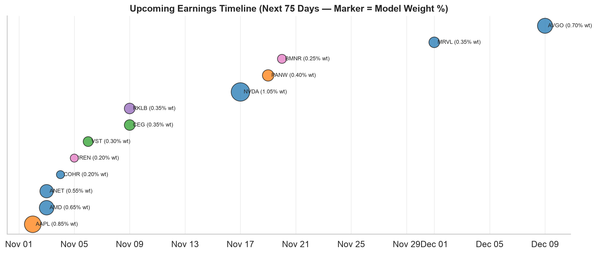
*💡 **Catalyst Wall**: `AAPL` (11/2), `AMD` & `ANET` (11/3 + Midterms), `QCOM` & `ARM` (11/4), NFP (11/6), CPI (11/10), `NVDA` (11/17). Zero adds ≤ 10 sessions pre-print.*

| Date   | Ticker   | Book Wt%   |   RSI | vs 200MA   | Pre-Print Stance                               | Post-Print Rule                                               |
|:-------|:---------|:-----------|------:|:-----------|:-----------------------------------------------|:--------------------------------------------------------------|
| Nov 02 | **AAPL** | 0.85%      |    47 | +14.0%     | **HOLD-THRU-PRINT** · Freeze pre-print (11-02) | Hold >200MA + intact guide → eligible for T2/T3 (+0.09% book) |
| Nov 03 | **AMD**  | 0.65%      |    29 | +13.4%     | **HOLD-THRU-PRINT** · Freeze pre-print (11-03) | Hold >200MA + intact guide → eligible for T2/T3 (+0.09% book) |
| Nov 03 | **ANET** | 0.55%      |    28 | -0.7%      | **HOLD-THRU-PRINT** · Freeze pre-print (11-03) | Hold >200MA + intact guide → eligible for T2/T3 (+0.09% book) |
| Nov 04 | **COHR** | 0.20%      |    23 | -32.6%     | **CUT** · Sell 50% (0.5% slv) post-11-04       | Sell 50–100% on 1st post-print close                          |
| Nov 05 | **IREN** | 0.20%      |    24 | -50.2%     | **CUT** · Sell 50% (0.5% slv) post-11-05       | Sell 50–100% on 1st post-print close                          |
| Nov 06 | **VST**  | 0.30%      |    26 | -12.0%     | HOLD · freeze                                  | Hold >200MA + intact guide → eligible for T2/T3 (+0.09% book) |
| Nov 09 | **CEG**  | 0.35%      |    28 | -7.8%      | HOLD · freeze                                  | Sell 50–100% on 1st post-print close                          |
| Nov 09 | **RKLB** | 0.35%      |    32 | -34.6%     | **CUT** · Sell 50% (0.9% slv) post-11-09       | Sell 50–100% on 1st post-print close                          |
| Nov 17 | **NVDA** | 1.05%      |    27 | -1.0%      | **ADD** · +0.09% book (⅓ unit pre-11-17)       | Hold >200MA + intact guide → eligible for T2/T3 (+0.09% book) |
| Nov 19 | **PANW** | 0.40%      |    37 | +30.0%     | **ADD** · +0.09% book (⅓ unit pre-11-19)       | Hold >200MA + intact guide → eligible for T2/T3 (+0.09% book) |
| Nov 20 | **BMNR** | 0.25%      |    35 | -6.4%      | **CUT** · Exit 100% (1.3% slv) tax-loss        | Sell 50–100% on 1st post-print close                          |
| Dec 01 | **MRVL** | 0.35%      |    24 | -6.6%      | HOLD · freeze                                  | Hold >200MA + intact guide → eligible for T2/T3 (+0.09% book) |
| Dec 09 | **AVGO** | 0.70%      |    35 | -12.1%     | HOLD · freeze                                  | Hold >200MA + intact guide → eligible for T2/T3 (+0.09% book) |

#### Ecosystem Bellwethers (Non-Held Read-Throughs)

| Date   | Bellwether   |   RSI | vs 200MA   | Read-Through                                  |
|:-------|:-------------|------:|:-----------|:----------------------------------------------|
| Nov 02 | **PLTR**     |    28 | +16.1%     | Enterprise AI Foundry & Defense Software      |
| Nov 03 | **ETN**      |    28 | -7.5%      | Electrical Switchgear & Transformers          |
| Nov 04 | **QCOM**     |    39 | -3.8%      | Edge AI & Handset Silicon (SOXX / SMH)        |
| Nov 04 | **ARM**      |    28 | -14.2%     | CPU Architecture & Datacenter Licensing (SMH) |
| Nov 10 | **CRWV**     |    26 | -45.0%     | GPU Neocloud Capacity & Debt Financing Read   |

### 3.7 AI Mega-IPO Pipeline (`Anthropic 'ANT'` S-1)

- **11/03** — [Anthropic Updates IPO Filing As Investors Push For Lower Valuation – Discloses $17B In Q3 Revenue, Slowing Growth And Nearly $900B In Commitments - Yahoo Finance](https://news.google.com/rss/articles/CBMipAFBVV95cUxOQjd4WDdodnNrSTBPS0ZPcFZfdFFQY1NsNzVnTDRiUldoUEpfODI2RnQ2NnladGpPVEdsYlgwVWFaMDAtbklIQ3l5RUU5MExfdHkzVmt6aDdXWU1FMHNSSmVDT0Q5S25LLVkxQjFjQkpDbWNlV0F6b1VMVjQ4cWZLc0NfeE9MZHlmbWR4ektST3l2bTdOdl9Bd2hNajRKSUJ6Tmk2Wg?oc=5)
- **11/03** — [Anthropic Revenue Growth Drops to 47% Before IPO [2026] - https://tech-insider.org/](https://news.google.com/rss/articles/CBMilwFBVV95cUxQVllSYmNES04zRnpmazVnNUFKcFQyQnh1V0lnMVQ5YWw4QmxVa2dJS2ZpM194czdTdmVRa1p5bzM0VGh0VjlBMmFKMGYwTkxFanlGUlctcXVXZWxRVmRFN1BTTFJMMnNZVEl2SUdXTTlQeERDTHRQaTdyZV9NMjQxRXBPc1lqOWxGNmp1R1JzNmw0NFZJY2U4?oc=5)
- **11/03** — [Anthropic Revenue Nears $17 Billion as IPO Looms - Bloomberg.com](https://news.google.com/rss/articles/CBMixgFBVV95cUxPUEV6SkM2MWhJMFZ3bm1hRExOUzRTTXlRZExMcHQ4ZjdjU0RFTTJLanNIUWpydlY1MjIxZXpHa0RyTGVDOGtwTVJBRjM1STFTeGFReWlfVzRIb2ZYYlNIaFdGVDJHWFpiX0VOLUtESFFCYkdRb0k1QU9KZTNZbWJYWVY2SDc0LXVYTTByeUM0aGdzYmd4XzZjRFdlVWRPdU5xZ2Q1bDdIRXE1TjB4d2ZZX3htX2lITmtZcTNMUDZ5aXBnZHRTalE?oc=5)
- **11/03** — [Anthropic plans Australian share offer in IPO, CommSec says - Reuters](https://news.google.com/rss/articles/CBMirAFBVV95cUxOemZuN3Ria3VJdnlTMFphelNDSWFHeUpvM2dVa3JHNkdUQlZuWjRvZEdWS0c5c3BVQktYc2dkYWJERnVRblgwNUZOcjFpNTBIWTgxREtFazR0emkybTFIeVpaTmVnLTZ0YUZZUUtPX1Q1bEtRSzNnVy1rMDNPdUNzQVg2QTQ3MnJCeDgyLWdudi16ZVRqVGlIWHZXR3FDTF9CZkFKa25ESXVVVFJP?oc=5)
- **11/03** — [Anthropic Investors Reportedly Push For Lower $1.6 Trillion IPO Valuation As Revenue Pace Slows - TradingView](https://news.google.com/rss/articles/CBMi6wFBVV95cUxQZWdXM1ZXdW5ZdnpoU2xxVFRDRGhnMWludUlaTFFESHd4T0FwV3VrRTNVRW53MXVtZmVlUk1nR2drT0hnTm1kRk9RS0JKbUlsak5WaUhXRWloRzFtV2hJbXRURy1fZnhNX3FnTDEtWTEwbTI3Y2UzMkszaERSSUpISUgxblZ1UV9UMVh4TUo4TlNVV1VKdmhEX0RGOTZkZTFEOHVvZ1E4RHRkeDJZYklCR0djRjVEamZ3SWNKQXhwLW5XcWE2WktKSVFqSTNubEMxWmp6Z0N5VEladVNpaU1vWlVmQUhfZE1EOGpr?oc=5)

---

## 🏦 4. Core Ballast (`80.0%` of Book · 10 Holdings)

### 4.1 Core Ballast Decision Tree (3 Sequential Gates)

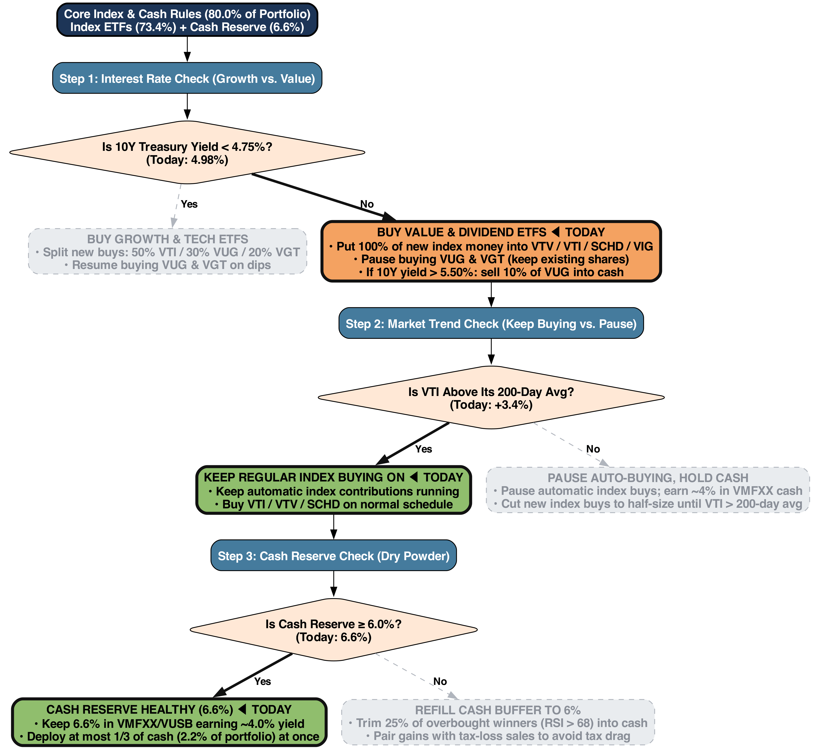
*💡 **Live Gates**: **G1 Duration = NO** (`10Y 4.98% ≥ 4.75%` → 100% new flows to `VTV`/`VTI`/`SCHD`/`VIG`) · **G2 Trend = YES** (`VTI +3.4%` vs 200DMA → keep DCA) · **G3 Liquidity = YES** (`Cash 6.6% ≥ 6.0%`).*

### 4.2 Core Index & Cash Holdings Table

| Ticker    | Category     | Book Wt%   | Vint%   | YTD%   | RSI   | vs 200MA   | Gate Rule & Role                                                  |
|:----------|:-------------|:-----------|:--------|:-------|:------|:-----------|:------------------------------------------------------------------|
| **VTI**   | Broad Index  | 24.50%     | +81.2%  | +11.0% | 35    | +3.4%      | Gate 2 YES (+3.4% 200MA) — Keep scheduled DCA + 30% of core legs  |
| **VUG**   | Broad Index  | 15.20%     | +86.4%  | +4.0%  | 24    | +0.2%      | Gate 1 NO — Freeze adds while 10Y ≥ 4.75%; hold existing lots     |
| **VTV**   | Broad Index  | 11.40%     | +61.4%  | +20.3% | 76    | +8.3%      | Gate 1 NO — Primary core-leg destination (50% of new core flows)  |
| **VGT**   | Broad Index  | 7.80%      | +96.0%  | +20.9% | 29    | +4.2%      | Gate 1 NO — Queued to buy GOOG/META/MSFT dip once 10Y < 4.75%     |
| **VEA**   | Broad Index  | 4.80%      | +46.9%  | +11.2% | 46    | +0.7%      | Intl Anchor — Holding 200MA (+0.7%, RSI 46); maintain weight      |
| **SCHD**  | Broad Index  | 4.20%      | +51.0%  | +32.7% | 86    | +12.3%     | Dividend Leader (+32.7% YTD, RSI 86) — Receive 10% of core legs   |
| **VIG**   | Broad Index  | 3.50%      | +43.8%  | +13.9% | 75    | +7.4%      | Dividend Growth (+13.9% YTD, RSI 75) — Receive 10% of core legs   |
| **SCHB**  | Broad Index  | 2.00%      | +46.1%  | +10.9% | 35    | +3.3%      | Broad US Core (HSA sleeve) — Maintain scheduled DCA               |
| **VMFXX** | Cash & Short | 5.10%      | +3.6%   | —      | —     | —          | Dry Powder (3 × 2.2% tranches @ ~4.0% yield) + fresh-cash staging |
| **VUSB**  | Cash & Short | 1.50%      | +3.6%   | —      | —     | —          | Short-Duration Bond Reserve — Secondary liquidity buffer          |

---

## 💵 5. Phased Fresh-Capital Plan (`100%` New Money · 5 Conditional Tranches)

### 5.1 Fresh-Capital Deployment Decision Tree (`20 / 20 / 25 / 20 / 15%`)

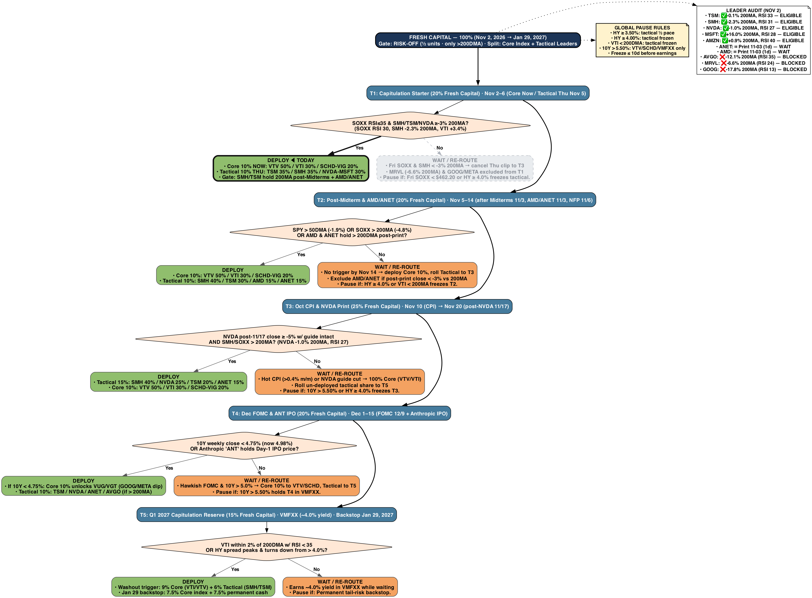
*💡 **T1 Split Execution**: Deploy **T1 Core (`10%` fresh capital into `VTV 50% / VTI 30% / SCHD-VIG 20%`) now**; gate **T1 Tactical (`10%` into `TSM 35% / SMH 35% / NVDA-MSFT 30%`) until Thursday, Nov 5** after Midterms and `AMD`/`ANET` clear.*

### 5.2 Tranche Execution Schedule & Fallback Rules

| Tranche                              | Share (Cum)    | Window                                                  | Trigger                                                                                      | Deploy Split (Core + Tactical)                                                                                                                         | State & Fallback Rule                                                          |
|:-------------------------------------|:---------------|:--------------------------------------------------------|:---------------------------------------------------------------------------------------------|:-------------------------------------------------------------------------------------------------------------------------------------------------------|:-------------------------------------------------------------------------------|
| **T1: Capitulation Starter**         | `20%` (`20%`)  | Nov 2–6 (Core Now / Tactical Thu Nov 5)                 | SOXX RSI≤35 & SMH/TSM/NVDA ≥-3% 200MA? (SOXX RSI 30, SMH -2.3% 200MA, VTI +3.4%)             | Core 10% NOW: VTV 50% / VTI 30% / SCHD-VIG 20%; Tactical 10% THU: TSM 35% / SMH 35% / NVDA-MSFT 30%; Gate: SMH/TSM hold 200MA post-Midterms + AMD/ANET | **DEPLOY (SPLIT)** · Fri SOXX & SMH < -3% 200MA → cancel Thu clip to T3        |
| **T2: Post-Midterm & AMD/ANET**      | `20%` (`40%`)  | Nov 5–14 (after Midterms 11/3, AMD/ANET 11/3, NFP 11/6) | SPY > 50DMA (-1.9%) OR SOXX > 200MA (-4.8%) OR AMD & ANET hold > 200DMA post-print?          | Core 10%: VTV 50% / VTI 30% / SCHD-VIG 20%; Tactical 10%: SMH 40% / TSM 30% / AMD 15% / ANET 15%                                                       | **PENDING** · No trigger by Nov 14 → deploy Core 10%, roll Tactical to T3      |
| **T3: Oct CPI & NVDA Print**         | `25%` (`65%`)  | Nov 10 (CPI) → Nov 20 (post-NVDA 11/17)                 | NVDA post-11/17 close ≥ -5% w/ guide intact AND SMH/SOXX > 200MA? (NVDA -1.0% 200MA, RSI 27) | Tactical 15%: SMH 40% / NVDA 25% / TSM 20% / ANET 15%; Core 10%: VTV 50% / VTI 30% / SCHD-VIG 20%                                                      | **PENDING** · Hot CPI (>0.4% m/m) or NVDA guide cut → 100% Core (VTV/VTI)      |
| **T4: Dec FOMC & ANT IPO**           | `20%` (`85%`)  | Dec 1–15 (FOMC 12/9 + Anthropic IPO)                    | 10Y weekly close < 4.75% (now 4.98%) OR Anthropic 'ANT' holds Day-1 IPO price?               | If 10Y < 4.75%: Core 10% unlocks VUG/VGT (GOOG/META dip); Tactical 10%: TSM / NVDA / ANET / AVGO (if > 200MA)                                          | **PENDING** · Hawkish FOMC & 10Y > 5.0% → Core 10% to VTV/SCHD, Tactical to T5 |
| **T5: Q1 2027 Capitulation Reserve** | `15%` (`100%`) | VMFXX (~4.0% yield) · Backstop Jan 29, 2027             | VTI within 2% of 200DMA w/ RSI < 35 OR HY spread peaks & turns down from > 4.0%?             | Washout trigger: 9% Core (VTI/VTV) + 6% Tactical (SMH/TSM); Jan 29 backstop: 7.5% Core index + 7.5% permanent cash                                     | **RESERVE** · Earns ~4.0% yield in VMFXX while waiting                         |

### 5.3 Tax-Wrapper Routing & Expected Outcomes Matrix

| Tax Wrapper           | Primary Vehicles                                       | Rule                                                                 |
|:----------------------|:-------------------------------------------------------|:---------------------------------------------------------------------|
| `Roth IRA (Tax-Free)` | Tactical Leaders (`SMH`, `TSM`, `NVDA`, `ANET`, `AMD`) | Shields high-compounding AI beta & active trim turnover              |
| `Taxable Core`        | Core Value (`VTV`, `VTI`, `VIG`) + Tax-Loss Harvests   | Pair index inflows with `CUT` harvests (`WDC`, `COHR`, `NLR`, `CCJ`) |
| `401k / Trad IRA`     | Scheduled Core DCA (`VTI`, `VTV`, `VUG`, `VGT`)        | Route new inflows to `VTV`/`VTI` while `10Y ≥ 4.75%`                 |
| `HSA Wrapper`         | Defensive Yield (`SCHD`, `SCHB`, `VHT`)                | Low-vol compounders (`SCHD` RSI 86, `VHT` RSI 78)                    |

| Macro Path (Prob) | Mid-Dec Signal | Fresh-Capital Outcome | Edge vs Lump-Sum Today |
| :--- | :--- | :--- | :--- |
| **A: Positioning Washout (~50%)** | `AMD`/`ANET`/`NVDA` hold guides; `SOXX > 200MA` | `85%` deployed (T1–T4); `15%` T5 in `VMFXX` | Captures 200DMA rebound, avoids `<200MA` traps (`MRVL`/`WDC`) |
| **B: Capex Digestion (~25%)** | Fri `SOXX < $462.20` (`-3%` 200MA); flat `NVDA` | `50%` deployed (`100%` Core `VTV`/`VTI`); Semis roll to T5 | **`+400–700 bps` alpha**: avoids `-15%` second leg in semis |
| **C: Stagflation Shock (~15%)** | Hot CPI, `WTI > $105`, `10Y > 5.25%` | `40%` deployed (`VTV`/`SCHD` only); `60%` in `VMFXX` | Preserves principal during multiple compression |
| **D: Duration Relief (~10%)** | `10Y < 4.75%` & `HY < 3.0%` post-FOMC | `100%` deployed; T4 unlocks `VUG`/`VGT` growth core | Participates via T1+T2 (`40%`) + `93.4%` invested Model Book |

---

## 🤖 6. Red-Team Risk Audit & Live News Digest

### 6.1 Chief Risk Officer Critique & Adopted Safeguards

| # | Red-Team Risk Critique | Nov 2 Quantitative Evidence | Adopted Rule / Safeguard |
| :--- | :--- | :--- | :--- |
| **1** | **`SOXX` Broke Daily ±3% Band** | `SOXX -3.8%` 1D to `-4.8%` vs 200DMA (`$453.65`); `MRVL -12.7%` (`-6.6%` vs 200DMA) | **Hard Friday Stop:** If `SOXX < $462.20` (`-3%` vs 200DMA) on Fri Nov 6, trim `SOXX`/`SMH` `20%`. T1 tactical leg gated until Thu Nov 5. `MRVL` disqualified. |
| **2** | **`GOOG` / `META` FCF Compression** | `GOOG` RSI `12.7` (`-17.8%` vs 200DMA); `META` RSI `8.2` (`-3.9%` vs 200DMA) on `$75–135B` capex | **Hold, Don't Average Down:** Block panic sales at `RSI < 15`, freeze single-name adds until 20DMA/50DMA reclaim; route new money to `MSFT`/`AMZN` (`>200DMA`). |
| **3** | **Hidden Look-Through Tech Beta** | `VGT` (`7.8%` wt) + `VUG` (`15.2%` wt) add `~16%` look-through AI/tech weight to the `20%` Tactical Sleeve | **Core Gate 1 = NO:** Route `100%` of new core flows to `VTV`/`SCHD`/`VIG` while `10Y ≥ 4.75%`; cap fresh-capital semis `≤ 35%`. |
| **4** | **Anthropic (`ANT`) Financing Stress** | `AVGO` (`-12.1%` vs 200DMA) carries `$43B` rack backstop; `AIPO -15.2%`, `IREN -50.2%` vs 200DMA | **Cut Proxies, Freeze `AVGO`:** Cut `AIPO`/`IREN` `50–100%`; keep `AVGO` on add-freeze until `200DMA` reclaim (`$366.54`) and `ANT` Day-5 hold. |
| **5** | **Hormuz / Stagflation Tail Risk** | `WTI` at `$103.37` (`$1.63` below `$105` trigger); `US10Y` at `4.98%`; 2 hawkish Fed dissenters | **Scenario C Pre-Staged:** If `WTI > $105` or `10Y > 5.50%`, exit `100%` of `<200DMA` spec names and trim `VUG` `10%` into `VMFXX`. |

### 6.2 Key Market & Sector Headlines (Thru Nov 2, 2026)

- **Fabs (11/03)**: [TSMC Eyes Texas Site Near Samsung’s Taylor Chip Plant - Businesskorea](https://news.google.com/rss/articles/CBMidEFVX3lxTE1MdVI4VGFfZFpsTjV0WUlNcnhRRjBGTjA2VnA4eEVZdEpmMFZiUjh4bFU5OUctdWF5STBvN19xdEdWTzBPV2tTbkxkbzRJeWlQUExWc0ZaUkdTa2taUHM4WHJ0cDEzNldidnQ0amdUODkzcEFP?oc=5)
- **AAPL (11/03)**: [Apple (AAPL) Q4 2026 Earnings Call Transcript - The Globe and Mail](https://news.google.com/rss/articles/CBMixwFBVV95cUxNTVVZR255RUJfU0ZLdW9EMTFIekF1NEZvejNQRVBlaU5TdXEybUctcHQ0eTVlREVpUENjYkdSc0g0UjU1angtSllSNEpkNkxtXzZpam5ITVg0YWxWa3c2QmtHY1ZwRmFjMnpwckoxdk5IR2NxcllvbE9jV2xKWDVCQm1qbXJsNmlQOWVzci12bjhqSlZJNGtPbllLY2JfTnpCT01yVEdsa2VjNXFHd3ZVWGdzUW5lVkZIUnFoU0JtWksxTWFkRDZR?oc=5)
- **AAPL (11/03)**: [Apple Inc (AAPL) (Q4 2026) Earnings Call Highlights: Record $114. ... - Yahoo Finance Singapore](https://news.google.com/rss/articles/CBMie0FVX3lxTE1VX2RORFdqVHVnbHNJOWlDeHM1c1pzQjQ2VGhWTFdiOVN4NW9wZHRjVUU0VEYxT0RpQVg3czA3T0NnOTR5UTJfczk4U1F4LWlLWlBZRzRjcWlfaHdiWHFtc05WWG45WmlrbUNwd0s3dHF2N3N3SjB2MkNNSQ?oc=5)
- **AMD (11/03)**: [5 Key Earnings Charts to Watch This Week](https://finance.yahoo.com/markets/stocks/articles/5-key-earnings-charts-watch-002000682.html?.tsrc=rss) - *Will AMD and Ralph Lauren, who have perfect 5-year earnings surprise streaks, beat again?*
- **AMD (11/03)**: [AMD Stock Price Forecast: AMD Plunges Over 7% Ahead of Earnings, Risks Further 10% Drop - TradingKey](https://news.google.com/rss/articles/CBMiqwFBVV95cUxOQlpncGRWbk1QNlFNRFBpeE5jUnAyT3VHOXFEWE1rdTlmOC1kZmNWUFVjOHhIQmpvNnBnUFoyZ0c1dmxXSklzZTVVLVNiR3dabjdwTG1ieVlkNkh3NlgtQ3AxSU50R2JTVHZzeXMzLXBDNnZMRVhoM0JhcUNoWFBxOHZhRUowUTFSZ2ppenQ2ZW55OWU4SUhzRmhvOVdvajJBMWQyaHFZLUl3UzA?oc=5)
- **AMZN (11/03)**: [ND Stevenson’s ‘Scarlet Morning’ in the Works as Movie From Kate Herron, Roy Lee at Amazon MGM (Exclusive) - The Hollywood Reporter](https://news.google.com/rss/articles/CBMiuwFBVV95cUxNUEhmU3MyTnU3cmFzZU5KU1BvYW5JWWl2U2o0eDg4WlctUlctbV9QS0JNRW1MVnozanFTVkJuQW1LTXRrZlFBWERITHh1RHpsSXNHWDRLYW9aQ3JDeFhrZlNPSVBZczNpYkp6a18zYzRGeFlzUVIxR0ZxT1RwNFNFT0FpZzhKUmE4dzlqbnFUTDh1a1hreXJDdkYtYzd6b2lQT2lSTWhrM0F1WUR4SjlleXdjYW5ORTVhUmNr?oc=5)
- **NVDA (11/03)**: [PATEO Advances In-Vehicle AI with NVIDIA Nemotron and ByteDance Doubao on its AI Box built on NVIDIA DRIVE AGX Thor](https://finance.yahoo.com/technology/ai/articles/pateo-advances-vehicle-ai-nvidia-050000070.html?.tsrc=rss) - *PATEO is advancing in-vehicle AI by deploying NVIDIA Nemotron and the 35-billion-parameter ByteDance Doubao language model in its AI Box, built on ...*
- **NVDA (11/03)**: [NVIDIA (NASDAQ:NVDA) Share Price Breaks Below 200-Day Moving Average on Analyst Downgrade - MarketBeat](https://news.google.com/rss/articles/CBMi4AFBVV95cUxQb09haXVkaGZRdXZnemxHdG00d1pISXp2Z0h3RWxCRVg3WThWc3E1Y1lWWHQ5Y0pCWlNDM3NoN1FvSFRIM29GNm1jdEw2ZlA1RUk2NGtpNXc1WHdXaTJ6Q2gxckhoNGRPRkdpZWdGNGFZb0Frb1RCTmgyNHdqMkd0UGR3YWIwXzNJRm9BbmlXeTE1MkFMWDdXUThocmlpQm1SQUhrQllTb0x3OGRzaWtoU3A5YkZ1N3VUdk5aTmpIeTVac0QydEQtUFpsdFpmX09sNVRhUEdOOXJnOXpnRmZ2Mg?oc=5)

---

*Generated on 2026-11-02 23:05 from `market_data/` pipelines (closes through `2026-11-02`). All weights, attribution figures, and trade sizes are expressed strictly as percentages (`%`) or basis points (`bps`) of the anonymized model portfolio or fresh-capital allocation. Not personalized investment advice.*
