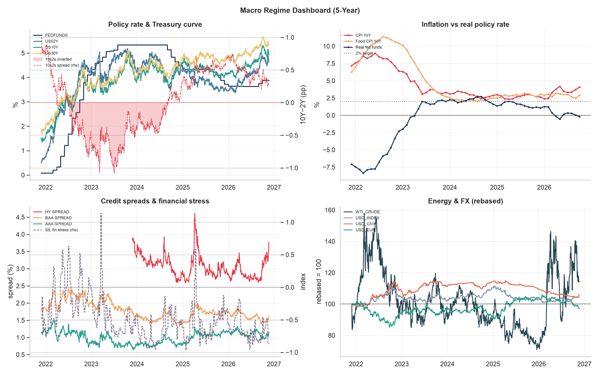
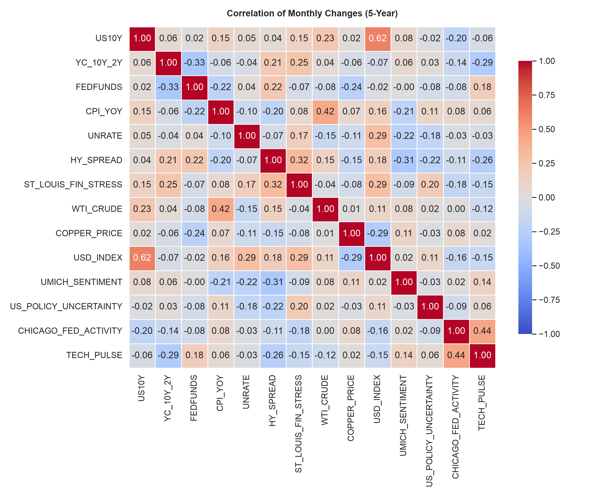

# Macroeconomic Regime Report

*Generated 2026-11-16. All statistics are computed on
native FRED observations (not the forward-filled daily grid); Δ columns are
percentage changes for levels and percentage-point (pp) changes for rates,
spreads and ratios.*

## Regime Read
**Late-cycle (hot rates).** Growth expansion (CFNAI +0.07), inflation re-accelerating (CPI 4.1% YoY, +0.8pp in 3M); 10Y 5.15% (+0.52pp 3M), curve 10s2s +0.27, real fed funds -0.20%; HY spread 3.23% (+52bp 3M), WTI $90 (+7% 3M); unemployment 4.1%, UMich sentiment 48.

## Alerts
- ⚠️ **FREIGHT_PPI** at 572.97 is +3.2σ from its 5-year mean (97th percentile).
- ⚠️ **TRUCK_PPI** at 230.99 is +3.0σ from its 5-year mean (98th percentile).
- ⚠️ **ELECTRIC_POWER_INDEX** at 123.52 is +3.0σ from its 5-year mean (98th percentile).
- 🚨 **RD_INVESTMENT**: latest move +27.18 is 3.1σ of its 5Y move distribution (now 977.70, 2026-07-01).
- ⚠️ **RD_INVESTMENT** at 977.70 is +2.0σ from its 5-year mean (95th percentile).
- 🚨 **HOUSEHOLD_NET_WORTH**: latest move +12803400.00 is 3.0σ of its 5Y move distribution (now 195,870,496.00, 2026-04-01).
- ⚠️ **HOUSEHOLD_NET_WORTH** at 195,870,496.00 is +2.1σ from its 5-year mean (94th percentile).
- 🚨 **GDP**: latest move +447.01 is 4.0σ of its 5Y move distribution (now 33,010.04, 2026-07-01).
- 🚨 **REAL_GDP**: latest move +203.07 is 2.7σ of its 5Y move distribution (now 24,611.08, 2026-07-01).
- 🚨 **US_POLICY_UNCERTAINTY**: latest move +502.19 is 3.9σ of its 5Y move distribution (now 615.93, 2026-11-15).
- ⚠️ **US_POLICY_UNCERTAINTY** at 615.93 is +2.6σ from its 5-year mean (97th percentile).

## Most Extreme vs 5-Year History
| Indicator             |         Latest |   5Y Z |   pct | Δ3M     | 3M   |
|-----------------------|----------------|--------|-------|---------|------|
| FREIGHT_PPI           |   572.97       |    3.2 |    97 | +9.9%   | ↑    |
| ELECTRIC_POWER_INDEX  |   123.52       |    3   |    98 | +7.0%   | ↑    |
| TRUCK_PPI             |   230.99       |    3   |    98 | +14.0%  | ↑    |
| US_POLICY_UNCERTAINTY |   615.93       |    2.6 |    97 | +255.8% | ↑    |
| HOUSEHOLD_NET_WORTH   |     1.9587e+08 |    2.1 |    94 | +7.0%   | ↑    |
| RD_INVESTMENT         |   977.7        |    2   |    95 | +2.9%   | ↑    |
| GDP                   | 33010          |    1.7 |    95 | +1.4%   | ↑    |
| UMICH_SENTIMENT       |    48.1        |   -1.7 |     2 | -2.8%   | ↓    |

## Regime Dashboard (5-Year)

## Regime Dashboard (1-Year)

*How to read*: top-left shows the policy rate against the curve with 10s2s
inversions shaded; top-right compares headline/food inflation with the real
policy rate (positive = restrictive); bottom-left is credit stress; bottom
right rebases commodities and the dollar to 100 at the window start.

## Correlation of Monthly Changes (5-Year)
### Move together (top +)
- **US10Y** & **USD_INDEX**: `+0.62`
- **CHICAGO_FED_ACTIVITY** & **TECH_PULSE**: `+0.44`
- **CPI_YOY** & **WTI_CRUDE**: `+0.42`
- **HY_SPREAD** & **ST_LOUIS_FIN_STRESS**: `+0.32`
- **ST_LOUIS_FIN_STRESS** & **USD_INDEX**: `+0.29`

### Move opposite (top −)
- **YC_10Y_2Y** & **FEDFUNDS**: `-0.33`
- **HY_SPREAD** & **UMICH_SENTIMENT**: `-0.31`
- **YC_10Y_2Y** & **TECH_PULSE**: `-0.29`
- **COPPER_PRICE** & **USD_INDEX**: `-0.29`
- **HY_SPREAD** & **TECH_PULSE**: `-0.26`

## Indicator Dashboard

### Rates & Curve
| Indicator     |   Latest | Δ1M     | Δ3M     | Δ1Y     |   5Y Z |   5Y pct | 3M   | As of      |
|---------------|----------|---------|---------|---------|--------|----------|------|------------|
| FEDFUNDS      |     3.88 | +0.13pp | +0.25pp | -0.21pp |    0.2 |       42 | ↑    | 2026-10-01 |
| US02Y         |     4.88 | +0.09pp | +0.73pp | +1.30pp |    1   |       91 | →    | 2026-11-13 |
| US10Y         |     5.15 | -0.06pp | +0.52pp | +1.04pp |    1.6 |       99 | →    | 2026-11-13 |
| US30Y         |     5.47 | -0.09pp | +0.26pp | +0.77pp |    1.5 |       99 | →    | 2026-11-13 |
| YC_10Y_2Y     |     0.27 | -0.15pp | -0.21pp | -0.26pp |    0.5 |       57 | ↓    | 2026-11-13 |
| YC_30Y_10Y    |     0.32 | -0.03pp | -0.26pp | -0.27pp |    0.1 |       60 | ↓    | 2026-11-13 |
| REAL_FEDFUNDS |    -0.2  | -0.23pp | -0.53pp | -1.27pp |    0.1 |       29 | ↓    | 2026-10-01 |

### Inflation & Growth
| Indicator            |   Latest | Δ1M     | Δ3M     | Δ1Y     |   5Y Z |   5Y pct | 3M   | As of      |
|----------------------|----------|---------|---------|---------|--------|----------|------|------------|
| CPI_YOY              |     4.08 | +0.36pp | +0.78pp | +1.06pp |   -0.1 |       66 | ↑    | 2026-10-01 |
| FOOD_CPI_YOY         |     2.91 | +0.42pp | -0.07pp | -0.20pp |   -0.6 |       40 | ↓    | 2026-10-01 |
| GDP                  | 33010    | +1.4%   | +1.4%   | +5.9%   |    1.7 |       95 | ↑    | 2026-07-01 |
| REAL_GDP             | 24611.1  | +0.8%   | +0.8%   | +2.1%   |    1.6 |       95 | ↑    | 2026-07-01 |
| CHICAGO_FED_ACTIVITY |     0.07 | +0.15pp | +0.06pp | +0.38pp |    0.6 |       72 | ↓    | 2026-09-01 |
| RECESSION_PROB       |     0.4  | +0.20pp | +0.28pp | -0.20pp |   -0   |       60 | ↑    | 2026-09-01 |
| M2_YOY               |     5.71 | +0.11pp | +0.41pp | +1.48pp |    0.8 |       88 | ↑    | 2026-09-01 |
| M2_VELOCITY          |     1.42 | -0.2%   | -0.2%   | +0.3%   |    0.8 |       82 | ↓    | 2026-07-01 |

### Labor & Consumer
| Indicator               |         Latest | Δ1M     | Δ3M     | Δ1Y     |   5Y Z |   5Y pct | 3M   | As of      |
|-------------------------|----------------|---------|---------|---------|--------|----------|------|------------|
| UNRATE                  |     4.1        | -0.10pp | +0.00pp | -0.30pp |    0.5 |       54 | →    | 2026-10-01 |
| UMICH_SENTIMENT         |    48.1        | -7.0%   | -2.8%   | -12.7%  |   -1.7 |        2 | ↓    | 2026-09-01 |
| SAVINGS_RATE            |     3.8        | -0.20pp | -0.60pp | -1.30pp |   -1.2 |       13 | ↓    | 2026-09-01 |
| DISPOSABLE_INCOME       | 18366.1        | -0.3%   | +0.0%   | +1.0%   |    1.1 |       95 | →    | 2026-09-01 |
| CREDIT_CARD_DELINQUENCY |     2.62       | -0.02pp | -0.02pp | -0.13pp |    0.5 |       39 | ↓    | 2026-04-01 |
| HOUSING_STARTS          |  1221          | -5.2%   | -15.1%  | -7.4%   |   -1.5 |        2 | ↓    | 2026-09-01 |
| HOUSEHOLD_NET_WORTH     |     1.9587e+08 | +7.0%   | +7.0%   | +11.8%  |    2.1 |       94 | ↑    | 2026-04-01 |

### Credit & Stress
| Indicator              |       Latest | Δ1M     | Δ3M     | Δ1Y     |   5Y Z |   5Y pct | 3M   | As of      |
|------------------------|--------------|---------|---------|---------|--------|----------|------|------------|
| HY_SPREAD              |  3.23        | +0.07pp | +0.52pp | +0.14pp |    0.5 |       74 | ↑    | 2026-11-13 |
| BAA_SPREAD             |  1.47        | +0.01pp | -0.20pp | -0.30pp |   -1.3 |        8 | ↓    | 2026-11-13 |
| AAA_SPREAD             |  1.02        | +0.04pp | -0.19pp | -0.13pp |    0.1 |       46 | ↓    | 2026-11-12 |
| CORP_SPREAD            |  0.89        | +0.06pp | +0.10pp | +0.06pp |    0.1 |       57 | ↑    | 2026-11-12 |
| ST_LOUIS_FIN_STRESS    | -0.49        | -0.03pp | +0.01pp | -0.03pp |   -0   |       57 | ↑    | 2026-11-06 |
| KANSAS_CITY_FIN_STRESS | -0.89        | +0.10pp | -0.05pp | -0.35pp |   -1.3 |        3 | ↓    | 2026-10-01 |
| FED_ASSETS             |  6.75887e+06 | +0.2%   | +0.2%   | +2.8%   |   -0.9 |       33 | →    | 2026-11-11 |

### Commodities & FX
| Indicator   |   Latest | Δ1M   | Δ3M   | Δ1Y    |   5Y Z |   5Y pct | 3M   | As of      |
|-------------|----------|-------|-------|--------|--------|----------|------|------------|
| WTI_CRUDE   |    89.62 | -9.2% | +7.0% | +47.1% |    0.7 |       78 | ↑    | 2026-11-10 |
| USD_INDEX   |   122.65 | +1.0% | +2.9% | +1.6%  |    0.5 |       75 | →    | 2026-11-13 |
| USD_CNY     |     6.67 | -0.3% | -1.1% | -6.0%  |   -1.1 |       11 | →    | 2026-11-13 |
| USD_EUR     |     1.1  | -1.4% | -4.3% | -5.3%  |    0.1 |       57 | →    | 2026-11-13 |
| USD_JPY     |   159.93 | +1.0% | +0.4% | +3.6%  |    1.2 |       96 | →    | 2026-11-13 |

### Policy & Trade
| Indicator                 |   Latest | Δ1M     | Δ3M     | Δ1Y     |   5Y Z |   5Y pct | 3M   | As of      |
|---------------------------|----------|---------|---------|---------|--------|----------|------|------------|
| US_POLICY_UNCERTAINTY     |   615.93 | +396.6% | +255.8% | +140.7% |    2.6 |       97 | ↑    | 2026-11-15 |
| EUROPE_POLICY_UNCERTAINTY |   373.55 | -1.9%   | +4.1%   | -17.5%  |    0   |       56 | ↑    | 2026-10-01 |
| TARIFFS                   |   275.3  | -10.2%  | -10.2%  | -17.5%  |    1.1 |       74 | ↓    | 2026-07-01 |
| CHINA_IMPORTS             | 31484.6  | +16.0%  | +25.2%  | +33.9%  |   -0.3 |       36 | ↑    | 2026-09-01 |
| TECH_PULSE                |    95.19 | -0.6%   | -1.2%   | +1.7%   |    0.5 |       64 | ↓    | 2026-09-01 |
| RD_INVESTMENT             |   977.7  | +2.9%   | +2.9%   | +11.9%  |    2   |       95 | ↑    | 2026-07-01 |

### Logistics & Power
| Indicator            |    Latest | Δ1M   | Δ3M    | Δ1Y    |   5Y Z |   5Y pct | 3M   | As of      |
|----------------------|-----------|-------|--------|--------|--------|----------|------|------------|
| FREIGHT_PPI          |    572.97 | -0.1% | +9.9%  | +36.2% |    3.2 |       97 | ↑    | 2026-10-01 |
| TRUCK_PPI            |    230.99 | +5.6% | +14.0% | +24.9% |    3   |       98 | ↑    | 2026-10-01 |
| AIR_PPI              |    182.54 | +0.7% | +3.3%  | +5.2%  |    0.8 |       81 | ↑    | 2026-10-01 |
| WAREHOUSE_PPI        |    168.51 | +1.0% | +1.0%  | +4.2%  |    1   |       85 | ↑    | 2026-10-01 |
| ELECTRIC_POWER_INDEX |    123.52 | +3.7% | +7.0%  | +10.8% |    3   |       98 | ↑    | 2026-09-01 |
| MFG_CONST            | 170217    | +0.1% | -0.6%  | -17.0% |   -0.5 |       26 | →    | 2026-09-01 |

Structural (slow)

| Indicator       |    Latest | Δ1M     | Δ3M     | Δ1Y     | 5Y Z   | 5Y pct   | 3M   | As of      |
|-----------------|-----------|---------|---------|---------|--------|----------|------|------------|
| US_POPULATION   | 343231    | +0.0%   | +0.1%   | +0.2%   | +1.3   | 98       | →    | 2026-11-01 |
| US_BIRTH_RATE   |     10.6  | -0.10pp | -0.10pp | -0.10pp | —      | —        | ↓    | 2024-01-01 |
| LIFE_EXPECTANCY |     78.89 | +0.6%   | +0.6%   | +0.6%   | —      | —        | ↑    | 2024-01-01 |

