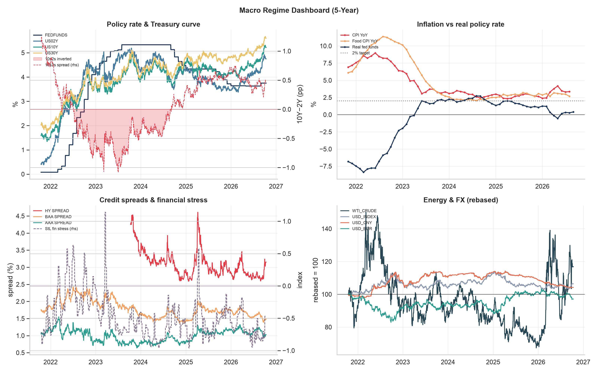
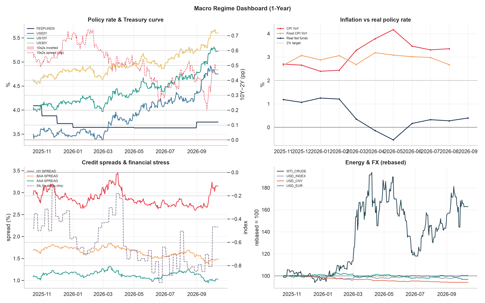
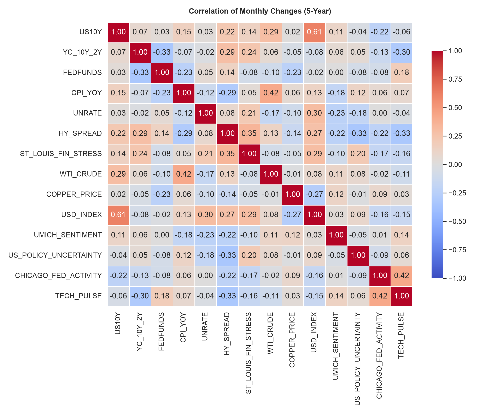

# Macroeconomic Regime Report

*Generated 2026-10-13. All statistics are computed on
native FRED observations (not the forward-filled daily grid); Δ columns are
percentage changes for levels and percentage-point (pp) changes for rates,
spreads and ratios.*

## Regime Read
**Late-cycle (hot rates).** Growth expansion (CFNAI -0.04), inflation cooling (CPI 3.4% YoY, -0.8pp in 3M); 10Y 5.22% (+0.66pp 3M), curve 10s2s +0.47, real fed funds +0.40%; HY spread 3.15% (+45bp 3M), WTI $96 (+38% 3M); unemployment 4.2%, UMich sentiment 52.

## Alerts
- ⚠️ **FREIGHT_PPI** at 518.62 is +2.7σ from its 5-year mean (97th percentile).
- ⚠️ **ELECTRIC_POWER_INDEX** at 118.75 is +2.0σ from its 5-year mean (98th percentile).
- 🚨 **RD_INVESTMENT**: latest move +23.42 is 2.8σ of its 5Y move distribution (now 950.52, 2026-04-01).
- 🚨 **HOUSEHOLD_NET_WORTH**: latest move +12803400.00 is 3.0σ of its 5Y move distribution (now 195,870,496.00, 2026-04-01).
- ⚠️ **HOUSEHOLD_NET_WORTH** at 195,870,496.00 is +2.1σ from its 5-year mean (94th percentile).
- 🚨 **GDP**: latest move +656.76 is 5.7σ of its 5Y move distribution (now 32,563.03, 2026-04-01).

## Most Extreme vs 5-Year History
| Indicator            |         Latest |   5Y Z |   pct | Δ3M     | 3M   |
|----------------------|----------------|--------|-------|---------|------|
| FREIGHT_PPI          |   518.62       |    2.7 |    97 | +9.2%   | ↑    |
| HOUSEHOLD_NET_WORTH  |     1.9587e+08 |    2.1 |    94 | +7.0%   | ↑    |
| ELECTRIC_POWER_INDEX |   118.75       |    2   |    98 | +2.5%   | ↑    |
| RD_INVESTMENT        |   950.52       |    2   |    94 | +2.5%   | ↑    |
| GDP                  | 32563          |    1.7 |    94 | +2.1%   | ↑    |
| US30Y                |     5.6        |    1.7 |    99 | +0.54pp | →    |
| US10Y                |     5.22       |    1.6 |    99 | +0.66pp | ↑    |
| TRUCK_PPI            |   207.64       |    1.6 |    91 | +2.0%   | ↑    |

## Regime Dashboard (5-Year)

## Regime Dashboard (1-Year)

*How to read*: top-left shows the policy rate against the curve with 10s2s
inversions shaded; top-right compares headline/food inflation with the real
policy rate (positive = restrictive); bottom-left is credit stress; bottom
right rebases commodities and the dollar to 100 at the window start.

## Correlation of Monthly Changes (5-Year)
### Move together (top +)
- **US10Y** & **USD_INDEX**: `+0.61`
- **CHICAGO_FED_ACTIVITY** & **TECH_PULSE**: `+0.42`
- **CPI_YOY** & **WTI_CRUDE**: `+0.42`
- **HY_SPREAD** & **ST_LOUIS_FIN_STRESS**: `+0.35`
- **UNRATE** & **USD_INDEX**: `+0.30`

### Move opposite (top −)
- **YC_10Y_2Y** & **FEDFUNDS**: `-0.33`
- **HY_SPREAD** & **US_POLICY_UNCERTAINTY**: `-0.33`
- **HY_SPREAD** & **TECH_PULSE**: `-0.33`
- **YC_10Y_2Y** & **TECH_PULSE**: `-0.30`
- **CPI_YOY** & **HY_SPREAD**: `-0.29`

## Indicator Dashboard

### Rates & Curve
| Indicator     |   Latest | Δ1M     | Δ3M     | Δ1Y     |   5Y Z |   5Y pct | 3M   | As of      |
|---------------|----------|---------|---------|---------|--------|----------|------|------------|
| FEDFUNDS      |     3.75 | +0.12pp | +0.12pp | -0.47pp |    0.1 |       37 | ↑    | 2026-09-01 |
| US02Y         |     4.75 | +0.36pp | +0.54pp | +1.17pp |    0.9 |       86 | ↑    | 2026-10-08 |
| US10Y         |     5.22 | +0.42pp | +0.66pp | +1.09pp |    1.6 |       99 | ↑    | 2026-10-08 |
| US30Y         |     5.6  | +0.35pp | +0.54pp | +0.88pp |    1.7 |       99 | →    | 2026-10-08 |
| YC_10Y_2Y     |     0.47 | +0.06pp | +0.12pp | -0.08pp |    0.8 |       71 | →    | 2026-10-08 |
| YC_30Y_10Y    |     0.38 | -0.07pp | -0.12pp | -0.21pp |    0.4 |       67 | ↓    | 2026-10-08 |
| REAL_FEDFUNDS |     0.4  | +0.12pp | +0.23pp | -0.80pp |    0.3 |       41 | ↑    | 2026-09-01 |

### Inflation & Growth
| Indicator            |   Latest | Δ1M     | Δ3M     | Δ1Y     |   5Y Z |   5Y pct | 3M   | As of      |
|----------------------|----------|---------|---------|---------|--------|----------|------|------------|
| CPI_YOY              |     3.35 | +0.05pp | -0.81pp | +0.41pp |   -0.5 |       53 | ↓    | 2026-08-01 |
| FOOD_CPI_YOY         |     2.67 | -0.31pp | -0.41pp | -0.52pp |   -0.7 |       26 | ↓    | 2026-08-01 |
| GDP                  | 32563    | +2.1%   | +2.1%   | +6.3%   |    1.7 |       94 | ↑    | 2026-04-01 |
| REAL_GDP             | 24408    | +0.6%   | +0.6%   | +2.2%   |    1.5 |       94 | ↑    | 2026-04-01 |
| CHICAGO_FED_ACTIVITY |    -0.04 | -0.12pp | +0.06pp | +0.32pp |    0.2 |       55 | ↑    | 2026-08-01 |
| RECESSION_PROB       |     0.62 | +0.38pp | +0.50pp | -0.24pp |    0.6 |       81 | ↑    | 2026-08-01 |
| M2_YOY               |     5.66 | +0.25pp | +0.27pp | +1.41pp |    0.7 |       84 | ↑    | 2026-08-01 |
| M2_VELOCITY          |     1.42 | +0.2%   | +0.2%   | +1.1%   |    0.9 |       94 | ↑    | 2026-04-01 |

### Labor & Consumer
| Indicator               |         Latest | Δ1M     | Δ3M     | Δ1Y     |   5Y Z |   5Y pct | 3M   | As of      |
|-------------------------|----------------|---------|---------|---------|--------|----------|------|------------|
| UNRATE                  |     4.2        | +0.10pp | +0.00pp | -0.20pp |    0.8 |       68 | →    | 2026-09-01 |
| UMICH_SENTIMENT         |    51.7        | -6.3%   | +15.4%  | -11.2%  |   -1.3 |       11 | ↑    | 2026-08-01 |
| SAVINGS_RATE            |     4.1        | -0.50pp | -0.30pp | -1.10pp |   -1   |       15 | ↓    | 2026-08-01 |
| DISPOSABLE_INCOME       | 18410.5        | -0.0%   | +0.6%   | +1.3%   |    1.2 |       97 | ↑    | 2026-08-01 |
| CREDIT_CARD_DELINQUENCY |     2.62       | -0.02pp | -0.02pp | -0.13pp |    0.5 |       39 | ↓    | 2026-04-01 |
| HOUSING_STARTS          |  1275          | -2.6%   | +7.9%   | -1.2%   |   -1.1 |        5 | ↑    | 2026-08-01 |
| HOUSEHOLD_NET_WORTH     |     1.9587e+08 | +7.0%   | +7.0%   | +11.8%  |    2.1 |       94 | ↑    | 2026-04-01 |

### Credit & Stress
| Indicator              |       Latest | Δ1M     | Δ3M     | Δ1Y     |   5Y Z |   5Y pct | 3M   | As of      |
|------------------------|--------------|---------|---------|---------|--------|----------|------|------------|
| HY_SPREAD              |  3.15        | +0.48pp | +0.45pp | +0.31pp |    0.1 |       61 | →    | 2026-10-08 |
| BAA_SPREAD             |  1.48        | -0.09pp | -0.08pp | -0.20pp |   -1.3 |        9 | ↓    | 2026-10-08 |
| AAA_SPREAD             |  1.03        | -0.10pp | -0.10pp | -0.01pp |    0.2 |       47 | ↓    | 2026-10-08 |
| CORP_SPREAD            |  0.82        | +0.01pp | +0.06pp | +0.07pp |   -0.6 |       36 | →    | 2026-10-07 |
| ST_LOUIS_FIN_STRESS    | -0.47        | +0.38pp | +0.17pp | +0.07pp |    0   |       61 | ↑    | 2026-10-02 |
| KANSAS_CITY_FIN_STRESS | -0.99        | -0.04pp | -0.22pp | -0.15pp |   -1.5 |        0 | ↓    | 2026-09-01 |
| FED_ASSETS             |  6.74756e+06 | +0.2%   | +0.3%   | +2.4%   |   -1   |       30 | →    | 2026-10-07 |

### Commodities & FX
| Indicator   |   Latest | Δ1M   | Δ3M    | Δ1Y    |   5Y Z |   5Y pct | 3M   | As of      |
|-------------|----------|-------|--------|--------|--------|----------|------|------------|
| WTI_CRUDE   |    96.24 | +3.8% | +38.3% | +54.0% |    1.2 |       87 | ↑    | 2026-10-06 |
| USD_INDEX   |   121.38 | +2.4% | +0.6%  | +0.8%  |    0.1 |       62 | →    | 2026-10-02 |
| USD_CNY     |     6.7  | -0.2% | -1.3%  | -5.8%  |   -1   |       14 | →    | 2026-10-01 |
| USD_EUR     |     1.13 | -2.9% | -1.7%  | -3.7%  |    0.5 |       64 | →    | 2026-10-02 |
| USD_JPY     |   157.81 | -0.6% | -1.9%  | +7.1%  |    1.1 |       88 | →    | 2026-10-02 |

### Policy & Trade
| Indicator                 |   Latest | Δ1M    | Δ3M    | Δ1Y    |   5Y Z |   5Y pct | 3M   | As of      |
|---------------------------|----------|--------|--------|--------|--------|----------|------|------------|
| US_POLICY_UNCERTAINTY     |   242.69 | -50.0% | -8.8%  | +5.3%  |    0.2 |       68 | →    | 2026-10-11 |
| EUROPE_POLICY_UNCERTAINTY |   358.52 | +2.2%  | -9.4%  | -23.9% |   -0.1 |       54 | ↓    | 2026-09-01 |
| TARIFFS                   |   306.4  | -6.1%  | -6.1%  | +13.2% |    1.4 |       78 | ↓    | 2026-04-01 |
| CHINA_IMPORTS             | 27133.8  | +0.2%  | +15.4% | +6.9%  |   -0.8 |       28 | ↑    | 2026-08-01 |
| TECH_PULSE                |    96.05 | -0.8%  | +0.1%  | +2.1%  |    0.8 |       76 | →    | 2026-08-01 |
| RD_INVESTMENT             |   950.52 | +2.5%  | +2.5%  | +12.2% |    2   |       94 | ↑    | 2026-04-01 |

### Logistics & Power
| Indicator            |    Latest | Δ1M   | Δ3M   | Δ1Y    |   5Y Z |   5Y pct | 3M   | As of      |
|----------------------|-----------|-------|-------|--------|--------|----------|------|------------|
| FREIGHT_PPI          |    518.62 | -0.5% | +9.2% | +32.0% |    2.7 |       97 | ↑    | 2026-08-01 |
| TRUCK_PPI            |    207.64 | +1.9% | +2.0% | +13.9% |    1.6 |       91 | ↑    | 2026-08-01 |
| AIR_PPI              |    187.37 | +6.3% | -8.2% | +9.4%  |    1.3 |       91 | ↓    | 2026-08-01 |
| WAREHOUSE_PPI        |    168.97 | +1.0% | -0.3% | +5.4%  |    1.1 |       84 | →    | 2026-08-01 |
| ELECTRIC_POWER_INDEX |    118.75 | +2.1% | +2.5% | +7.1%  |    2   |       98 | ↑    | 2026-08-01 |
| MFG_CONST            | 170701    | +0.2% | -1.7% | -19.2% |   -0.4 |       26 | ↓    | 2026-08-01 |

Structural (slow)

| Indicator       |    Latest | Δ1M     | Δ3M     | Δ1Y     | 5Y Z   | 5Y pct   | 3M   | As of      |
|-----------------|-----------|---------|---------|---------|--------|----------|------|------------|
| US_POPULATION   | 343150    | +0.0%   | +0.1%   | +0.2%   | +1.3   | 98       | →    | 2026-10-01 |
| US_BIRTH_RATE   |     10.6  | -0.10pp | -0.10pp | -0.10pp | —      | —        | ↓    | 2024-01-01 |
| LIFE_EXPECTANCY |     78.89 | +0.6%   | +0.6%   | +0.6%   | —      | —        | ↑    | 2024-01-01 |

