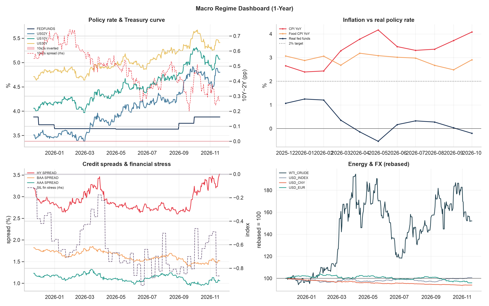

# Macroeconomic Regime Report

*Generated 2026-11-24. All statistics are computed on
native FRED observations (not the forward-filled daily grid); Δ columns are
percentage changes for levels and percentage-point (pp) changes for rates,
spreads and ratios.*

## Regime Read
**Mid-cycle.** Growth expansion (CFNAI -0.06), inflation re-accelerating (CPI 4.1% YoY, +0.8pp in 3M); 10Y 4.92% (+0.23pp 3M), curve 10s2s +0.29, real fed funds -0.20%; HY spread 3.76% (+101bp 3M), WTI $90 (+4% 3M); unemployment 4.1%, UMich sentiment 48.

## Alerts
- ⚠️ **FREIGHT_PPI** at 572.97 is +3.2σ from its 5-year mean (97th percentile).
- ⚠️ **TRUCK_PPI** at 230.99 is +3.0σ from its 5-year mean (98th percentile).
- 🚨 **RD_INVESTMENT**: latest move +27.18 is 3.1σ of its 5Y move distribution (now 977.70, 2026-07-01).
- ⚠️ **RD_INVESTMENT** at 977.70 is +2.0σ from its 5-year mean (95th percentile).
- 🚨 **HOUSEHOLD_NET_WORTH**: latest move +12803400.00 is 3.0σ of its 5Y move distribution (now 195,870,496.00, 2026-04-01).
- ⚠️ **HOUSEHOLD_NET_WORTH** at 195,870,496.00 is +2.1σ from its 5-year mean (94th percentile).
- 🚨 **GDP**: latest move +447.01 is 4.0σ of its 5Y move distribution (now 33,010.04, 2026-07-01).
- 🚨 **REAL_GDP**: latest move +203.07 is 2.7σ of its 5Y move distribution (now 24,611.08, 2026-07-01).
- 🚨 **HY_SPREAD**: latest move +0.24 is 3.2σ of its 5Y move distribution (now 3.76, 2026-11-20).
- ⚠️ **HY_SPREAD** at 3.76 is +2.1σ from its 5-year mean (96th percentile).

## Most Extreme vs 5-Year History
| Indicator           |         Latest |   5Y Z |   pct | Δ3M     | 3M   |
|---------------------|----------------|--------|-------|---------|------|
| FREIGHT_PPI         |   572.97       |    3.2 |    97 | +9.9%   | ↑    |
| TRUCK_PPI           |   230.99       |    3   |    98 | +14.0%  | ↑    |
| HOUSEHOLD_NET_WORTH |     1.9587e+08 |    2.1 |    94 | +7.0%   | ↑    |
| HY_SPREAD           |     3.76       |    2.1 |    96 | +1.01pp | ↑    |
| RD_INVESTMENT       |   977.7        |    2   |    95 | +2.9%   | ↑    |
| GDP                 | 33010          |    1.7 |    95 | +1.4%   | ↑    |
| UMICH_SENTIMENT     |    48          |   -1.6 |     2 | -13.0%  | ↓    |
| REAL_GDP            | 24611.1        |    1.6 |    95 | +0.8%   | ↑    |

## Regime Dashboard (5-Year)

## Regime Dashboard (1-Year)

*How to read*: top-left shows the policy rate against the curve with 10s2s
inversions shaded; top-right compares headline/food inflation with the real
policy rate (positive = restrictive); bottom-left is credit stress; bottom
right rebases commodities and the dollar to 100 at the window start.

## Correlation of Monthly Changes (5-Year)
### Move together (top +)
- **US10Y** & **USD_INDEX**: `+0.61`
- **CHICAGO_FED_ACTIVITY** & **TECH_PULSE**: `+0.43`
- **CPI_YOY** & **WTI_CRUDE**: `+0.42`
- **UNRATE** & **USD_INDEX**: `+0.28`
- **ST_LOUIS_FIN_STRESS** & **USD_INDEX**: `+0.26`

### Move opposite (top −)
- **YC_10Y_2Y** & **FEDFUNDS**: `-0.33`
- **HY_SPREAD** & **UMICH_SENTIMENT**: `-0.30`
- **YC_10Y_2Y** & **TECH_PULSE**: `-0.30`
- **COPPER_PRICE** & **USD_INDEX**: `-0.29`
- **HY_SPREAD** & **TECH_PULSE**: `-0.26`

## Indicator Dashboard

### Rates & Curve
| Indicator     |   Latest | Δ1M     | Δ3M     | Δ1Y     |   5Y Z |   5Y pct | 3M   | As of      |
|---------------|----------|---------|---------|---------|--------|----------|------|------------|
| FEDFUNDS      |     3.88 | +0.13pp | +0.25pp | -0.21pp |    0.2 |       42 | ↑    | 2026-10-01 |
| US02Y         |     4.63 | -0.16pp | +0.44pp | +1.08pp |    0.8 |       79 | →    | 2026-11-20 |
| US10Y         |     4.92 | -0.20pp | +0.23pp | +0.82pp |    1.3 |       96 | →    | 2026-11-20 |
| US30Y         |     5.31 | -0.11pp | +0.08pp | +0.58pp |    1.3 |       97 | →    | 2026-11-20 |
| YC_10Y_2Y     |     0.29 | -0.04pp | -0.21pp | -0.26pp |    0.5 |       58 | ↓    | 2026-11-20 |
| YC_30Y_10Y    |     0.39 | +0.09pp | -0.15pp | -0.24pp |    0.5 |       70 | ↓    | 2026-11-20 |
| REAL_FEDFUNDS |    -0.2  | -0.23pp | -0.53pp | -1.27pp |    0.1 |       29 | ↓    | 2026-10-01 |

### Inflation & Growth
| Indicator            |   Latest | Δ1M     | Δ3M     | Δ1Y     |   5Y Z |   5Y pct | 3M   | As of      |
|----------------------|----------|---------|---------|---------|--------|----------|------|------------|
| CPI_YOY              |     4.08 | +0.36pp | +0.78pp | +1.06pp |   -0.1 |       66 | ↑    | 2026-10-01 |
| FOOD_CPI_YOY         |     2.91 | +0.42pp | -0.07pp | -0.20pp |   -0.6 |       40 | ↓    | 2026-10-01 |
| GDP                  | 33010    | +1.4%   | +1.4%   | +5.9%   |    1.7 |       95 | ↑    | 2026-07-01 |
| REAL_GDP             | 24611.1  | +0.8%   | +0.8%   | +2.1%   |    1.6 |       95 | ↑    | 2026-07-01 |
| CHICAGO_FED_ACTIVITY |    -0.06 | -0.11pp | -0.19pp | +0.43pp |    0.2 |       49 | ↓    | 2026-10-01 |
| RECESSION_PROB       |     0.4  | +0.20pp | +0.28pp | -0.20pp |   -0   |       60 | ↑    | 2026-09-01 |
| M2_YOY               |     5.71 | +0.11pp | +0.41pp | +1.48pp |    0.8 |       88 | ↑    | 2026-09-01 |
| M2_VELOCITY          |     1.42 | -0.2%   | -0.2%   | +0.3%   |    0.8 |       82 | ↓    | 2026-07-01 |

### Labor & Consumer
| Indicator               |         Latest | Δ1M     | Δ3M     | Δ1Y     |   5Y Z |   5Y pct | 3M   | As of      |
|-------------------------|----------------|---------|---------|---------|--------|----------|------|------------|
| UNRATE                  |     4.1        | -0.10pp | +0.00pp | -0.30pp |    0.5 |       54 | →    | 2026-10-01 |
| UMICH_SENTIMENT         |    48          | -0.2%   | -13.0%  | -10.4%  |   -1.6 |        2 | ↓    | 2026-10-01 |
| SAVINGS_RATE            |     3.8        | -0.20pp | -0.60pp | -1.30pp |   -1.2 |       13 | ↓    | 2026-09-01 |
| DISPOSABLE_INCOME       | 18366.1        | -0.3%   | +0.0%   | +1.0%   |    1.1 |       95 | →    | 2026-09-01 |
| CREDIT_CARD_DELINQUENCY |     2.62       | -0.02pp | -0.02pp | -0.13pp |    0.5 |       39 | ↓    | 2026-04-01 |
| HOUSING_STARTS          |  1309          | +9.9%   | -4.4%   | +2.8%   |   -0.8 |       17 | ↓    | 2026-10-01 |
| HOUSEHOLD_NET_WORTH     |     1.9587e+08 | +7.0%   | +7.0%   | +11.8%  |    2.1 |       94 | ↑    | 2026-04-01 |

### Credit & Stress
| Indicator              |       Latest | Δ1M     | Δ3M     | Δ1Y     |   5Y Z |   5Y pct | 3M   | As of      |
|------------------------|--------------|---------|---------|---------|--------|----------|------|------------|
| HY_SPREAD              |  3.76        | +0.43pp | +1.01pp | +0.59pp |    2.1 |       96 | ↑    | 2026-11-20 |
| BAA_SPREAD             |  1.61        | +0.17pp | -0.03pp | -0.19pp |   -0.7 |       24 | →    | 2026-11-20 |
| AAA_SPREAD             |  1.15        | +0.19pp | -0.04pp | -0.04pp |    0.9 |       77 | →    | 2026-11-20 |
| CORP_SPREAD            |  0.98        | +0.11pp | +0.16pp | +0.13pp |    1   |       83 | ↑    | 2026-11-20 |
| ST_LOUIS_FIN_STRESS    | -0.87        | -0.15pp | -0.10pp | -0.55pp |   -1.2 |        4 | ↑    | 2026-11-13 |
| KANSAS_CITY_FIN_STRESS | -0.89        | +0.10pp | -0.05pp | -0.35pp |   -1.3 |        3 | ↓    | 2026-10-01 |
| FED_ASSETS             |  6.74145e+06 | -0.2%   | -0.3%   | +2.4%   |   -1   |       28 | →    | 2026-11-18 |

### Commodities & FX
| Indicator   |   Latest | Δ1M    | Δ3M   | Δ1Y    |   5Y Z |   5Y pct | 3M   | As of      |
|-------------|----------|--------|-------|--------|--------|----------|------|------------|
| WTI_CRUDE   |    89.53 | -17.3% | +4.1% | +47.6% |    0.7 |       77 | →    | 2026-11-17 |
| USD_INDEX   |   123.6  | +2.0%  | +4.5% | +1.6%  |    0.8 |       83 | →    | 2026-11-20 |
| USD_CNY     |     6.68 | -0.0%  | -0.7% | -6.1%  |   -1.1 |       11 | →    | 2026-11-20 |
| USD_EUR     |     1.1  | -2.0%  | -5.9% | -4.8%  |   -0   |       55 | →    | 2026-11-19 |
| USD_JPY     |   158.76 | +0.4%  | -0.1% | +0.9%  |    1.1 |       90 | →    | 2026-11-20 |

### Policy & Trade
| Indicator                 |   Latest | Δ1M    | Δ3M    | Δ1Y    |   5Y Z |   5Y pct | 3M   | As of      |
|---------------------------|----------|--------|--------|--------|--------|----------|------|------------|
| US_POLICY_UNCERTAINTY     |   259.27 | +4.2%  | +49.2% | +42.0% |    0.3 |       69 | →    | 2026-11-22 |
| EUROPE_POLICY_UNCERTAINTY |   373.55 | -1.9%  | +4.1%  | -17.5% |    0   |       56 | ↑    | 2026-10-01 |
| TARIFFS                   |   275.3  | -10.2% | -10.2% | -17.5% |    1.1 |       74 | ↓    | 2026-07-01 |
| CHINA_IMPORTS             | 31484.6  | +16.0% | +25.2% | +33.9% |   -0.3 |       36 | ↑    | 2026-09-01 |
| TECH_PULSE                |    95.63 | +1.3%  | -1.1%  | +5.1%  |    0.7 |       68 | ↓    | 2026-10-01 |
| RD_INVESTMENT             |   977.7  | +2.9%  | +2.9%  | +11.9% |    2   |       95 | ↑    | 2026-07-01 |

### Logistics & Power
| Indicator            |    Latest | Δ1M   | Δ3M    | Δ1Y    |   5Y Z |   5Y pct | 3M   | As of      |
|----------------------|-----------|-------|--------|--------|--------|----------|------|------------|
| FREIGHT_PPI          |    572.97 | -0.1% | +9.9%  | +36.2% |    3.2 |       97 | ↑    | 2026-10-01 |
| TRUCK_PPI            |    230.99 | +5.6% | +14.0% | +24.9% |    3   |       98 | ↑    | 2026-10-01 |
| AIR_PPI              |    182.54 | +0.7% | +3.3%  | +5.2%  |    0.8 |       81 | ↑    | 2026-10-01 |
| WAREHOUSE_PPI        |    168.51 | +1.0% | +1.0%  | +4.2%  |    1   |       85 | ↑    | 2026-10-01 |
| ELECTRIC_POWER_INDEX |    117.71 | -4.2% | +0.4%  | +2.5%  |    1.6 |       95 | ↑    | 2026-10-01 |
| MFG_CONST            | 170217    | +0.1% | -0.6%  | -17.0% |   -0.5 |       26 | →    | 2026-09-01 |

Structural (slow)

| Indicator       |    Latest | Δ1M     | Δ3M     | Δ1Y     | 5Y Z   | 5Y pct   | 3M   | As of      |
|-----------------|-----------|---------|---------|---------|--------|----------|------|------------|
| US_POPULATION   | 343231    | +0.0%   | +0.1%   | +0.2%   | +1.3   | 98       | →    | 2026-11-01 |
| US_BIRTH_RATE   |     10.6  | -0.10pp | -0.10pp | -0.10pp | —      | —        | ↓    | 2024-01-01 |
| LIFE_EXPECTANCY |     78.89 | +0.6%   | +0.6%   | +0.6%   | —      | —        | ↑    | 2024-01-01 |

