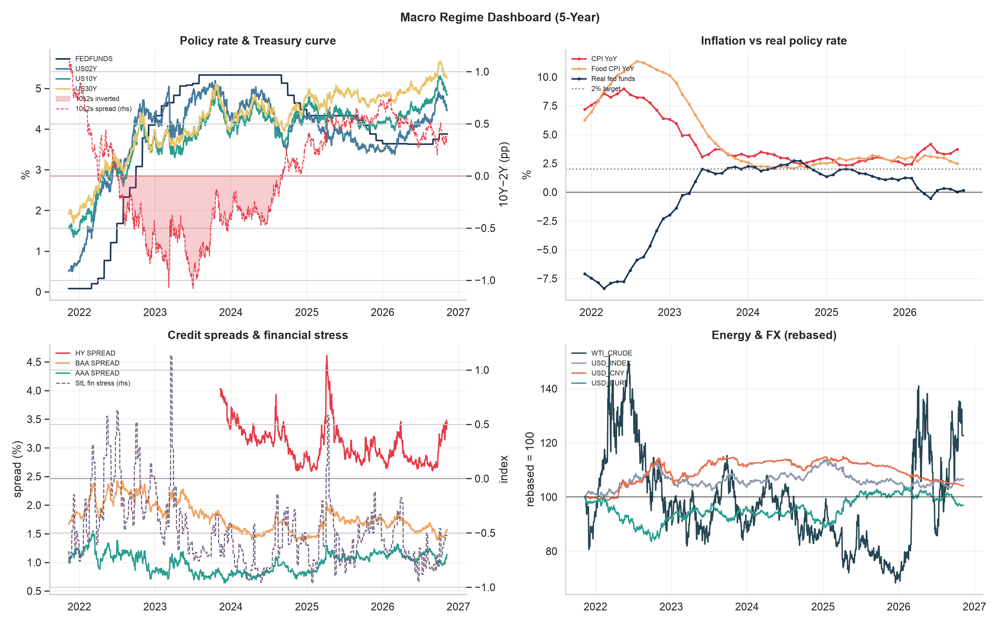
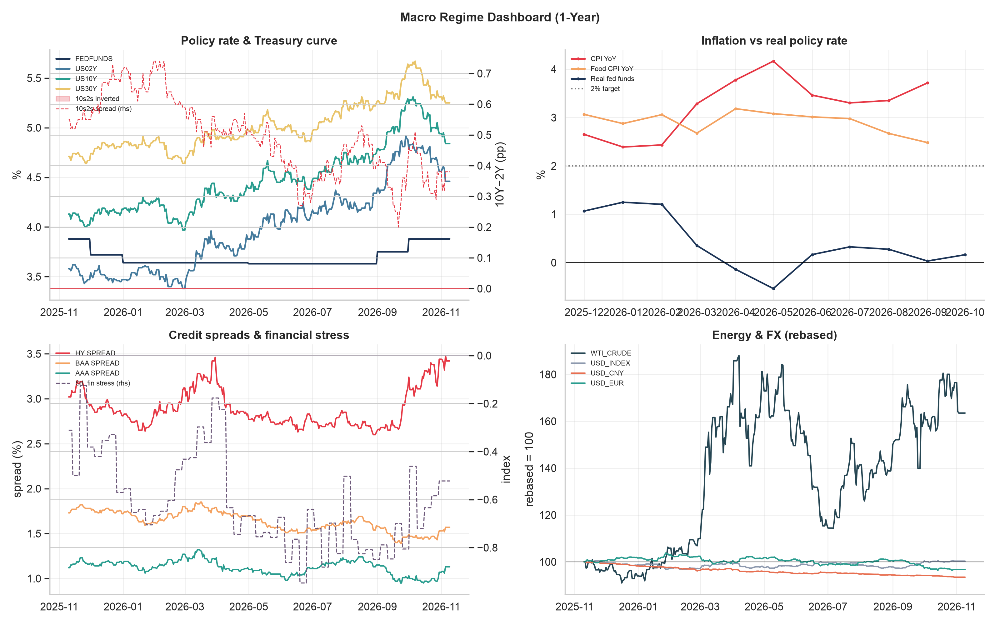
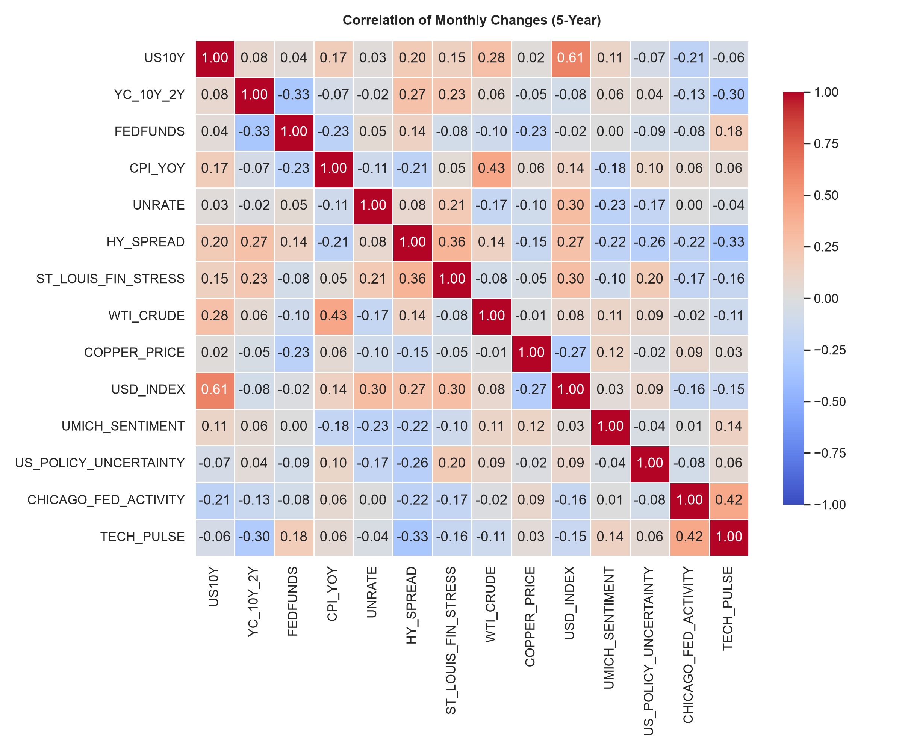

# Macroeconomic Regime Report

*Generated 2026-11-04. All statistics are computed on
native FRED observations (not the forward-filled daily grid); Δ columns are
percentage changes for levels and percentage-point (pp) changes for rates,
spreads and ratios.*

## Regime Read
**Mid-cycle.** Growth expansion (CFNAI +0.07), inflation re-accelerating (CPI 3.7% YoY, +0.3pp in 3M); 10Y 4.91% (+0.16pp 3M), curve 10s2s +0.32, real fed funds +0.16%; HY spread 3.43% (+58bp 3M), WTI $103 (+23% 3M); unemployment 4.2%, UMich sentiment 48.

## Alerts
- ⚠️ **FREIGHT_PPI** at 534.80 is +2.8σ from its 5-year mean (98th percentile).
- ⚠️ **TRUCK_PPI** at 219.38 is +2.4σ from its 5-year mean (98th percentile).
- ⏳ **CHINA_IMPORTS** stale: last observation 2026-08-01 (95d; typical cadence 31d).
- ⚠️ **ELECTRIC_POWER_INDEX** at 123.52 is +3.0σ from its 5-year mean (98th percentile).
- 🚨 **RD_INVESTMENT**: latest move +27.18 is 3.1σ of its 5Y move distribution (now 977.70, 2026-07-01).
- ⚠️ **RD_INVESTMENT** at 977.70 is +2.0σ from its 5-year mean (95th percentile).
- 🚨 **HOUSEHOLD_NET_WORTH**: latest move +12803400.00 is 3.0σ of its 5Y move distribution (now 195,870,496.00, 2026-04-01).
- ⚠️ **HOUSEHOLD_NET_WORTH** at 195,870,496.00 is +2.1σ from its 5-year mean (94th percentile).
- 🚨 **GDP**: latest move +447.01 is 4.0σ of its 5Y move distribution (now 33,010.04, 2026-07-01).
- 🚨 **REAL_GDP**: latest move +203.07 is 2.7σ of its 5Y move distribution (now 24,611.08, 2026-07-01).
- 🚨 **CORP_SPREAD**: latest move +0.05 is 2.9σ of its 5Y move distribution (now 0.94, 2026-10-30).

## Most Extreme vs 5-Year History
| Indicator            |         Latest |   5Y Z |   pct | Δ3M    | 3M   |
|----------------------|----------------|--------|-------|--------|------|
| ELECTRIC_POWER_INDEX |   123.52       |    3   |    98 | +7.0%  | ↑    |
| FREIGHT_PPI          |   534.8        |    2.8 |    98 | +6.0%  | ↑    |
| TRUCK_PPI            |   219.38       |    2.4 |    98 | +10.8% | ↑    |
| HOUSEHOLD_NET_WORTH  |     1.9587e+08 |    2.1 |    94 | +7.0%  | ↑    |
| RD_INVESTMENT        |   977.7        |    2   |    95 | +2.9%  | ↑    |
| WTI_CRUDE            |   103.37       |    1.7 |    92 | +22.7% | ↑    |
| GDP                  | 33010          |    1.7 |    95 | +1.4%  | ↑    |
| UMICH_SENTIMENT      |    48.1        |   -1.7 |     2 | -2.8%  | ↓    |

## Regime Dashboard (5-Year)

## Regime Dashboard (1-Year)

*How to read*: top-left shows the policy rate against the curve with 10s2s
inversions shaded; top-right compares headline/food inflation with the real
policy rate (positive = restrictive); bottom-left is credit stress; bottom
right rebases commodities and the dollar to 100 at the window start.

## Correlation of Monthly Changes (5-Year)
### Move together (top +)
- **US10Y** & **USD_INDEX**: `+0.61`
- **CHICAGO_FED_ACTIVITY** & **TECH_PULSE**: `+0.44`
- **CPI_YOY** & **WTI_CRUDE**: `+0.42`
- **HY_SPREAD** & **ST_LOUIS_FIN_STRESS**: `+0.31`
- **UNRATE** & **USD_INDEX**: `+0.29`

### Move opposite (top −)
- **YC_10Y_2Y** & **FEDFUNDS**: `-0.33`
- **HY_SPREAD** & **UMICH_SENTIMENT**: `-0.31`
- **YC_10Y_2Y** & **TECH_PULSE**: `-0.29`
- **COPPER_PRICE** & **USD_INDEX**: `-0.29`
- **HY_SPREAD** & **TECH_PULSE**: `-0.27`

## Indicator Dashboard

### Rates & Curve
| Indicator     |   Latest | Δ1M     | Δ3M     | Δ1Y     |   5Y Z |   5Y pct | 3M   | As of      |
|---------------|----------|---------|---------|---------|--------|----------|------|------------|
| FEDFUNDS      |     3.88 | +0.13pp | +0.25pp | -0.21pp |    0.2 |       42 | ↑    | 2026-10-01 |
| US02Y         |     4.59 | -0.24pp | +0.31pp | +0.99pp |    0.7 |       78 | ↑    | 2026-11-02 |
| US10Y         |     4.91 | -0.37pp | +0.16pp | +0.80pp |    1.3 |       97 | ↑    | 2026-11-02 |
| US30Y         |     5.28 | -0.35pp | +0.01pp | +0.61pp |    1.3 |       97 | →    | 2026-11-02 |
| YC_10Y_2Y     |     0.32 | -0.13pp | -0.15pp | -0.19pp |    0.6 |       61 | ↓    | 2026-11-02 |
| YC_30Y_10Y    |     0.37 | +0.02pp | -0.15pp | -0.19pp |    0.4 |       68 | ↓    | 2026-11-02 |
| REAL_FEDFUNDS |     0.16 | +0.13pp | -0.16pp | -0.90pp |    0.2 |       34 | ↓    | 2026-10-01 |

### Inflation & Growth
| Indicator            |   Latest | Δ1M     | Δ3M     | Δ1Y     |   5Y Z |   5Y pct | 3M   | As of      |
|----------------------|----------|---------|---------|---------|--------|----------|------|------------|
| CPI_YOY              |     3.72 | +0.36pp | +0.25pp | +0.69pp |   -0.3 |       61 | ↑    | 2026-09-01 |
| FOOD_CPI_YOY         |     2.48 | -0.19pp | -0.53pp | -0.63pp |   -0.8 |       18 | ↓    | 2026-09-01 |
| GDP                  | 33010    | +1.4%   | +1.4%   | +5.9%   |    1.7 |       95 | ↑    | 2026-07-01 |
| REAL_GDP             | 24611.1  | +0.8%   | +0.8%   | +2.1%   |    1.6 |       95 | ↑    | 2026-07-01 |
| CHICAGO_FED_ACTIVITY |     0.07 | +0.15pp | +0.06pp | +0.38pp |    0.6 |       72 | ↓    | 2026-09-01 |
| RECESSION_PROB       |     0.4  | +0.20pp | +0.28pp | -0.20pp |   -0   |       60 | ↑    | 2026-09-01 |
| M2_YOY               |     5.71 | +0.11pp | +0.41pp | +1.48pp |    0.8 |       88 | ↑    | 2026-09-01 |
| M2_VELOCITY          |     1.42 | -0.2%   | -0.2%   | +0.3%   |    0.8 |       82 | ↓    | 2026-07-01 |

### Labor & Consumer
| Indicator               |         Latest | Δ1M     | Δ3M     | Δ1Y     |   5Y Z |   5Y pct | 3M   | As of      |
|-------------------------|----------------|---------|---------|---------|--------|----------|------|------------|
| UNRATE                  |     4.2        | +0.10pp | +0.00pp | -0.20pp |    0.8 |       68 | →    | 2026-09-01 |
| UMICH_SENTIMENT         |    48.1        | -7.0%   | -2.8%   | -12.7%  |   -1.7 |        2 | ↓    | 2026-09-01 |
| SAVINGS_RATE            |     3.8        | -0.20pp | -0.60pp | -1.30pp |   -1.2 |       13 | ↓    | 2026-09-01 |
| DISPOSABLE_INCOME       | 18366.1        | -0.3%   | +0.0%   | +1.0%   |    1.1 |       95 | →    | 2026-09-01 |
| CREDIT_CARD_DELINQUENCY |     2.62       | -0.02pp | -0.02pp | -0.13pp |    0.5 |       39 | ↓    | 2026-04-01 |
| HOUSING_STARTS          |  1221          | -5.2%   | -15.1%  | -7.4%   |   -1.5 |        2 | ↓    | 2026-09-01 |
| HOUSEHOLD_NET_WORTH     |     1.9587e+08 | +7.0%   | +7.0%   | +11.8%  |    2.1 |       94 | ↑    | 2026-04-01 |

### Credit & Stress
| Indicator              |       Latest | Δ1M     | Δ3M     | Δ1Y     |   5Y Z |   5Y pct | 3M   | As of      |
|------------------------|--------------|---------|---------|---------|--------|----------|------|------------|
| HY_SPREAD              |  3.43        | +0.33pp | +0.58pp | +0.49pp |    1   |       87 | ↑    | 2026-11-02 |
| BAA_SPREAD             |  1.53        | +0.06pp | -0.11pp | -0.11pp |   -1.1 |       14 | ↓    | 2026-10-30 |
| AAA_SPREAD             |  1.08        | +0.08pp | -0.13pp | -0.03pp |    0.5 |       60 | ↓    | 2026-11-02 |
| CORP_SPREAD            |  0.94        | +0.10pp | +0.14pp | +0.17pp |    0.5 |       72 | ↑    | 2026-10-30 |
| ST_LOUIS_FIN_STRESS    | -0.58        | +0.12pp | +0.11pp | -0.23pp |   -0.3 |       48 | ↑    | 2026-10-23 |
| KANSAS_CITY_FIN_STRESS | -0.99        | -0.04pp | -0.22pp | -0.15pp |   -1.6 |        0 | ↓    | 2026-09-01 |
| FED_ASSETS             |  6.74564e+06 | -0.0%   | -0.0%   | +2.4%   |   -1   |       28 | →    | 2026-10-28 |

### Commodities & FX
| Indicator   |   Latest | Δ1M    | Δ3M    | Δ1Y    |   5Y Z |   5Y pct | 3M   | As of      |
|-------------|----------|--------|--------|--------|--------|----------|------|------------|
| WTI_CRUDE   |   103.37 | +21.3% | +22.7% | +66.4% |    1.7 |       92 | ↑    | 2026-10-27 |
| USD_INDEX   |   121.67 | +0.6%  | +1.7%  | +0.3%  |    0.2 |       66 | →    | 2026-10-30 |
| USD_CNY     |     6.65 | -0.8%  | -1.5%  | -6.4%  |   -1.2 |       10 | →    | 2026-10-30 |
| USD_EUR     |     1.12 | -1.6%  | -3.1%  | -3.5%  |    0.3 |       62 | →    | 2026-10-30 |
| USD_JPY     |   157.47 | +0.1%  | -1.3%  | +2.1%  |    1   |       85 | →    | 2026-10-30 |

### Policy & Trade
| Indicator                 |   Latest | Δ1M     | Δ3M    | Δ1Y    |   5Y Z |   5Y pct | 3M   | As of      |
|---------------------------|----------|---------|--------|--------|--------|----------|------|------------|
| US_POLICY_UNCERTAINTY     |   415.28 | +162.0% | +15.9% | +23.7% |    1.3 |       89 | →    | 2026-11-02 |
| EUROPE_POLICY_UNCERTAINTY |   373.55 | -1.9%   | +4.1%  | -17.5% |    0   |       56 | ↑    | 2026-10-01 |
| TARIFFS                   |   275.3  | -10.2%  | -10.2% | -17.5% |    1.1 |       74 | ↓    | 2026-07-01 |
| CHINA_IMPORTS ⏳          | 27133.8  | +0.2%   | +15.4% | +6.9%  |   -0.8 |       28 | ↑    | 2026-08-01 |
| TECH_PULSE                |    95.19 | -0.6%   | -1.2%  | +1.7%  |    0.5 |       64 | ↓    | 2026-09-01 |
| RD_INVESTMENT             |   977.7  | +2.9%   | +2.9%  | +11.9% |    2   |       95 | ↑    | 2026-07-01 |

### Logistics & Power
| Indicator            |    Latest | Δ1M   | Δ3M    | Δ1Y    |   5Y Z |   5Y pct | 3M   | As of      |
|----------------------|-----------|-------|--------|--------|--------|----------|------|------------|
| FREIGHT_PPI          |    534.8  | +0.4% | +6.0%  | +36.8% |    2.8 |       98 | ↑    | 2026-09-01 |
| TRUCK_PPI            |    219.38 | +4.6% | +10.8% | +17.9% |    2.4 |       98 | ↑    | 2026-09-01 |
| AIR_PPI              |    181.85 | -1.9% | -10.0% | +5.8%  |    0.7 |       79 | ↓    | 2026-09-01 |
| WAREHOUSE_PPI        |    166.87 | +0.7% | -0.4%  | +4.4%  |    0.9 |       79 | ↓    | 2026-09-01 |
| ELECTRIC_POWER_INDEX |    123.52 | +3.7% | +7.0%  | +10.8% |    3   |       98 | ↑    | 2026-09-01 |
| MFG_CONST            | 170217    | +0.1% | -0.6%  | -17.0% |   -0.5 |       26 | →    | 2026-09-01 |

Structural (slow)

| Indicator       |    Latest | Δ1M     | Δ3M     | Δ1Y     | 5Y Z   | 5Y pct   | 3M   | As of      |
|-----------------|-----------|---------|---------|---------|--------|----------|------|------------|
| US_POPULATION   | 343231    | +0.0%   | +0.1%   | +0.2%   | +1.3   | 98       | →    | 2026-11-01 |
| US_BIRTH_RATE   |     10.6  | -0.10pp | -0.10pp | -0.10pp | —      | —        | ↓    | 2024-01-01 |
| LIFE_EXPECTANCY |     78.89 | +0.6%   | +0.6%   | +0.6%   | —      | —        | ↑    | 2024-01-01 |

