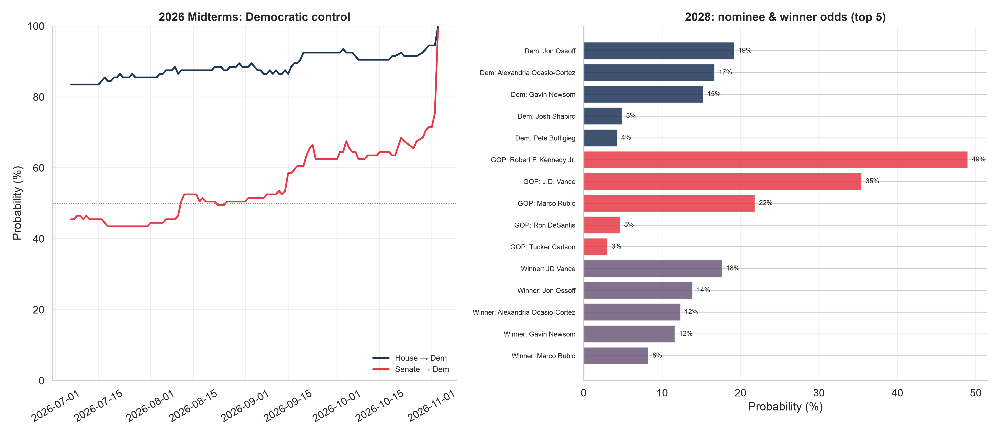
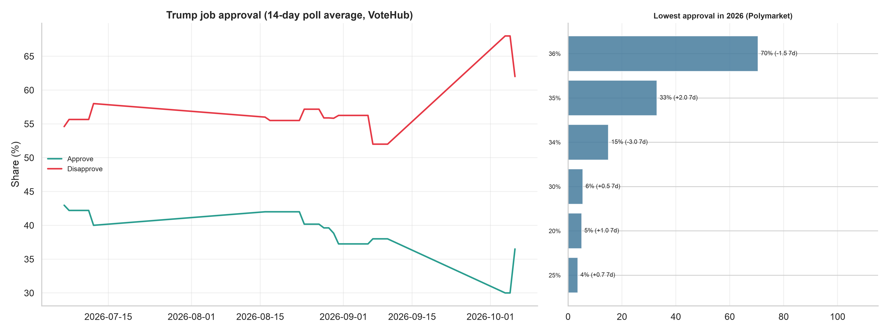
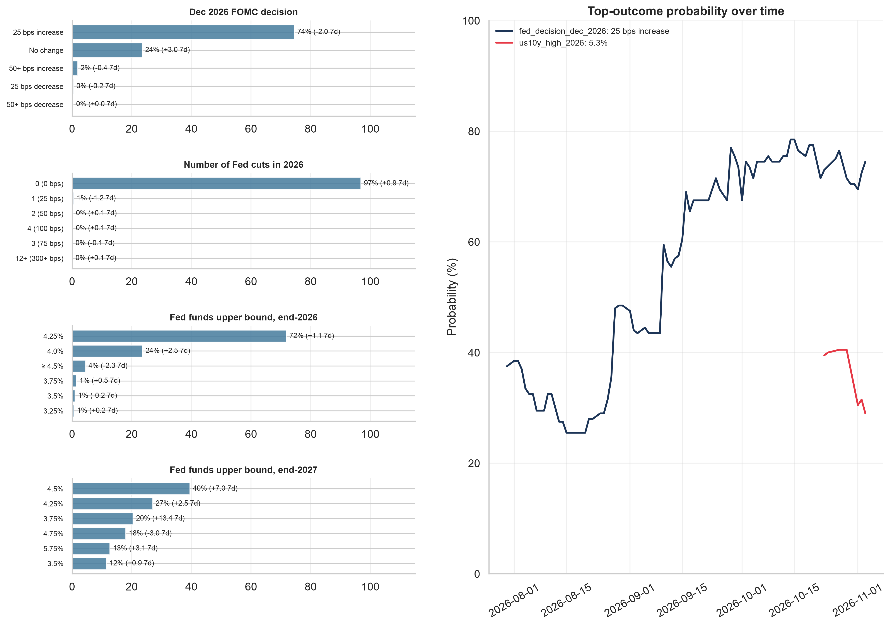
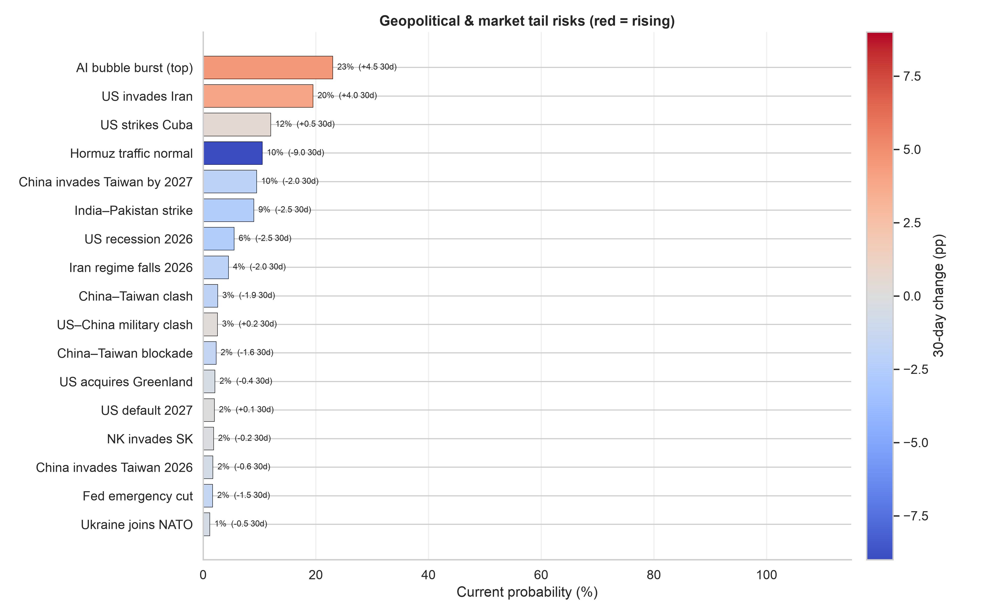

# Political Sentiment Report

*Generated 2026-11-03. Probabilities are Polymarket
Yes-prices (0–100%); Δ columns are percentage-point changes versus the
nearest prior print 1 / 7 / 30 days earlier.*

> [!NOTE]
> Sources: Polymarket Gamma/CLOB (odds, volume) and VoteHub (approval polls,
> 14-day trailing mean). Data as of 2026-11-03.

## Regime Dashboard
| Signal                     | Outcome           | Prob   | Δ1d   | Δ7d   | Δ30d   | As of      |
|----------------------------|-------------------|--------|-------|-------|--------|------------|
| House → Democrats          | Democratic Party  | 99.8%  | +5.3  | +8.3  | +7.3   | 2026-11-03 |
| Senate → Democrats         | Democratic Party  | 99.0%  | +23.5 | +31.4 | +31.4  | 2026-11-03 |
| Dec FOMC (top)             | 25 bps increase   | 74.5%  | +2.0  | -2.0  | +3.0   | 2026-11-03 |
| Fed cuts in 2026 (top)     | 0 (0 bps)         | 96.9%  | -0.1  | +0.9  | +0.9   | 2026-11-03 |
| Fed funds end-2026 (top)   | 4.25%             | 71.9%  | +0.0  | +1.1  | +24.5  | 2026-11-03 |
| 10Y high 2026 (top bucket) | 5.3%              | 29.0%  | -2.5  | -11.5 | —      | 2026-11-03 |
| Shutdown by Dec 31         | December 31       | 35.5%  | -8.5  | —     | —      | 2026-11-03 |
| US recession 2026          | Yes               | 5.5%   | +0.0  | -2.0  | -2.5   | 2026-11-03 |
| Taiwan invasion 2026       | Yes               | 1.8%   | -0.2  | -0.3  | -0.6   | 2026-11-03 |
| Taiwan invasion by 2027    | Yes               | 9.5%   | +0.0  | -1.0  | -2.0   | 2026-11-03 |
| Hormuz normal by Dec 31    | Yes               | 10.5%  | -1.0  | -1.0  | -9.0   | 2026-11-03 |
| Anthropic IPO by Dec 15    | December 15, 2026 | 91.5%  | +0.5  | +0.0  | +11.0  | 2026-11-03 |
| Trump approve (14d)        | Approve           | 36.5%  | +6.5  | -1.5  | -0.8   | 2026-10-06 |
| Trump disapprove (14d)     | Disapprove        | 62.0%  | -6.0  | +10.0 | +5.8   | 2026-10-06 |

## Biggest Movers (7-day, volume ≥ $10K)
| Key               | Outcome          | Prob   | Δ1d   | Δ7d   | Δ30d   | Volume   |
|-------------------|------------------|--------|-------|-------|--------|----------|
| us5y_low_2026     | Below 4.70%      | 90.2%  | -5.0  | +32.2 | —      | $26K     |
| senate_2026       | Democratic Party | 99.0%  | +23.5 | +31.4 | +31.4  | $15.0M   |
| senate_2026       | Republican Party | 1.1%   | -23.3 | -31.4 | -32.4  | $12.1M   |
| us5y_low_2026     | Below 4.65%      | 84.0%  | +2.5  | +30.5 | —      | $81K     |
| ipos_2026         | Freddie Mac      | 31.6%  | +1.5  | +27.0 | +27.2  | $246K    |
| us5y_low_2026     | Below 4.60%      | 62.5%  | -4.0  | +25.5 | —      | $12K     |
| us5y_low_2026     | Below 4.55%      | 53.0%  | -9.5  | +17.5 | —      | $16K     |
| wti_nov_2026      | ↓ $90            | 65.0%  | -1.5  | +17.5 | —      | $23K     |
| wti_nov_2026      | ↑ $105           | 50.0%  | -5.0  | -14.0 | —      | $29K     |
| us5y_low_2026     | Below 4.50%      | 47.0%  | -4.5  | +12.0 | +28.5  | $37K     |
| eth_price_2026    | ↓ 2,000          | 46.5%  | +1.0  | +11.5 | +30.0  | $628K    |
| btc_gold_spx_2026 | S&P 500          | 83.5%  | +1.5  | +10.5 | +22.0  | $213K    |

## Market Read-Through
- **Rates gate unlikely to release**: Dec FOMC `25 bps increase` at 74% — hike priced.
- **Oil tail open**: Hormuz-normal-by-Dec-31 only 10%.
- **Gridlock priced**: Dem House 100% / Senate 99% — expect veto politics, little fiscal legislation.
- **Semis supply-chain tail**: Taiwan invasion by 2027 at 10%.
- **Growth scare not priced**: 2026 recession only 6%.

## Markets by Category

### Elections
| Key               | Outcome                  | Prob   | Δ7d   |
|-------------------|--------------------------|--------|-------|
| approval_low_2026 | 36%                      | 70.5%  | -1.5  |
| approval_low_2026 | 35%                      | 33.0%  | +2.0  |
| approval_low_2026 | 34%                      | 15.0%  | -3.0  |
| approval_trump    | Disapprove               | 62.0%  | +10.0 |
| approval_trump    | Approve                  | 36.5%  | -1.5  |
| dem_nominee_2028  | Jon Ossoff               | 19.2%  | +4.6  |
| dem_nominee_2028  | Alexandria Ocasio-Cortez | 16.7%  | +0.8  |
| dem_nominee_2028  | Gavin Newsom             | 15.2%  | -1.3  |
| gop_nominee_2028  | Robert F. Kennedy Jr.    | 49.0%  | —     |
| gop_nominee_2028  | J.D. Vance               | 35.4%  | -3.3  |
| gop_nominee_2028  | Marco Rubio              | 21.9%  | +3.8  |
| house_2026        | Democratic Party         | 99.8%  | +8.3  |
| house_2026        | Republican Party         | 0.2%   | -8.2  |
| pres_winner_2028  | JD Vance                 | 17.6%  | -0.7  |
| pres_winner_2028  | Jon Ossoff               | 13.9%  | +4.6  |
| pres_winner_2028  | Alexandria Ocasio-Cortez | 12.3%  | -0.7  |
| senate_2026       | Democratic Party         | 99.0%  | +31.4 |
| senate_2026       | Republican Party         | 1.1%   | -31.4 |

### Fed & Rates
| Key                   | Outcome          | Prob   | Δ7d   |
|-----------------------|------------------|--------|-------|
| fed_cuts_2026         | 0 (0 bps)        | 96.9%  | +0.9  |
| fed_cuts_2026         | 1 (25 bps)       | 0.5%   | -1.2  |
| fed_cuts_2026         | 2 (50 bps)       | 0.3%   | +0.1  |
| fed_decision_dec_2026 | 25 bps increase  | 74.5%  | -2.0  |
| fed_decision_dec_2026 | No change        | 23.5%  | +3.0  |
| fed_decision_dec_2026 | 50+ bps increase | 1.8%   | -0.4  |
| fed_emergency_cut     | Yes              | 1.7%   | -0.3  |
| fed_rate_end_2026     | 4.25%            | 71.9%  | +1.1  |
| fed_rate_end_2026     | 4.0%             | 23.6%  | +2.5  |
| fed_rate_end_2026     | ≥ 4.5%           | 4.5%   | -2.3  |
| fed_rate_end_2027     | 4.5%             | 39.5%  | +7.0  |
| fed_rate_end_2027     | 4.25%            | 27.0%  | +2.5  |
| fed_rate_end_2027     | 3.75%            | 20.4%  | +13.4 |
| powell_out            | Yes              | 11.5%  | -0.5  |
| us10y_high_2026       | 5.3%             | 29.0%  | -11.5 |
| us10y_high_2026       | 5.4%             | 21.5%  | +1.5  |
| us10y_high_2026       | 5.5%             | 11.2%  | -1.5  |
| us5y_low_2026         | Below 4.70%      | 90.2%  | +32.2 |
| us5y_low_2026         | Below 4.65%      | 84.0%  | +30.5 |
| us5y_low_2026         | Below 4.60%      | 62.5%  | +25.5 |

### Fiscal, Economy & Trade
| Key                   | Outcome                             | Prob   | Δ7d   |
|-----------------------|-------------------------------------|--------|-------|
| bills_law_2026        | Export-control chip security        | 44.5%  | +8.5  |
| bills_law_2026        | Data center utility cost protection | 22.0%  | +5.0  |
| bills_law_2026        | FISA Section 702 reauthorization    | 18.0%  | +4.0  |
| china_gdp_2026        | 4.0–5.0%                            | 96.1%  | -0.1  |
| china_gdp_2026        | 5.0–6.0%                            | 2.4%   | -0.3  |
| china_gdp_2026        | 3.0–4.0%                            | 0.9%   | +0.0  |
| china_tariff_2026     | 5–15%                               | 86.0%  | -1.0  |
| china_tariff_2026     | 15–25%                              | 10.0%  | +0.0  |
| china_tariff_2026     | 25–35%                              | 5.0%   | -0.9  |
| ez_inflation_2026     | 3.1%+                               | 82.0%  | -6.8  |
| ez_inflation_2026     | 1.0–1.2%                            | 7.2%   | +4.5  |
| ez_inflation_2026     | 2.8-3.0%                            | 5.9%   | -3.9  |
| gov_shutdown          | December 12                         | 36.5%  | —     |
| gov_shutdown          | December 31                         | 35.5%  | —     |
| trade_deals_2026      | South Korea                         | 18.7%  | +8.8  |
| trade_deals_2026      | Canada                              | 17.0%  | +6.5  |
| trade_deals_2026      | Indonesia                           | 16.0%  | +7.5  |
| trump_impeached_2026  | December 31, 2027                   | 68.5%  | +6.5  |
| trump_impeached_2026  | June 30, 2027                       | 56.5%  | +10.0 |
| trump_impeached_2026  | December 31, 2026                   | 3.2%   | +1.5  |
| us_default_2027       | Yes                                 | 2.0%   | +1.1  |
| us_inflation_oct_2026 | 3.7%                                | 89.5%  | -2.5  |
| us_inflation_oct_2026 | 3.8%                                | 5.7%   | +2.5  |
| us_inflation_oct_2026 | 3.9%                                | 2.7%   | -0.7  |
| us_recession_2026     | Yes                                 | 5.5%   | -2.0  |
| wti_nov_2026          | ↑ $100                              | 73.5%  | —     |
| wti_nov_2026          | ↓ $90                               | 65.0%  | +17.5 |
| wti_nov_2026          | ↑ $105                              | 50.0%  | -14.0 |

### Geopolitics
| Key                          | Outcome             | Prob   | Δ7d   |
|------------------------------|---------------------|--------|-------|
| bab_el_mandeb_closed         | December 31         | 8.5%   | -6.0  |
| bab_el_mandeb_closed         | November 30         | 6.0%   | -2.5  |
| bab_el_mandeb_closed         | October 31          | 0.4%   | -0.4  |
| china_japan_clash            | Yes                 | 3.2%   | -0.5  |
| china_taiwan_blockade        | Yes                 | 2.3%   | -0.2  |
| china_taiwan_clash           | Yes                 | 2.6%   | -1.0  |
| china_taiwan_invasion        | Yes                 | 1.8%   | -0.3  |
| china_taiwan_invasion_2027   | Yes                 | 9.5%   | -1.0  |
| greenland_acquire            | Yes                 | 2.1%   | -0.4  |
| hormuz_traffic_normal        | Yes                 | 10.5%  | -1.0  |
| india_pakistan_strike        | Yes                 | 9.0%   | +1.0  |
| iran_nuclear_deal            | December 31         | 11.0%  | -1.5  |
| iran_nuclear_deal            | November 30         | 6.5%   | -1.0  |
| iran_regime_fall_2026        | Yes                 | 4.5%   | -2.0  |
| israel_strike_countries_2026 | 4                   | 73.7%  | +7.8  |
| israel_strike_countries_2026 | 5                   | 15.1%  | -5.5  |
| israel_strike_countries_2026 | 6                   | 3.1%   | -0.2  |
| kim_out                      | Yes                 | 2.6%   | -1.2  |
| nk_invade_sk                 | Yes                 | 1.8%   | -2.2  |
| putin_out                    | June 30, 2027       | 9.5%   | +0.0  |
| putin_out                    | March 31, 2027      | 6.0%   | —     |
| putin_out                    | December 31, 2026   | 2.1%   | +0.1  |
| russia_ukraine_ceasefire     | December 31, 2027   | 70.5%  | -1.0  |
| russia_ukraine_ceasefire     | November 30, 2027   | 68.0%  | -0.5  |
| russia_ukraine_ceasefire     | October 31, 2027    | 64.5%  | -1.0  |
| trump_meetings_2026          | Vladimir Putin      | 82.5%  | +2.5  |
| trump_meetings_2026          | Mohammed bin Salman | 79.0%  | +7.5  |
| trump_meetings_2026          | Kim Jong Un         | 13.5%  | -4.5  |
| ukraine_nato                 | Yes                 | 1.2%   | -0.1  |
| us_china_military_clash      | Yes                 | 2.5%   | +0.1  |
| us_invade_iran               | Yes                 | 19.5%  | +1.0  |
| us_russia_nuclear_deal       | Yes                 | 5.9%   | -3.0  |
| us_strike_cuba               | Yes                 | 12.0%  | +2.5  |
| venezuela_leader_2026        | Nicolás Maduro      | 85.7%  | +6.6  |
| venezuela_leader_2026        | Delcy Rodríguez     | 10.0%  | -6.5  |
| venezuela_leader_2026        | No Head of State    | 1.5%   | -0.2  |
| xi_out                       | Yes                 | 1.9%   | -2.2  |

### Markets & IPOs
| Key                  | Outcome           | Prob   | Δ7d   |
|----------------------|-------------------|--------|-------|
| ai_bubble_burst      | June 30, 2027     | 23.0%  | +0.5  |
| ai_bubble_burst      | December 31, 2026 | 8.5%   | +0.5  |
| anthropic_ipo        | December 15, 2026 | 91.5%  | +0.0  |
| anthropic_ipo        | December 31, 2026 | 91.5%  | -2.0  |
| anthropic_ipo        | November 30, 2026 | 85.5%  | -3.0  |
| btc_ath_by           | Yes               | 3.2%   | -0.3  |
| btc_gold_spx_2026    | S&P 500           | 83.5%  | +10.5 |
| btc_gold_spx_2026    | Bitcoin           | 12.0%  | -6.5  |
| btc_gold_spx_2026    | Gold              | 5.5%   | +0.0  |
| eth_price_2026       | ↓ 2,000           | 46.5%  | +11.5 |
| eth_price_2026       | ↓ 1,750           | 19.5%  | +6.0  |
| eth_price_2026       | ↑ 3,000           | 18.5%  | -5.0  |
| ipos_2026            | Anthropic         | 92.5%  | -3.0  |
| ipos_2026            | Freddie Mac       | 31.6%  | +27.0 |
| ipos_2026            | Celonis           | 8.5%   | +1.0  |
| largest_company_2026 | NVIDIA            | 64.5%  | +0.0  |
| largest_company_2026 | Apple             | 35.8%  | +2.9  |
| largest_company_2026 | Alphabet          | 1.1%   | -0.1  |
| largest_ipo_2026     | SpaceX            | 62.5%  | +4.0  |
| largest_ipo_2026     | Anthropic         | 29.0%  | -10.2 |
| largest_ipo_2026     | xAI               | 25.5%  | —     |
| openai_ipo           | June 30, 2027     | 44.5%  | +4.0  |
| openai_ipo           | March 31, 2027    | 19.5%  | -1.0  |
| openai_ipo           | December 31, 2026 | 2.1%   | -1.5  |

### Foreign Politics
| Key               | Outcome                            | Prob   | Δ7d   |
|-------------------|------------------------------------|--------|-------|
| france_pres_2027  | Marine Le Pen                      | 40.2%  | -3.1  |
| france_pres_2027  | David Lisnard                      | 15.3%  | +0.0  |
| france_pres_2027  | Jean-Luc Mélenchon                 | 12.5%  | +1.0  |
| japan_pm_out      | Yes                                | 3.5%   | -0.6  |
| leader_out_2026   | None before 2027                   | 61.0%  | +1.5  |
| leader_out_2026   | Sánchez - Spanish PM               | 14.8%  | +7.0  |
| leader_out_2026   | Netanyahu - Israel PM              | 13.5%  | -4.0  |
| modi_out          | Yes                                | 1.5%   | -2.0  |
| taiwan_local_2026 | Kuomintang (KMT)                   | 76.5%  | +7.0  |
| taiwan_local_2026 | Democratic Progressive Party (DPP) | 20.5%  | -10.2 |
| taiwan_local_2026 | Taiwan People’s Party (TPP)        | 0.1%   | +0.0  |

## Upcoming Key Events (next 90 days)
| Date       | Event                                         | Category   | Notes                                |
|------------|-----------------------------------------------|------------|--------------------------------------|
| 2026-11-03 | US midterm elections                          | elections  | House + 35 Senate                    |
| 2026-11-10 | US-China trade truce 1-yr expiry (Busan deal) | trade      | approx; renewal or tariff snap-back  |
| 2026-11-12 | CPI release (Oct)                             | data       | approx; verify bls.gov               |
| 2026-11-28 | Taiwan local (9-in-1) elections               | foreign    | KMT vs DPP                           |
| 2026-11-30 | OPEC+ ministerial meeting                     | energy     | approx                               |
| 2026-12-09 | FOMC decision                                 | fed        | Dec 8-9 meeting + SEP                |
| 2026-12-10 | CPI release (Nov)                             | data       | approx; verify bls.gov               |
| 2026-12-10 | ECB decision                                  | cb         | approx                               |
| 2026-12-14 | G20 summit (Miami, US presidency)             | summit     | Dec 14-15                            |
| 2026-12-15 | China Central Economic Work Conference        | foreign    | approx; sets 2027 growth target tone |
| 2026-12-17 | BoE decision                                  | cb         | approx                               |
| 2026-12-18 | BoJ decision                                  | cb         | Dec 17-18                            |
| 2027-01-01 | Brazil presidential inauguration              | foreign    |                                      |
| 2027-01-03 | 120th Congress convenes                       | congress   | Speaker vote                         |
| 2027-01-13 | CPI release (Dec)                             | data       | approx; verify bls.gov               |
| 2027-01-18 | World Economic Forum (Davos)                  | summit     | approx                               |
| 2027-01-27 | FOMC decision                                 | fed        | Jan 26-27 meeting                    |
| 2027-02-01 | India Union Budget                            | foreign    |                                      |
| 2027-02-01 | State of the Union                            | domestic   | date TBD                             |
