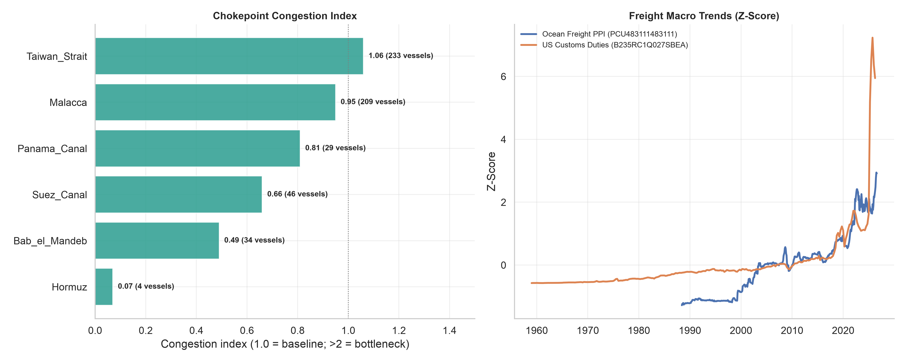

# Maritime Shipping Report

## Overview
This report monitors global maritime chokepoints (Strait of Hormuz, Malacca Strait, Suez Canal, Bab el-Mandeb, Panama Canal, Taiwan Strait) and macroeconomic freight indicators to track supply chain bottlenecks, tanker availability, and logistical disruptions.

> [!NOTE]
> Chokepoint transit counts and congestion indices are sourced from IMF PortWatch daily transit calls data (covering Hormuz, Malacca, Suez, Bab el-Mandeb, Panama, and Taiwan Strait). Baseline indices reflect normalized pre-disruption transit volume (1.0 = normal baseline).

## Congestion Trends

## Chokepoint Status
| Chokepoint    |   Vessels |   Congestion Index |
|---------------|-----------|--------------------|
| Hormuz        |         2 |               0.03 |
| Bab_el_Mandeb |        31 |               0.44 |
| Suez_Canal    |        43 |               0.61 |
| Panama_Canal  |        32 |               0.89 |
| Malacca       |       223 |               1.01 |
| Taiwan_Strait |       246 |               1.12 |

## Shipping Macro Metrics
| Metric                              |   Latest | YoY Chg       | Date       |
|-------------------------------------|----------|---------------|------------|
| Ocean Freight PPI (PCU483111483111) |   518.62 | (+32.02% YoY) | 2026-08-01 |
| US Customs Duties (B235RC1Q027SBEA) |   306.4  | (+13.23% YoY) | 2026-04-01 |
