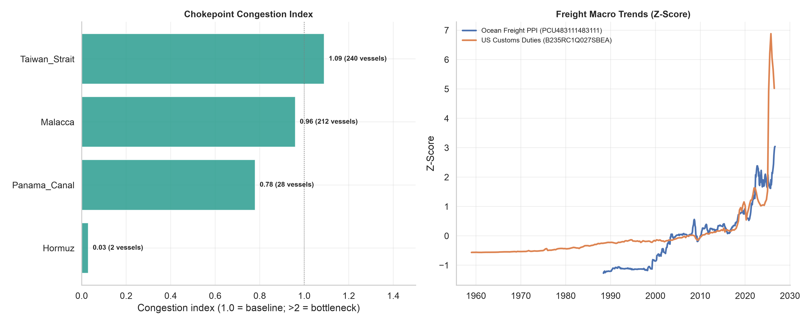

# Maritime Shipping Report

## Overview
This report monitors global maritime chokepoints (Strait of Hormuz, Malacca Strait, Suez Canal, Bab el-Mandeb, Panama Canal, Taiwan Strait) and macroeconomic freight indicators to track supply chain bottlenecks, tanker availability, and logistical disruptions.

> [!NOTE]
> Chokepoint transit counts and congestion indices are sourced from IMF PortWatch daily transit calls data (covering Hormuz, Malacca, Suez, Bab el-Mandeb, Panama, and Taiwan Strait). Baseline indices reflect normalized pre-disruption transit volume (1.0 = normal baseline).

## Congestion Trends

## Chokepoint Status
| Chokepoint    |   Vessels |   Congestion Index |
|---------------|-----------|--------------------|
| Hormuz        |         1 |               0.02 |
| Bab_el_Mandeb |        30 |               0.43 |
| Suez_Canal    |        46 |               0.66 |
| Panama_Canal  |        27 |               0.75 |
| Malacca       |       194 |               0.88 |
| Taiwan_Strait |       245 |               1.11 |

Data as of 2026-11-01

> [!WARNING]
> Chokepoint data is **8 days stale** (last observation 2026-11-01). The IMF PortWatch `Daily_Chokepoints_Data` service is currently returning errors; values above are the last real observations and are **not** carried forward as current.

## Major Port Calls (7-day avg vs prior 4 weeks)
| Port                   | Country                  | Last Date   |   7d Avg Calls |   4w Avg Calls | Δ%     |   Container 7d |   Tanker 7d |
|------------------------|--------------------------|-------------|----------------|----------------|--------|----------------|-------------|
| Singapore              | Singapore                | 2026-10-30  |          115   |          117.9 | -2.4%  |           36.6 |        67.3 |
| Rotterdam              | The Netherlands          | 2026-10-30  |           74.1 |           83.2 | -10.9% |           15.6 |        39.9 |
| Shanghai               | China                    | 2026-10-30  |           67.3 |           78.2 | -14.0% |           25.6 |        12.6 |
| Antwerp                | Belgium                  | 2026-10-30  |           49   |           53.7 | -8.7%  |           11.3 |        27   |
| Busan                  | Korea                    | 2026-10-30  |           46.6 |           47.6 | -2.1%  |           28.3 |         8.4 |
| Ningbo                 | China                    | 2026-10-30  |           45.6 |           45.8 | -0.5%  |           24.3 |        12.3 |
| Kaohsiung              | Taiwan Province of China | 2026-10-30  |           30.9 |           25.6 | +20.3% |           18.9 |         4   |
| Houston (US-TX)        | United States            | 2026-10-30  |           23.6 |           20.1 | +17.4% |            3   |        15.9 |
| Hamburg                | Germany                  | 2026-10-30  |           14.7 |           16.9 | -13.1% |            7.7 |         3.6 |
| Los Angeles-Long Beach | United States            | 2026-10-30  |           11.3 |            9.6 | +17.0% |            7   |         2   |
| Jebel Ali              | United Arab Emirates     | 2026-10-30  |            4   |            4.8 | -15.8% |            1.6 |         0.7 |

Source: IMF PortWatch `Daily_Ports_Data` (`port_calls.tsv`).

## Shipping Macro Metrics
| Metric                              |   Latest | YoY Chg       | Date       |
|-------------------------------------|----------|---------------|------------|
| Ocean Freight PPI (PCU483111483111) |    534.8 | (+36.79% YoY) | 2026-09-01 |
| US Customs Duties (B235RC1Q027SBEA) |    275.3 | (-17.51% YoY) | 2026-07-01 |
