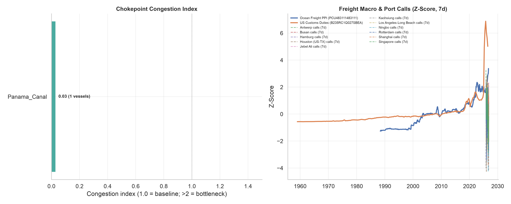

# Maritime Shipping Report

## Overview
This report monitors global maritime chokepoints (Strait of Hormuz, Malacca Strait, Suez Canal, Bab el-Mandeb, Panama Canal, Taiwan Strait) and macroeconomic freight indicators to track supply chain bottlenecks, tanker availability, and logistical disruptions.

> [!NOTE]
> Chokepoint transit counts and congestion indices are sourced from IMF PortWatch daily transit calls data (covering Hormuz, Malacca, Suez, Bab el-Mandeb, Panama, and Taiwan Strait). Baseline indices reflect normalized pre-disruption transit volume (1.0 = normal baseline).

## Congestion Trends

## Chokepoint Status
| Chokepoint   |   Vessels |   Congestion Index |
|--------------|-----------|--------------------|
| Panama_Canal |         1 |               0.03 |

Data as of 2026-11-16

## Major Port Calls (7-day avg vs prior 4 weeks)
| Port                   | Country                  | Last Date   |   7d Avg Calls |   4w Avg Calls | Δ%     |   Container 7d |   Tanker 7d |
|------------------------|--------------------------|-------------|----------------|----------------|--------|----------------|-------------|
| Singapore              | Singapore                | 2026-11-13  |          121   |          116   | +4.3%  |           34.4 |        74.4 |
| Rotterdam              | The Netherlands          | 2026-11-13  |           81.9 |           80.2 | +2.0%  |           18   |        41.1 |
| Shanghai               | China                    | 2026-11-13  |           71.9 |           78.8 | -8.8%  |           27.7 |        13.9 |
| Antwerp                | Belgium                  | 2026-11-13  |           57   |           53.8 | +6.0%  |           12.4 |        34   |
| Ningbo                 | China                    | 2026-11-13  |           48.6 |           45.7 | +6.3%  |           28.3 |        11.1 |
| Busan                  | Korea                    | 2026-11-13  |           46.6 |           47.3 | -1.6%  |           28.4 |         7.1 |
| Kaohsiung              | Taiwan Province of China | 2026-11-13  |           28.7 |           27.1 | +5.9%  |           17.9 |         4.3 |
| Houston (US-TX)        | United States            | 2026-11-13  |           22.4 |           20.9 | +7.4%  |            2.9 |        15   |
| Hamburg                | Germany                  | 2026-11-13  |           16   |           16.6 | -3.4%  |            7   |         4   |
| Los Angeles-Long Beach | United States            | 2026-11-13  |           10.6 |            9.8 | +8.0%  |            6.4 |         2   |
| Jebel Ali              | United Arab Emirates     | 2026-11-13  |            5.9 |            4.7 | +25.2% |            2.3 |         1.1 |

Source: IMF PortWatch `Daily_Ports_Data` (`port_calls.tsv`).

## Shipping Macro Metrics
| Metric                              |   Latest | YoY Chg       | Date       |
|-------------------------------------|----------|---------------|------------|
| Ocean Freight PPI (PCU483111483111) |   572.97 | (+36.20% YoY) | 2026-10-01 |
| US Customs Duties (B235RC1Q027SBEA) |   275.3  | (-17.51% YoY) | 2026-07-01 |
